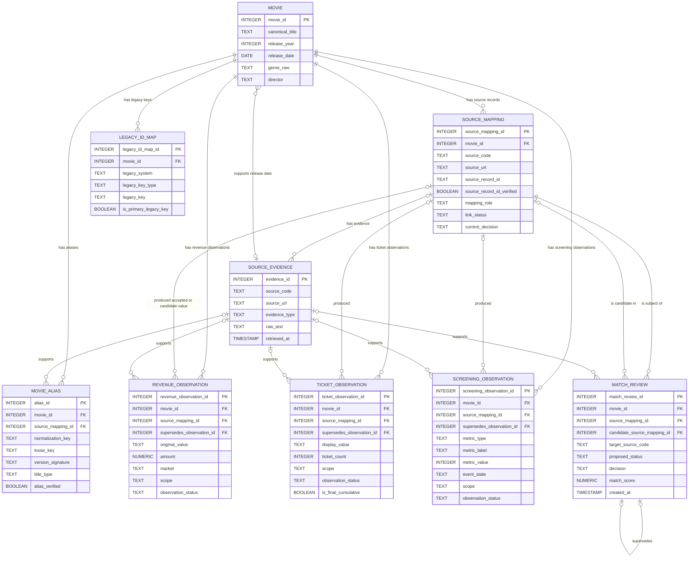

# Canonical Data Model for the Movie Dataset

**Status:** revised design proposal only — no implementation, migration, scraping, HTTP request, export generation or data modification was performed.
**Date:** 2026-11-18.
**Input evidence:** `reports/data_quality_audit/01`–`06`, the CSV/JSONL files in `data/` and `state/`, and the existing source modules (`matching.py`, `pipeline.py`, `full_export.py`, `scrape_*.py`, `search_tickets_web.py`, `utils.py`).
**Design goal:** a small, practical model for a ~92-movie project that preserves provenance, separates facts from interpretations, and supports incremental implementation. It is deliberately **not** an enterprise-wide media data warehouse.

This revision resolves the issues raised in design review. Section 11 summarizes the corrections and remaining unresolved decisions.

---

## 1. Current architecture assessment

### 1.1 How the existing datasets relate

```
state/doanhthuphim_movies.jsonl ──┐
                                  ├─> movies.csv ──> unmatched_movies.csv (filter)
state/boxoffice_matches.jsonl ────┘        │
                                           ├─> collection_log.csv (projection + match_score/reason)
                                           └─> full_export.csv (positional merge)
state/web_tickets_progress.jsonl ──> tickets_sold_web.csv ──> full_export.csv
```

Five CSVs (92, 11, 92, 92, 92 rows) and three state JSONL files (92 records each). Four of the five CSVs share `source_url_doanhthuphim` as a common join key; `full_export.csv` has no URL or ID at all.

### 1.2 Confirmed facts vs design recommendations

| Area | Confirmed fact (from audit / local files) | Design recommendation |
|---|---|---|
| Identifiers | `source_url_doanhthuphim` is unique in all 92 rows; 0 duplicate keys, 0 duplicate normalized titles; no internal `movie_id` exists | Introduce a surrogate `movie_id`; keep URLs as attributes of `source_mapping`, never as the permanent movie PK |
| Matching | 81 `matched`, 1 `needs_review`, 10 `not_found`; scores and reasons exist only in `collection_log.csv` and state files; no human-review field exists | Separate `source_mapping` (current link state) from append-only `match_review` (algorithm proposal + workflow decision + history) |
| BOV URLs | 82 non-empty `source_url_bovn`: 81 accepted mappings + 1 pending candidate (`Kính Vạn Hoa`); 10 `not_found` rows have no BOV URL | Do not create 82 accepted mappings; create 81 accepted BOV mappings and 1 pending candidate mapping |
| Revenue | 92 DTP strings; **81 non-empty BOV strings = 80 accepted-mapping values + 1 pending-candidate value**. The audit's 21 >10% magnitude gaps comprise 20 accepted rows + 1 pending candidate | Model revenue as multiple `revenue_observation` rows. Store candidate revenue with `observation_status='candidate_held'`; never use it as verified revenue |
| Scope | BOV raw page text is **not persisted** (`_bov_detail_raw` empty in all 92 state records); daily/weekly vs cumulative cannot be verified locally | Keep `scope='unknown'`; classify current cross-source gaps as `insufficient_evidence`/warnings, not verified conflicts |
| Tickets | `tickets_sold` 0/92 from BOV; 16 web candidates (5 `found`, 11 `needs_review`, 76 `not_found`); accepted values are point-in-time news snippets | `ticket_observation` with `unit`, `scope`, `is_final_cumulative`, `verification_status`, `confidence` and mandatory evidence for any "final" claim |
| Screenings | 0/92 everywhere; the single `screening_count` field is ambiguous by construction | `screening_observation` with explicit `metric_type`, `event_state` and `metric_label`; no synonym duplication |
| Export | `full_export.csv` is positionally merged, drops 7 provenance columns, has no key, and makes uncertain matches look identical to clean ones | Build typed, key-based analytical views; no positional joins; carry IDs, URLs, scope and review state into every export |
| Alternate titles | `original_title` 2/92 and both values are fragments (`Endgame`, `Lật Mặt 1`), not verified original titles | Make `movie.original_title` optional and initially NULL; move observed strings into `movie_alias` with `alias_verified=0` |
| Enrichment | No rating, runtime, budget, country, language, cast or full release date exists | Leave those columns NULL; do not create tables for them yet; compute completeness rather than store it |

> **Count reconciliation note:** the audit reports describe “21/81 matched” revenue conflicts. Against the underlying local files, 81 rows have a BOV revenue string: 80 with `match_status='matched'` and 1 with `match_status='needs_review'`. The 21 >10% magnitude gaps are therefore **20 accepted-mapping gaps + 1 pending-candidate gap**. This report preserves the audit's count but assigns the candidate row correctly and does not treat any of them as a *verified* conflict while `scope` remains unknown.

### 1.3 Where positional merging creates risk

`full_export.build_full_export()` reads `movies.csv` and `tickets_sold_web.csv`, builds a lookup dictionary in memory and then emits rows **in the order of `movies.csv`**. The two files happen to have identical 92-row order today, so the output looks correct, but:

1. Any future re-sort, filter, insertion or partial re-collection of either file silently misattributes revenue, tickets and review notes to the wrong movie.
2. The export has no `movie_id` and no source URL, so a mismatch cannot even be detected after the fact.
3. `revenue = bov_raw or dtp_raw` is a silent precedence rule: it discards the other source's value and its provenance for all 81 rows where BOV revenue exists.
4. `to_review_*` free text is not a structured status; it cannot be queried or enforced.

Replacing this with key-based SQL joins on `movie_id`, `source_mapping_id` and `match_review_id` removes the entire failure class.

### 1.4 Fields and provenance lost in `full_export.csv`

Dropped columns: `source_url_doanhthuphim`, `source_url_bovn`, `revenue_doanhthuphim`, `revenue_bovn`, `title_bovn`, `match_status`, `collection_status`. Also lost: `match_score`, `match_reason` (never present in `movies.csv`; only in `collection_log.csv`), all 16 web evidence fields (`source_url`, `snippet`, `confidence`, `published`, `search_backend`, `matched_query`, `candidate_count`, …), and `_bov_candidate` / candidate context from state. Free-text `to_review_revenue` (21 rows) and `to_review_tickets_sold` (11 rows) are weak substitutes for structured flags.

### 1.5 Retain / transform / deprecate / replace

| Disposition | Fields |
|---|---|
| **Retain (raw, unchanged)** | `movie_name`, `genre`, `director`, all source URLs, `match_score`, `match_reason`, every web evidence field, state `_dtp_raw`, `_bov_candidate` and candidate `context` |
| **Transform** | `release_year` → integer + precision; `revenue_doanhthuphim`/`revenue_bovn` → observation rows with explicit `observation_status`; `tickets_sold_web` → ticket observations; `match_status`/`match_reason` → review proposal + workflow decision; `ticket_status`/`tickets_basis` → verification status + scope + `is_final_cumulative` |
| **Deprecate (do not use as analytical truth)** | `full_export.revenue`, `full_export.tickets_sold`, `screening_count`, `collection_status` (duplicate of `match_status`), `unmatched_movies.csv` as a physical table (becomes a view), `original_title` as a mandatory movie attribute, `to_review_*` free text as a status mechanism |
| **Replace** | Positional merge → keyed joins; one revenue column → observation table; one match status → mapping link state + review decision history |

---

## 2. Proposed canonical data model

### 2.1 Design principles

1. **Identity is internal and source-independent.** `movie_id` is a surrogate key; every external record lives in `source_mapping`.
2. **Facts are observations.** Revenue, tickets and screenings are time- and source-specific; they are never overwritten by a later scrape.
3. **Provenance is mandatory for verified analytics.** Exploratory rows may lack evidence, but verified exports and human-confirmed claims require evidence.
4. **Machine proposal ≠ workflow decision ≠ mapping state.** `match_review.proposed_status`, `match_review.decision` and `source_mapping.link_status` have different responsibilities and are never used interchangeably.
5. **Candidates are first-class but non-authoritative.** A pending BOV candidate can have its own mapping row and revenue observation, but its values are quarantined until accepted.
6. **Comparability is explicit.** Two numbers are not a conflict merely because they differ; market, currency, scope, period and evidence must align first.
7. **Absence is preserved.** Empty fields stay NULL; no imputation, no inferred values, no silent source preference.
8. **Right-sized.** Eight primary entities plus one migration-support table in one SQLite database; no separate genre/director/rating/cast tables in phase 1.

### 2.2 Storage recommendation

A single local SQLite database (e.g. `data/movies.sqlite3`) with `PRAGMA foreign_keys = ON` is sufficient for 92 movies: it enforces keys, enums (via CHECK), referential integrity and transactions without a server. Typed CSV/Parquet exports are generated *from* it. Flat CSVs as the system of record are possible but would lose constraint enforcement — not recommended.

### 2.3 Enum registry

All enum values referenced later in this report are defined here. Values are stored as TEXT with CHECK constraints.

| Enum / concept | Allowed values |
|---|---|
| `mapping_role` | `primary_source`, `matched_source`, `candidate_source`, `evidence_source` |
| `link_status` | `active`, `pending`, `rejected`, `superseded` |
| `current_decision` | `none`, `pending`, `auto_accepted`, `human_confirmed`, `rejected`, `superseded` |
| `proposed_status` | `matched`, `needs_review`, `not_found` |
| `decision` | `pending`, `auto_accepted`, `human_confirmed`, `rejected`, `not_found`, `superseded` |
| `derived.bov_match_status` | `matched`, `needs_review`, `not_found`, `unknown` |
| `release_date_precision` | `day`, `month`, `year`, `unknown` |
| `title_type` | `canonical`, `original`, `english`, `alternate`, `source_specific`, `fragment`, `transliteration` |
| `value_quality` | `exact`, `rounded`, `approximate`, `lower_bound`, `upper_bound`, `unknown` |
| `revenue.scope` | `cumulative_lifetime`, `cumulative_to_date`, `daily`, `weekly`, `opening_weekend`, `per_screening`, `unknown` |
| `observation_status` | `active`, `candidate_held`, `superseded`, `rejected` |
| `observation verification_status` | `unverified`, `auto_parsed`, `evidence_checked`, `human_confirmed`, `rejected` |
| `revenue.extraction_method` | `page_label`, `regex`, `news_snippet`, `manual`, `api` |
| `ticket.unit` | `ticket`, `admission`, `viewer`, `attendee`, `unknown` |
| `ticket.metric_context` | `cinema_admissions`, `presale`, `event_attendance`, `streaming_views`, `unknown` |
| `ticket.scope` | `cumulative_to_date`, `cumulative_lifetime`, `presale`, `daily`, `weekly`, `opening_weekend`, `unknown` |
| `ticket.extraction_method` | `page_label`, `news_snippet`, `manual`, `api` |
| `screening.metric_type` | `showtime_count`, `screening_count`, `screen_count`, `cinema_count`, `location_count`, `unknown` |
| `screening.scope` | `snapshot`, `daily`, `weekly`, `cumulative_to_date`, `unknown` |
| `screening.event_state` | `scheduled`, `completed`, `not_applicable`, `unknown` |
| `evidence_type` | `page_text`, `page_html`, `search_result`, `news_snippet`, `rss_item`, `manual_note`, `api_response` |
| `evidence_status` | `unverified`, `retrieved`, `human_checked`, `invalid` |
| `derived.revenue_conflict_class` | `comparable_and_consistent`, `comparable_but_conflicting`, `not_directly_comparable`, `insufficient_evidence` |
| `legacy_key_type` | `source_url`, `source_record_id`, `row_number`, `composite`, `state_index` |
| `match_method` | `manual`, `exact_alias`, `fuzzy`, `search`, `imported` |

`source_code` is TEXT, with known current values `doanhthuphim`, `boxofficevietnam`, `web_news` and `manual`; additional sources may be added without a schema change.

---

## 3. Entity definitions and field descriptions

### 3.1 `movie` — canonical movie record

| Field | Type | Required | Description / current availability |
|---|---|---|---|
| `movie_id` | INTEGER PK | yes | Surrogate internal key. Assigned at migration; never derived from a URL. |
| `canonical_title` | TEXT | yes | Display title, initially the DTP `movie_name` (92/92 available). Preserve original spelling/punctuation. |
| `original_title` | TEXT | no | **Optional.** Verified original-language title only. NULL initially (current 2 values are fragments, not verified). |
| `release_year` | INTEGER | no | Typed year. 92/92 currently available from DTP; 13 rows disagree with weak BOV date text. |
| `release_date` | DATE | no | ISO `YYYY-MM-DD`. **NULL initially** — no verified full date exists locally. |
| `release_date_precision` | ENUM(`day`,`month`,`year`,`unknown`) | yes | `year` for current rows; prevents pretending a full date exists. |
| `release_date_evidence_id` | FK → `source_evidence` | no | Only populated when a verified date is stored. |
| `genre_raw` | TEXT | no | Exact DTP string, e.g. `"Lịch sử, Chiến tranh, Chính kịch"` (92/92). |
| `genre_codes` | TEXT | no | Comma-separated controlled vocabulary, initially NULL (normalization deferred). |
| `director` | TEXT | no | Raw DTP value (89/92; 3 stay NULL). |
| `runtime_minutes` | INTEGER | no | No local data. |
| `country`, `language` | TEXT | no | No reliable local data (BOV fields often blank/polluted). |
| `metadata_completeness` | — | — | **Not stored**; derive in a view so it cannot go stale. |
| `created_at`, `updated_at` | TIMESTAMP | yes | Audit timestamps. |
| `notes`, `legacy_payload` | TEXT | no | Free-text notes and JSON of any unmapped legacy fields, preserving the original snapshot. |

### 3.2 `movie_alias` — alternative titles and version-aware normalization

| Field | Type | Required | Description |
|---|---|---|---|
| `alias_id` | INTEGER PK | yes | Surrogate key. |
| `movie_id` | FK → `movie` | yes | Owning movie. |
| `title` | TEXT | yes | Exact alias string as it appears in a source. |
| `normalization_key` | TEXT | yes | **Strict** similarity key: casefolded, accent/`đ` normalized, punctuation reduced to separators, whitespace collapsed, but all numeric/version tokens preserved. See §3.2.1. |
| `loose_key` | TEXT | yes | Recall-only key that additionally canonicalizes digit↔Vietnamese-number-word and Roman↔Arabic forms. Never sufficient for auto-acceptance. |
| `version_signature` | TEXT | no | Ordered sequel/remake/re-release signature extracted from the **main title before the first colon** plus explicit markers. NULL when no version signal is detected. See §3.2.2. |
| `normalization_version` | TEXT | yes | Algorithm version, e.g. `alias_norm_v2`; allows old keys to be recomputed reproducibly. |
| `title_type` | ENUM(`canonical`,`original`,`english`,`alternate`,`source_specific`,`fragment`,`transliteration`) | yes | `fragment` for the current `original_title` leftovers. |
| `language` | TEXT | no | e.g. `vi`, `en`, `ko`. NULL when unknown. |
| `is_low_discriminating` | BOOLEAN | yes, default 0 | Set for short/generic aliases such as `Tài` (audit row 49). Matcher must down-weight or require a director/year corroborator. |
| `alias_verified` | BOOLEAN | yes, default 0 | Human-confirmed as a true alternate title of this movie. |
| `source_mapping_id` | FK → `source_mapping` | no | Origin of the alias (accepted or candidate mapping). Composite FK requires the mapping's `movie_id` to equal this alias's `movie_id` when present. |
| `evidence_id` | FK → `source_evidence` | no | Raw page/candidate text supporting the alias. |
| `created_at` | TIMESTAMP | yes | |

#### 3.2.1 Normalization rules

Applied in this order for both keys:

1. Unicode casefold and trim.
2. Strip diacritics via NFD and map `đ`→`d` (and stroke variants).
3. Map `&`→`and`; colon remains a **boundary marker** in `normalization_key` (rendered as a space in the stored key but used when extracting `version_signature`).
4. Replace punctuation with spaces; collapse whitespace.
5. **Strict `normalization_key`:** keep Arabic digits, Vietnamese number words and Roman numerals exactly as distinct tokens. Do **not** apply the old `digit_words` digit→word substitution. This prevents `2` and `3` from collapsing or being ignored.
6. **Loose `loose_key`:** additionally map `0`–`10`↔Vietnamese number words and known Roman numerals (`I`–`X`)↔Arabic in a bounded token table. Use only to propose candidates.

#### 3.2.2 Version and sequel protection

`version_signature` is derived from:

- Arabic/Roman/number-word tokens appearing in the **main title before the first colon** (e.g. `Chị Mười Ba 2` → `seq:2`; `Lật Mặt 7` → `seq:7`).
- Explicit markers anywhere: `làm lại`, `remake`, `tái phát hành`, `re-release`, `phát hành lại` and parenthesized years attached to those markers (e.g. `REMAKE:2017`, `RERELEASE:2025`).

Trailing subtitle numbers such as `3 Ngày Sinh Tử` are **not** sequel markers unless they occur before the colon or with an explicit sequel keyword. This directly fixes the current `_sequel_digits()` flaw of taking the last number anywhere in the string.

If both aliases have non-empty `version_signature` values and they differ, auto-acceptance is blocked regardless of fuzzy score. If either signature is NULL, the match requires corroboration (year/director/evidence) or human review. An identical `normalization_key` alone **never** proves movie identity: two remakes or re-releases can share a title; differing release year, director, market or version signature must trigger review.

#### 3.2.3 Required test case — Chị Mười Ba

| Source title | `normalization_key` | `loose_key` | `version_signature` | Required outcome |
|---|---|---|---|---|
| `Chị Mười Ba: 3 Ngày Sinh Tử` | `chi muoi ba 3 ngay sinh tu` | `chi muoi ba ba ngay sinh tu` | NULL (no pre-colon sequel token; trailing `3` is subtitle text) | — |
| `Chị Mười Ba 2: 3 Ngày Sinh Tử` | `chi muoi ba 2 3 ngay sinh tu` | `chi muoi ba hai ba ngay sinh tu` | `seq:2` | Strict keys differ; version signature is present only on candidate; auto-match blocked → `needs_review`. The current code incorrectly accepts this pair at score 100. |

Aliases help matching by resolving benign variants (`Heo 5 Móng` ↔ `Heo Năm Móng`, `Thỏ Ơi!!` ↔ `Thỏ Ơi`) through `loose_key` candidate recall, while `normalization_key` and `version_signature` protect identity. Aliases are suggestions and evidence — they never by themselves prove that two records are the same film.

### 3.3 `source_mapping` — canonical movie ↔ external record

| Field | Type | Required | Description |
|---|---|---|---|
| `source_mapping_id` | INTEGER PK | yes | |
| `movie_id` | FK → `movie` | yes | One canonical movie may have many mappings. |
| `source_code` | TEXT | yes | `doanhthuphim`, `boxofficevietnam`, `web_news`, etc. |
| `source_record_id` | TEXT | no | **Verified** source-native ID only. NULL unless the source explicitly exposes a stable identifier or the slug's reliability has been confirmed by a human. Never auto-derived from a URL slug. |
| `source_record_id_verified` | BOOLEAN | yes, default 0 | 1 only when `source_record_id` is a confirmed stable ID. CHECK: `(source_record_id IS NULL AND source_record_id_verified = 0) OR (source_record_id IS NOT NULL AND source_record_id_verified = 1)`. |
| `source_url` | TEXT | no* | Full original URL, preserved exactly. *At least one of `source_url` / `source_record_id` required (CHECK); current rows all use `source_url`. |
| `source_title` | TEXT | no | Exact title as displayed on that source. |
| `mapping_role` | ENUM(`primary_source`,`matched_source`,`candidate_source`,`evidence_source`) | yes | Why the mapping exists. Role is independent of status. |
| `link_status` | ENUM(`active`, `pending`, `rejected`, `superseded`) | yes | Current usability of **this mapping row** in exports. |
| `current_decision` | ENUM(`none`, `pending`, `auto_accepted`, `human_confirmed`, `rejected`, `superseded`) | yes | Denormalized latest decision **about this mapping**. Primary DTP mappings use `none`. |
| `current_match_score` | NUMERIC(5,2) | no | Cache of the latest review score for convenience; `match_review` is authoritative if drift is suspected. |
| `match_method` | ENUM(`manual`, `exact_alias`, `fuzzy`, `search`, `imported`) | no | How the link was proposed. |
| `first_collected_at`, `last_seen_at` | TIMESTAMP | no | Source observation window. |
| `legacy_payload` | TEXT | no | JSON of unmapped legacy fields (e.g. `collection_status`, search metadata for `not_found`). |

#### 3.3.1 Field responsibilities

| Field | Answers | Does **not** answer |
|---|---|---|
| `mapping_role` | Why does this source record exist for the movie? (primary identity, accepted match, candidate, evidence) | Whether it is accepted. |
| `link_status` | Is this mapping row currently usable, awaiting review, rejected or superseded? | What the algorithm proposed; whether a BOV page was found. |
| `current_decision` | What is the latest workflow decision about this mapping? | BOV search outcome for a movie with no BOV mapping. |
| `match_review.proposed_status` | What did the matcher propose (`matched`, `needs_review`, `not_found`)? | Whether a human accepted it. |
| `match_review.decision` | What is the workflow outcome (`auto_accepted`, `human_confirmed`, `rejected`, `not_found`, `pending`, `superseded`)? | Whether a source mapping row is active (that is `link_status`). |

Primary DTP mappings therefore remain `link_status='active'`, `current_decision='none'` even when the BOV search fails. `not_found` is **not** a DTP mapping state. It is a `match_review` decision (`proposed_status='not_found'`, `decision='not_found'`) on the DTP mapping with no BOV mapping row. A derived `bov_match_status` is exposed for analytics and can be `matched`, `needs_review`, `not_found` or `unknown`.

#### 3.3.2 State transition table

| # | Trigger | Review subject | `proposed_status` | `decision` | BOV mapping role / `link_status` / `current_decision` | Export effect |
|---:|---|---|---|---|---|---|
| 1 | Initial DTP import | none | — | — | No BOV row; DTP = `primary_source` / `active` / `none` | Movie exists; BOV fields NULL; `bov_match_status='unknown'` until searched |
| 2 | BOV search finds high-confidence candidate | DTP mapping | `matched` | `auto_accepted` | `matched_source` / `active` / `auto_accepted` | BOV fields eligible if evidence/comparability rules pass |
| 3 | BOV search finds uncertain candidate | DTP mapping | `needs_review` | `pending` | `candidate_source` / `pending` / `pending` | Excluded from verified BOV columns; candidate revenue `candidate_held` |
| 4 | Human confirms candidate | DTP mapping | `matched` or `needs_review` | `human_confirmed` | candidate promoted → `matched_source` / `active` / `human_confirmed` | BOV fields eligible; reviewer/evidence required |
| 5 | Human rejects candidate | DTP mapping | `matched` or `needs_review` | `rejected` | `candidate_source` / `rejected` / `rejected` | Candidate and its revenue retained but never exported as verified |
| 6 | No BOV candidate found | DTP mapping | `not_found` | `not_found` | **No BOV mapping row**; DTP unchanged | `bov_match_status='not_found'`; movie still exported |
| 7 | Candidate replaced | DTP mapping | any | `superseded` | old row `superseded` / `superseded`; new row created | Only new active mapping may contribute |
| 8 | Source URL changes | none | — | — | new `source_mapping` row; old row `superseded`; `legacy_id_map` updated | `movie_id` unchanged |

`confirmed` is deliberately **not** a `link_status` value. Human acceptance is `decision/current_decision='human_confirmed'` with `link_status='active'`.

URL slugs are **not** treated as verified source IDs in this design. The exact URL string is preserved in `source_url` and in `legacy_id_map` with `legacy_key_type='source_url'`; `source_record_id` remains NULL until a stable source-native ID is explicitly verified.

### 3.4 `revenue_observation` — one reported revenue value

| Field | Type | Required | Description |
|---|---|---|---|
| `revenue_observation_id` | INTEGER PK | yes | |
| `movie_id` | FK → `movie` | yes | Canonical movie the observation is *about*, even when unconfirmed. |
| `source_mapping_id` | FK → `source_mapping` | no | Exact page that produced the value; may point to an accepted **or pending candidate** BOV mapping. Composite FK requires the mapping's `movie_id` and `source_code` to match this row when present. NULL only for manual entry. |
| `source_code` | TEXT | yes | Attribution from the referenced mapping when `source_mapping_id` is present: composite FK requires equality with `source_mapping.source_code`. For manual rows with NULL mapping, CHECK requires `source_code='manual'`. |
| `original_value` | TEXT | yes | **Exact raw string**: `714 tỷ`, `hơn 21 tỷ`, `714,030,584,098₫`. Never overwritten. |
| `amount` | NUMERIC(18,2) | no | Parsed numeric amount in `currency`; NULL if not parseable (no guessing). |
| `currency` | TEXT | yes, default `VND` | ISO 4217 code. |
| `fx_rate_to_vnd` | NUMERIC(18,8) | no | Required in comparison if `currency != 'VND'` and no stored VND conversion exists. |
| `fx_rate_date` | DATE | no | Date of FX rate; required with `fx_rate_to_vnd`. |
| `market` | TEXT | no | ISO market code (e.g. `VN`). Not inferred from source language; required for verified comparison. |
| `value_quality` | ENUM(`exact`,`rounded`,`approximate`,`lower_bound`,`upper_bound`,`unknown`) | yes | `hơn 21 tỷ` → `lower_bound`; `714 tỷ` → `rounded`; BOV `…₫` → `exact`. |
| `scope` | ENUM(`cumulative_lifetime`,`cumulative_to_date`,`daily`,`weekly`,`opening_weekend`,`per_screening`,`unknown`) | yes, default `unknown` | **Never assume lifetime cumulative.** Current values migrate as `unknown`. |
| `period_start`, `period_end` | DATE | no | Required for `daily`, `weekly`, `opening_weekend`. |
| `as_of_date` | DATE | no | Date the number refers to. Distinct from collection time. |
| `observation_date` | TIMESTAMP | yes | When this value was observed/collected. Differences here are **not** conflicts. |
| `extraction_method` | ENUM(`page_label`,`regex`,`news_snippet`,`manual`,`api`) | yes | |
| `verification_status` | ENUM(`unverified`,`auto_parsed`,`evidence_checked`,`human_confirmed`,`rejected`) | yes | |
| `observation_status` | ENUM(`active`,`candidate_held`,`superseded`,`rejected`) | yes, default `active` | `candidate_held` quarantines pending-candidate revenue. Historical rows are retained, never deleted. |
| `evidence_id` | FK → `source_evidence` | no | Raw page text/snippet supporting the value; required for verified export. |
| `supersedes_observation_id` | FK → `revenue_observation` | no | Points to an older revenue row replaced by this row. Composite self-FK requires the predecessor to belong to the same `movie_id` and `source_code`. An active predecessor becomes `superseded`; a `candidate_held` or `rejected` predecessor is retained with its original status for audit. |
| `notes` | TEXT | no | |

#### 3.4.1 Candidate vs accepted revenue

- **Accepted mapping revenue:** `source_mapping` has `mapping_role='matched_source'`, `link_status='active'`, `current_decision IN ('auto_accepted','human_confirmed')`; observation uses `observation_status='active'`.
- **Pending candidate revenue:** mapping has `mapping_role='candidate_source'`, `link_status='pending'`, `current_decision='pending'`; observation uses `observation_status='candidate_held'`. It may be stored with `verification_status='auto_parsed'`, but it is excluded from all verified analytical fields.
- **Rejected candidate revenue:** mapping `link_status='rejected'`; observation `observation_status='rejected'`; retained for audit only.
- **Promotion is explicit:** when a candidate is accepted, create a **new** observation row linked to the newly active mapping and set it to `observation_status='active'`. The old `candidate_held` row remains. This avoids silently re-pointing candidate revenue to an accepted mapping.

#### 3.4.2 Representation rules

Approximate/rounded values keep their raw string and `value_quality`; `hơn X` is a `lower_bound`, never converted to an exact X. Conflicting values are **multiple rows**, not one winner — a conflict class is computed in the analytical view (§7.3). No source preference (BOV over DTP or vice versa) is encoded in this table.

### 3.5 `ticket_observation` — ticket/admissions evidence

| Field | Type | Required | Description |
|---|---|---|---|
| `ticket_observation_id` | INTEGER PK | yes | |
| `movie_id` | FK → `movie` | yes | |
| `source_mapping_id` | FK → `source_mapping` | no | Usually a `web_news` `evidence_source` mapping. Composite FK requires the mapping's `movie_id` and `source_code` to match this row when present. |
| `source_code` | TEXT | yes | Must equal `source_mapping.source_code` when a mapping is referenced; NULL-mapping manual rows require `source_code='manual'`. |
| `ticket_count` | INTEGER | no | Parsed count; NULL when only display text exists. |
| `display_value` | TEXT | yes | Raw string, e.g. `8,1 triệu lượt khán giả`. |
| `unit` | ENUM(`ticket`,`admission`,`viewer`,`attendee`,`unknown`) | yes | Distinguishes cinema tickets from views/attendees. |
| `metric_context` | ENUM(`cinema_admissions`,`presale`,`event_attendance`,`streaming_views`,`unknown`) | yes | Audit row 49 (`Tài`) was event attendance, not cinema admissions. |
| `scope` | ENUM(`cumulative_to_date`,`cumulative_lifetime`,`presale`,`daily`,`weekly`,`opening_weekend`,`unknown`) | yes | |
| `is_final_cumulative` | BOOLEAN | yes, default 0 | **Hard rule:** 1 only when `verification_status='human_confirmed'` and `evidence_id` is set. A headline milestone never sets it. |
| `period_start`, `period_end`, `as_of_date` | DATE | no | |
| `observation_date` | TIMESTAMP | yes | |
| `confidence` | NUMERIC(5,2) | no | Heuristic score (current web values: 40/55/70), 0–100. |
| `verification_status` | ENUM(`unverified`,`auto_parsed`,`evidence_checked`,`human_confirmed`,`rejected`) | yes | Current 5 `found` values migrate as `auto_parsed`; 11 `needs_review` as `unverified`. |
| `observation_status` | ENUM(`active`,`candidate_held`,`superseded`,`rejected`) | yes, default `active` | Same revision pattern as revenue: 5 `found` → `active`; 11 `needs_review` → `candidate_held`. |
| `extraction_method` | ENUM(`page_label`,`news_snippet`,`manual`,`api`) | yes | |
| `evidence_id` | FK → `source_evidence` | no | Source URL, snippet, publication date, search query; required for verified export. |
| `supersedes_observation_id` | FK → `ticket_observation` | no | Points to an older ticket row replaced by this row. Composite self-FK requires the predecessor to belong to the same `movie_id` and `source_code`; status transition follows §5.5.4. |
| `notes` | TEXT | no | |

### 3.6 `screening_observation` — non-overlapping screening metrics

The current single `screening_count` field conflates several concepts. This table uses one row per **metric type** and stores the raw source wording in `metric_label` so synonyms do not create duplicate enums.

| Field | Type | Required | Description |
|---|---|---|---|
| `screening_observation_id` | INTEGER PK | yes | |
| `movie_id` | FK → `movie` | yes | |
| `source_mapping_id` | FK → `source_mapping` | no | Composite FK requires the mapping's `movie_id` and `source_code` to match this row when present. |
| `source_code` | TEXT | yes | Must equal `source_mapping.source_code` when a mapping is referenced; NULL-mapping manual rows require `source_code='manual'`. |
| `metric_type` | ENUM(`showtime_count`,`screening_count`,`screen_count`,`cinema_count`,`location_count`,`unknown`) | yes | See definitions below. |
| `metric_label` | TEXT | no | Exact source wording, e.g. `rạp`, `suất chiếu`, `theaters`. `theater_count` maps to `cinema_count`; it is **not** a separate enum. |
| `metric_value` | INTEGER | yes | Non-negative count. |
| `event_state` | ENUM(`scheduled`,`completed`,`not_applicable`,`unknown`) | yes | Distinguishes planned from realized events. |
| `scope` | ENUM(`snapshot`,`daily`,`weekly`,`cumulative_to_date`,`unknown`) | yes | |
| `period_start`, `period_end`, `as_of_date` | DATE | no | `screening_count` requires a period. |
| `observation_date` | TIMESTAMP | yes | |
| `verification_status` | ENUM(`unverified`,`auto_parsed`,`evidence_checked`,`human_confirmed`,`rejected`) | yes | |
| `observation_status` | ENUM(`active`,`candidate_held`,`superseded`,`rejected`) | yes, default `active` | Same revision pattern as revenue and tickets. No rows exist today. |
| `extraction_method` | ENUM(`page_label`,`news_snippet`,`manual`,`api`) | yes | |
| `evidence_id` | FK → `source_evidence` | no | Required for verified export. |
| `supersedes_observation_id` | FK → `screening_observation` | no | Points to an older screening row replaced by this row. Composite self-FK requires the predecessor to belong to the same `movie_id` and `source_code`; status transition follows §5.5.4. |
| `notes` | TEXT | no | |

#### 3.6.1 Metric definitions

| `metric_type` | Precise meaning | Required `event_state` / `scope` |
|---|---|---|
| `showtime_count` | Number of **scheduled/advertised performances** in a listing at a snapshot (future or planned; not proof they occurred). | `event_state='scheduled'`; `scope='snapshot'` or `daily` |
| `screening_count` | Number of **completed screening events** over a stated period. One completed show = one screening event. | `event_state='completed'`; period or `as_of_date` required; never `snapshot` |
| `screen_count` | Number of physical auditoriums/projection screens in a venue or chain. Not an event count. | `event_state='not_applicable'`; `scope='snapshot'` |
| `cinema_count` | Number of distinct cinema venues/theatres. `theater_count` is a raw-label synonym only. | `event_state='not_applicable'`; `scope='snapshot'` |
| `location_count` | Number of distinct geographic sites/cities. A city with 5 cinemas is 1 location and 5 cinemas. | `event_state='not_applicable'`; `scope='snapshot'` |
| `unknown` | Unclassified; excluded from all exports. | Any; requires review |

The table is empty today (0/92) — define it now so the ambiguous field does not reappear, but populate it only when a legitimate public source exists.

### 3.7 `match_review` — fuzzy matching and human review (append-only)

| Field | Type | Required | Description |
|---|---|---|---|
| `match_review_id` | INTEGER PK | yes | Stable append order; final tie-breaker for latest-review selection. |
| `movie_id` | FK → `movie` | yes | Canonical movie of the subject mapping. Stored explicitly so composite FKs can prove the candidate mapping belongs to the same movie. |
| `source_mapping_id` | FK → `source_mapping` | yes | Subject being matched (currently the DTP primary mapping). |
| `target_source_code` | TEXT | yes, default `boxofficevietnam` | Source being searched. Enables a derived per-target `bov_match_status`. |
| `algorithm` / `scoring_version` | TEXT | no | e.g. `rapidfuzz_v1`, git commit; needed to reproduce old scores. |
| `match_score` | NUMERIC(5,2) | no | 0–100 fuzzy confidence. **Not a movie rating.** |
| `margin` | NUMERIC(5,2) | no | Gap to runner-up (current 3-point rule cannot be reproduced locally → NULL on migration). |
| `match_reason` | TEXT | no | `auto`, `below_threshold`, `no_candidates`, `ambiguous_or_low_confidence`, `search_error:*`. |
| `proposed_status` | ENUM(`matched`,`needs_review`,`not_found`) | yes | Algorithm proposal. |
| `candidate_source_mapping_id` | FK → `source_mapping` | no | The BOV candidate mapping row. NULL when `proposed_status='not_found'`. Composite FK requires same `movie_id` and `source_code = target_source_code` when present. |
| `candidate_url`, `candidate_title`, `candidate_context` | TEXT | no | Raw candidate data preserved even when rejected (from `_bov_candidate`). Also mirrored into the candidate mapping/evidence where applicable. |
| `decision` | ENUM(`pending`,`auto_accepted`,`human_confirmed`,`rejected`,`not_found`,`superseded`) | yes | Workflow outcome for this review row. |
| `reviewer`, `reviewed_at` | TEXT / TIMESTAMP | no | Required when `decision='human_confirmed'`; required with `review_notes` when `decision='rejected'`. |
| `review_notes` | TEXT | no | Reason for rejection, confirmation or supersession. |
| `review_evidence_id` | FK → `source_evidence` | no | Evidence used by the reviewer; required for `human_confirmed`. |
| `supersedes_review_id` | FK → `match_review` | no | Points to an older review row; new rows are appended, old rows are not rewritten. |
| `created_at` | TIMESTAMP | yes | Append timestamp used for latest-review ordering; ties are broken by `match_review_id DESC`. |

Covered cases: **automatic match** → `proposed_status='matched'`, `decision='auto_accepted'`; **needs review** → `needs_review` / `pending`; **confirmed match** → `decision='human_confirmed'` with reviewer, timestamp and evidence; **rejected match** → `rejected` with notes; **not found** → `not_found` with no candidate mapping. Export eligibility requires `decision IN ('auto_accepted','human_confirmed')`; `pending`, `rejected`, `superseded` and `not_found` can never become accepted implicitly.

### 3.8 `source_evidence` — traceable raw evidence

| Field | Type | Required | Description |
|---|---|---|---|
| `evidence_id` | INTEGER PK | yes | |
| `source_mapping_id` | FK → `source_mapping` | no | Page/article context when known. |
| `source_code`, `source_name` | TEXT | yes / no | e.g. `boxofficevietnam`, `Kenh14`. |
| `source_url` | TEXT | no* | Full URL, including RSS redirect URLs (store as-is). Required for all `evidence_type` values **except** `manual_note`. |
| `source_title` | TEXT | no | Headline/page title from the source. |
| `evidence_type` | ENUM(`page_text`,`page_html`,`search_result`,`news_snippet`,`rss_item`,`manual_note`,`api_response`) | yes | |
| `extracted_field` | TEXT | no | Hint: `revenue_bovn`, `tickets_sold_web`, `release_info`, `title`. |
| `raw_text` | TEXT | no | Raw snippet/body excerpt exactly as collected. Required for `manual_note`; strongly recommended otherwise. |
| `content_hash` | TEXT | no* | Hash of `raw_text`; detects changed source pages. Required for `manual_note`; recommended otherwise. |
| `retrieved_at` | TIMESTAMP | yes | When collected/recorded. |
| `published_at` | TIMESTAMP | no | Article publication date (from RSS). |
| `recorded_by` | TEXT | no | Person/process for `manual_note`; required when `evidence_type='manual_note'`. |
| `search_backend`, `search_query`, `matched_query`, `candidate_count` | TEXT / INTEGER | no | Web-search context for news/candidate evidence. |
| `evidence_status` | ENUM(`unverified`,`retrieved`,`human_checked`,`invalid`) | yes | Replaces the previously ambiguous evidence-level `verification_status`. |

#### 3.8.1 Conditional evidence rules

| `evidence_type` | `source_url` | Other requirements |
|---|---|---|
| `page_text`, `page_html` | required | `raw_text` recommended; `content_hash` recommended |
| `search_result` | required (candidate `href`) | `raw_text` should contain candidate `context`; `search_query` optional |
| `news_snippet`, `rss_item` | required | `raw_text` and `published_at` expected when available |
| `api_response` | required | `raw_text` or `content_hash` required |
| `manual_note` | **nullable** | `raw_text`, `content_hash` and `recorded_by` required |

#### 3.8.2 Evidence by use tier

| Use | Evidence requirement |
|---|---|
| **Exploratory analysis** | `evidence_id` optional. If absent, observation `verification_status` may not exceed `auto_parsed`; no verified-conflict or final-cumulative claims. |
| **Verified analytical export** | `evidence_id` required; `evidence_status IN ('retrieved','human_checked')`; `raw_text` or `content_hash` present; source URL present unless `manual_note`. |
| **Human-confirmed claim** | Review `decision='human_confirmed'` and `review_evidence_id` set; evidence `evidence_status='human_checked'`; for tickets additionally `is_final_cumulative=1` and observation `verification_status='human_confirmed'`. |

**Storage decision:** store raw evidence directly in this table, not inline in each observation and not in an external blob store. At 92 movies and a few hundred snippets this is tiny, keeps one source of truth, and fixes the exact failure found in the audit (BOV body text was returned by the scraper but never persisted, so revenue scope cannot be verified). One evidence row may support several observations; each observation/review references at most one evidence row in phase 1.

### 3.9 `legacy_id_map` — migration and re-collection identity anchor

| Field | Type | Required | Description |
|---|---|---|---|
| `legacy_id_map_id` | INTEGER PK | yes | |
| `legacy_system` | TEXT | yes | e.g. `doanhthuphim_csv`, `collection_log_csv`, `boxoffice_state_jsonl`, `web_tickets_state_jsonl`, `full_export_csv`. |
| `legacy_key_type` | ENUM(`source_url`,`source_record_id`,`row_number`,`composite`,`state_index`) | yes | Interpretation of `legacy_key`. |
| `legacy_key` | TEXT | yes | Exact legacy value; for `composite`, canonical JSON. |
| `movie_id` | FK → `movie` | yes | Canonical movie this legacy key refers to. |
| `is_primary_legacy_key` | BOOLEAN | yes, default 0 | Marks the DTP URL as the migration anchor. Exactly one primary key per movie may be set. |
| `source_file` | TEXT | no | File name the key came from. |
| `source_row` | INTEGER | no | CSV line / JSONL line where applicable. |
| `first_seen_at`, `last_seen_at` | TIMESTAMP | yes | Audit window. |
| `notes` | TEXT | no | |

Constraints and behavior:

- `UNIQUE(legacy_system, legacy_key_type, legacy_key)` — one legacy key resolves to exactly one movie; a conflict is a hard error requiring review, never a duplicate movie.
- `UNIQUE(legacy_system, source_file, source_row)` — traceability for row-based keys.
- Partial unique index: at most one row per `movie_id` with `is_primary_legacy_key=1`.
- **Idempotency:** lookup by `(legacy_system, legacy_key_type, legacy_key)` before inserting. If found, reuse `movie_id`; if not, create a new movie and key row. Deterministic creation order (sorted DTP URL) is used only on first migration.
- **Multiple legacy datasets:** the same movie may have many rows (DTP URL, CSV row number, BOV URL after acceptance, web-ticket row key). BOV candidate URLs for `needs_review` are stored as candidate/review keys, not as primary movie identity.
- **Future full re-collections:** never renumber `movie_id`. New URLs create new `legacy_id_map` rows and a review/supersession event; `--no-resume` must not reset the ID sequence. Unrecognized movies receive new IDs only after review.

---

## 4. Entity relationship diagram



**Cardinality summary**

| Relationship | Cardinality | Rule |
|---|---|---|
| `movie` → `movie_alias` | 1 : 0..* | Many title variants per movie; one alias belongs to one movie. If `source_mapping_id` is present, a composite FK requires the same `movie_id`. |
| `movie` → `source_mapping` | 1 : 0..* | 92 DTP primary + 81 accepted BOV + 1 pending BOV candidate in the current snapshot; future sources may be added. |
| `movie` → `legacy_id_map` | 1 : 0..* | Multiple legacy datasets may refer to the same movie. |
| `source_mapping` → `match_review` (subject) | 1 : 0..* | Append-only decision history; composite FK requires the review's `movie_id` to match the subject mapping's `movie_id`. |
| `source_mapping` → `match_review` (candidate) | 1 : 0..* | A candidate mapping belongs to one movie; composite FK requires the review's `movie_id` and `target_source_code` to match the candidate mapping's `movie_id` and `source_code`. Reusing the same source URL for another movie is a conflict to review, not an identity to assume. |
| `movie` → `revenue_observation` | 1 : 0..* | Multiple sources/scopes/periods; accepted and candidate-held rows coexist. Composite FK requires any referenced mapping to have the same `movie_id` and `source_code`. |
| `movie` → `ticket_observation` | 1 : 0..* | Multiple candidates and revisions, with the same composite ownership rule. |
| `movie` → `screening_observation` | 1 : 0..* | One row per metric type/period, with the same composite ownership rule. |
| `source_evidence` → entities | 1 : 0..* | One evidence row may support many facts; each fact references at most one evidence row in phase 1. |
| `match_review` → `match_review` | 0..1 : 0..1 | Supersession chain; old decisions retained. |

---

## 5. Primary key and relationship strategy

### 5.1 Internal key strategy

- Use **integer surrogate keys** for all nine tables (`AUTOINCREMENT`/sequence). For 92 movies this is simple, readable and fast; UUIDs/ULIDs are unnecessary unless databases are later merged offline.
- `movie_id` is assigned once, anchored by `legacy_id_map` on the DTP URL, and reused on every subsequent migration/re-collection.
- `movie_id` is stable even if a source slug changes, a page is deleted, or a new source is added.

### 5.2 Why source URLs must not be the permanent movie identifier

1. **Instability:** slugs can change (`…/phim/mai` → a new slug), HTTP→HTTPS and trailing slashes can change, and duplicate-looking pages exist (`co-ba-sai-gon-2`, audit row 78).
2. **Cardinality:** one movie has several source URLs (DTP, BOV, news articles); a single URL column cannot express that.
3. **Coverage:** `full_export.csv` has no URL at all, and a future movie may be discovered from BOV or another source without a DTP record.
4. **Reuse risk:** two movies can point to the same BOV candidate — that is a conflict to investigate, not an identity to assume.
5. **Opacity:** URLs are not meaningful to reviewers or BI users; a numeric ID is.

Source URLs remain **unique business identifiers within a source**: `UNIQUE(source_code, source_url)` on accepted mappings and `UNIQUE(legacy_system, legacy_key_type, legacy_key)` in `legacy_id_map`.

### 5.3 Foreign keys, uniqueness and nullability

| Table | Required | Nullable / conditional | Unique constraints |
|---|---|---|---|
| `movie` | `movie_id`, `canonical_title`, `release_date_precision`, timestamps | everything else, especially `original_title`, `release_date`, enrichment fields | none besides PK; dedupe via alias + review warnings |
| `movie_alias` | `movie_id`, `title`, `normalization_key`, `loose_key`, `normalization_version`, `title_type`, flags, `created_at` | `version_signature`, `language`, `source_mapping_id`, `evidence_id` | Partial indexes: with-source `(movie_id, normalization_key, title_type, source_mapping_id, normalization_version, COALESCE(version_signature,'')) WHERE source_mapping_id IS NOT NULL`; without-source `(movie_id, normalization_key, title_type, normalization_version, COALESCE(version_signature,'')) WHERE source_mapping_id IS NULL`; one canonical alias per movie. No global title index. |
| `source_mapping` | `movie_id`, `source_code`, `mapping_role`, `link_status`, `current_decision`, `source_record_id_verified` | `source_record_id` (NULL unless verified), `source_url` (at least one required), `source_title` | Partial `(source_code, source_record_id)` where `source_record_id IS NOT NULL`; `(source_code, source_url)` where URL not NULL; parent keys `(movie_id, source_mapping_id)` and `(movie_id, source_mapping_id, source_code)` for composite FKs; partial: one active `primary_source` per movie |
| `revenue_observation` | `movie_id`, `source_code`, `original_value`, `currency`, `value_quality`, `scope`, `observation_date`, `extraction_method`, `verification_status`, `observation_status` | `amount`, all dates except observation, `evidence_id`, `source_mapping_id`, `fx_rate_to_vnd`, `fx_rate_date`, `market`, `supersedes_observation_id` | Composite FK `(movie_id, source_mapping_id, source_code)` → `source_mapping`; parent key `(movie_id, source_code, revenue_observation_id)` for self-supersession FK; exact-duplicate index with `COALESCE` for NULL dates/IDs; manual CHECK when mapping NULL |
| `ticket_observation` | `movie_id`, `source_code`, `display_value`, `unit`, `metric_context`, `scope`, `is_final_cumulative`, `observation_date`, `extraction_method`, `verification_status`, `observation_status` | `ticket_count`, `confidence`, dates, `evidence_id`, `source_mapping_id`, `supersedes_observation_id` | Composite FK `(movie_id, source_mapping_id, source_code)` → `source_mapping`; parent key `(movie_id, source_code, ticket_observation_id)` for self-supersession FK; exact-duplicate index with `COALESCE`; manual CHECK when mapping NULL |
| `screening_observation` | `movie_id`, `source_code`, `metric_type`, `metric_value`, `event_state`, `scope`, `observation_date`, `verification_status`, `observation_status` | `metric_label`, period dates, `evidence_id`, `source_mapping_id`, `supersedes_observation_id` | Composite FK `(movie_id, source_mapping_id, source_code)` → `source_mapping`; parent key `(movie_id, source_code, screening_observation_id)` for self-supersession FK; exact-duplicate index with `COALESCE`; manual CHECK when mapping NULL |
| `match_review` | `movie_id`, `source_mapping_id`, `target_source_code`, `proposed_status`, `decision`, `created_at` | score/candidate/reviewer/evidence/supersession fields except when decision requires them | Composite FKs: subject `(movie_id, source_mapping_id)`; candidate `(movie_id, candidate_source_mapping_id, target_source_code)`; partial unique index: one `pending` review per `(movie_id, source_mapping_id, target_source_code)` |
| `source_evidence` | `source_code`, `evidence_type`, `retrieved_at`, `evidence_status` | `source_url` only for `manual_note`; `raw_text`, hash, publication/search metadata otherwise conditional | `(source_url, evidence_type, content_hash, retrieved_at)` where URL not NULL; `(source_code, evidence_type, content_hash, retrieved_at)` for `manual_note` |
| `legacy_id_map` | `legacy_system`, `legacy_key_type`, `legacy_key`, `movie_id`, `is_primary_legacy_key`, timestamps | `source_file`, `source_row`, `notes` | `(legacy_system, legacy_key_type, legacy_key)`, `(legacy_system, source_file, source_row)`; one primary key per movie |

### 5.4 Referential integrity rules

- `ON DELETE RESTRICT` everywhere: no movie, mapping, review, evidence or legacy key row may be deleted while anything references it. Observation history is immutable except for explicit `observation_status` transitions.
- `ON UPDATE RESTRICT` everywhere: surrogate keys and source-attributing columns must not be changed in place. Composite FKs therefore cannot silently move an alias, observation, or review from one movie/source to another.
- `source_mapping.link_status` and `source_mapping.current_decision` may be written **only** by a workflow that creates/updates a `match_review`; manual edits require a new review row.
- Re-pointing a `source_mapping` to a different `movie_id` or `source_code` requires `decision='rejected'` on the old link, creation of a new mapping row, and `human_confirmed` on the new review — no silent reassignment.
- Every `human_confirmed` decision must have `reviewer`, `reviewed_at` and `review_evidence_id`.
- Candidate revenue is never promoted by changing `source_mapping_id` in place; create a new active observation and keep the old `candidate_held` row.
- No `movie` row is required to have a BOV mapping; the 10 `not_found` records remain full canonical movies.
- A `legacy_id_map` key may never be reassigned to another `movie_id`; create a review/supersession event instead.

### 5.5 Exact SQLite constraints for composite relationships

The following is a **design specification only**. No database was created and no DDL was executed. It shows the constraints that the implementation should include. `PRAGMA foreign_keys = ON` is required for every connection.

#### 5.5.1 Parent keys and source identity constraints

```sql
-- source_mapping_id is already the PRIMARY KEY, but SQLite parent-key columns
-- referenced by a composite FOREIGN KEY must have a matching UNIQUE index.
CREATE UNIQUE INDEX ux_source_mapping_movie_mapping
    ON source_mapping(movie_id, source_mapping_id);

CREATE UNIQUE INDEX ux_source_mapping_movie_mapping_source
    ON source_mapping(movie_id, source_mapping_id, source_code);

-- A URL identifies at most one mapping row/source. This also blocks reusing
-- one BOV page as a candidate for two different movies.
CREATE UNIQUE INDEX ux_source_mapping_source_url
    ON source_mapping(source_code, source_url)
    WHERE source_url IS NOT NULL;

-- Only verified, source-native IDs participate in this uniqueness rule.
CREATE UNIQUE INDEX ux_source_mapping_verified_record_id
    ON source_mapping(source_code, source_record_id)
    WHERE source_record_id IS NOT NULL;

CREATE UNIQUE INDEX ux_source_mapping_one_active_primary
    ON source_mapping(movie_id)
    WHERE mapping_role = 'primary_source'
      AND link_status = 'active';

CREATE UNIQUE INDEX ux_match_review_one_pending
    ON match_review(movie_id, source_mapping_id, target_source_code)
    WHERE decision = 'pending';
```

Include these CHECK constraints on `source_mapping`:

```sql
CHECK (
    source_url IS NOT NULL OR source_record_id IS NOT NULL
),
CHECK (
    (source_record_id IS NULL AND source_record_id_verified = 0)
    OR (source_record_id IS NOT NULL AND source_record_id_verified = 1)
)
```

The second CHECK makes the rule explicit: a URL slug may be preserved as `source_url` and as a `legacy_id_map.source_url` key, but it is never promoted to `source_record_id` without verification.

#### 5.5.2 Composite FK clauses

These clauses belong in the corresponding `CREATE TABLE` definitions. Columns not relevant to the constraint are omitted.

```sql
CREATE TABLE movie_alias (
    -- ...
    movie_id INTEGER NOT NULL
        REFERENCES movie(movie_id) ON UPDATE RESTRICT ON DELETE RESTRICT,
    source_mapping_id INTEGER,
    FOREIGN KEY (movie_id, source_mapping_id)
        REFERENCES source_mapping(movie_id, source_mapping_id)
        ON UPDATE RESTRICT ON DELETE RESTRICT
);

CREATE TABLE revenue_observation (
    -- ...
    movie_id INTEGER NOT NULL
        REFERENCES movie(movie_id) ON UPDATE RESTRICT ON DELETE RESTRICT,
    source_mapping_id INTEGER,
    source_code TEXT NOT NULL,
    extraction_method TEXT NOT NULL,
    supersedes_observation_id INTEGER,
    CHECK (
        source_mapping_id IS NOT NULL
        OR (source_code = 'manual' AND extraction_method = 'manual')
    ),
    FOREIGN KEY (movie_id, source_mapping_id, source_code)
        REFERENCES source_mapping(movie_id, source_mapping_id, source_code)
        ON UPDATE RESTRICT ON DELETE RESTRICT
);

CREATE TABLE ticket_observation (
    -- ...
    movie_id INTEGER NOT NULL
        REFERENCES movie(movie_id) ON UPDATE RESTRICT ON DELETE RESTRICT,
    source_mapping_id INTEGER,
    source_code TEXT NOT NULL,
    extraction_method TEXT NOT NULL,
    supersedes_observation_id INTEGER,
    CHECK (
        source_mapping_id IS NOT NULL
        OR (source_code = 'manual' AND extraction_method = 'manual')
    ),
    FOREIGN KEY (movie_id, source_mapping_id, source_code)
        REFERENCES source_mapping(movie_id, source_mapping_id, source_code)
        ON UPDATE RESTRICT ON DELETE RESTRICT
);

CREATE TABLE screening_observation (
    -- ...
    movie_id INTEGER NOT NULL
        REFERENCES movie(movie_id) ON UPDATE RESTRICT ON DELETE RESTRICT,
    source_mapping_id INTEGER,
    source_code TEXT NOT NULL,
    extraction_method TEXT NOT NULL,
    supersedes_observation_id INTEGER,
    CHECK (
        source_mapping_id IS NOT NULL
        OR (source_code = 'manual' AND extraction_method = 'manual')
    ),
    FOREIGN KEY (movie_id, source_mapping_id, source_code)
        REFERENCES source_mapping(movie_id, source_mapping_id, source_code)
        ON UPDATE RESTRICT ON DELETE RESTRICT
);

CREATE TABLE match_review (
    -- ...
    movie_id INTEGER NOT NULL
        REFERENCES movie(movie_id) ON UPDATE RESTRICT ON DELETE RESTRICT,
    source_mapping_id INTEGER NOT NULL,
    candidate_source_mapping_id INTEGER,
    target_source_code TEXT NOT NULL,
    FOREIGN KEY (movie_id, source_mapping_id)
        REFERENCES source_mapping(movie_id, source_mapping_id)
        ON UPDATE RESTRICT ON DELETE RESTRICT,
    FOREIGN KEY (movie_id, candidate_source_mapping_id, target_source_code)
        REFERENCES source_mapping(movie_id, source_mapping_id, source_code)
        ON UPDATE RESTRICT ON DELETE RESTRICT
);
```

SQLite's default `MATCH SIMPLE` behavior skips a composite FK when any child FK column is NULL. Therefore:

- `movie_alias.source_mapping_id IS NULL` skips the composite ownership check, but the direct `movie_id` FK still applies.
- Observation rows with `source_mapping_id IS NULL` skip the source-mapping FK; the CHECK forces them to be genuine manual observations (`source_code='manual'`, `extraction_method='manual'`).
- `match_review.candidate_source_mapping_id IS NULL` skips the candidate FK, which is correct for `proposed_status='not_found'`.
- The subject FK in `match_review` is never skipped because both columns are NOT NULL.

| Invariant | Mechanism | Why it is necessary |
|---|---|---|
| Alias belongs to the same movie as its source mapping | Composite FK `(movie_id, source_mapping_id)` | Prevents an alias observed on one movie's page from being attached to another movie through a wrong mapping ID. |
| Revenue/ticket/screening source agreement | Composite FK `(movie_id, source_mapping_id, source_code)` | Prevents an observation from claiming `source_code='boxofficevietnam'` while pointing to a DTP mapping, or pointing to another movie's mapping. |
| Manual observation with NULL mapping is explicit | CHECK plus nullable composite FK | SQLite cannot check a non-existent mapping row; the CHECK constrains the fallback to manual provenance instead of leaving arbitrary source codes. |
| Review subject belongs to the review's movie | Composite FK `(movie_id, source_mapping_id)` | Prevents cross-movie review history. |
| Review candidate belongs to the same movie and target source | Composite FK `(movie_id, candidate_source_mapping_id, target_source_code)` | Prevents a BOV candidate from being accepted for a different movie or with a mismatched `target_source_code`. |

#### 5.5.3 Alias uniqueness with SQLite NULL semantics

```sql
CREATE UNIQUE INDEX ux_movie_alias_with_source
    ON movie_alias(
        movie_id,
        source_mapping_id,
        normalization_key,
        title_type,
        normalization_version,
        COALESCE(version_signature, '')
    )
    WHERE source_mapping_id IS NOT NULL;

CREATE UNIQUE INDEX ux_movie_alias_without_source
    ON movie_alias(
        movie_id,
        normalization_key,
        title_type,
        normalization_version,
        COALESCE(version_signature, '')
    )
    WHERE source_mapping_id IS NULL;

CREATE UNIQUE INDEX ux_movie_alias_one_canonical_per_movie
    ON movie_alias(movie_id)
    WHERE title_type = 'canonical';
```

SQLite allows multiple NULLs in ordinary UNIQUE columns, so the two partial indexes are required: the ordinary unique key would otherwise allow unlimited duplicate aliases with `source_mapping_id IS NULL`. There is deliberately **no global unique index on `normalization_key` or `loose_key`**; two distinct movies may have the same title until a human resolves identity.

#### 5.5.4 Observation deduplication and revision

Each observation table uses the same pattern. Parent keys are required for a composite self-FK that prevents a revision from pointing to an observation for another movie/source.

```sql
CREATE UNIQUE INDEX ux_revenue_obs_parent
    ON revenue_observation(movie_id, source_code, revenue_observation_id);
CREATE UNIQUE INDEX ux_ticket_obs_parent
    ON ticket_observation(movie_id, source_code, ticket_observation_id);
CREATE UNIQUE INDEX ux_screening_obs_parent
    ON screening_observation(movie_id, source_code, screening_observation_id);
```

Add these self-FK clauses:

```sql
FOREIGN KEY (movie_id, source_code, supersedes_observation_id)
    REFERENCES revenue_observation(movie_id, source_code, revenue_observation_id)
    ON UPDATE RESTRICT ON DELETE RESTRICT;

FOREIGN KEY (movie_id, source_code, supersedes_observation_id)
    REFERENCES ticket_observation(movie_id, source_code, ticket_observation_id)
    ON UPDATE RESTRICT ON DELETE RESTRICT;

FOREIGN KEY (movie_id, source_code, supersedes_observation_id)
    REFERENCES screening_observation(movie_id, source_code, screening_observation_id)
    ON UPDATE RESTRICT ON DELETE RESTRICT;
```

Exact duplicates are blocked with expression indexes. `COALESCE` is required because ordinary SQLite UNIQUE indexes treat NULL `as_of_date`, `period_start`, `period_end`, `source_mapping_id` and `evidence_id` as different from every other NULL.

```sql
CREATE UNIQUE INDEX ux_revenue_obs_exact
    ON revenue_observation(
        movie_id,
        COALESCE(source_mapping_id, -1),
        source_code,
        original_value,
        COALESCE(CAST(amount AS TEXT), ''),
        currency,
        value_quality,
        scope,
        COALESCE(period_start, '0001-01-01'),
        COALESCE(period_end, '0001-01-01'),
        COALESCE(as_of_date, '0001-01-01'),
        COALESCE(evidence_id, -1)
    );

CREATE UNIQUE INDEX ux_ticket_obs_exact
    ON ticket_observation(
        movie_id,
        COALESCE(source_mapping_id, -1),
        source_code,
        display_value,
        COALESCE(ticket_count, -1),
        unit,
        metric_context,
        scope,
        COALESCE(period_start, '0001-01-01'),
        COALESCE(period_end, '0001-01-01'),
        COALESCE(as_of_date, '0001-01-01'),
        COALESCE(evidence_id, -1)
    );

CREATE UNIQUE INDEX ux_screening_obs_exact
    ON screening_observation(
        movie_id,
        COALESCE(source_mapping_id, -1),
        source_code,
        metric_type,
        metric_value,
        event_state,
        scope,
        COALESCE(metric_label, ''),
        COALESCE(period_start, '0001-01-01'),
        COALESCE(period_end, '0001-01-01'),
        COALESCE(as_of_date, '0001-01-01'),
        COALESCE(evidence_id, -1)
    );
```

Optional but recommended guards against two competing active successors:

```sql
CREATE UNIQUE INDEX ux_revenue_one_active_successor
    ON revenue_observation(
        movie_id,
        COALESCE(source_mapping_id, -1),
        source_code,
        scope,
        COALESCE(as_of_date, '0001-01-01'),
        supersedes_observation_id
    )
    WHERE supersedes_observation_id IS NOT NULL
      AND observation_status = 'active';

CREATE UNIQUE INDEX ux_ticket_one_active_successor
    ON ticket_observation(
        movie_id,
        COALESCE(source_mapping_id, -1),
        source_code,
        scope,
        COALESCE(as_of_date, '0001-01-01'),
        supersedes_observation_id
    )
    WHERE supersedes_observation_id IS NOT NULL
      AND observation_status = 'active';

CREATE UNIQUE INDEX ux_screening_one_active_successor
    ON screening_observation(
        movie_id,
        COALESCE(source_mapping_id, -1),
        source_code,
        scope,
        COALESCE(as_of_date, '0001-01-01'),
        supersedes_observation_id
    )
    WHERE supersedes_observation_id IS NOT NULL
      AND observation_status = 'active';
```

Revision semantics, applied consistently to all three observation tables:

1. A corrected or replaced value is a **new row**. Set `supersedes_observation_id` to the old row's primary key and set the new row to `observation_status='active'`.
2. If the predecessor was `active`, its status becomes `superseded`. If the predecessor was `candidate_held` or `rejected`, it keeps that status because it was never a current verified value. Candidate promotion therefore creates a new active row without rewriting the audited candidate row.
3. Rejected or invalid observations are retained with `observation_status='rejected'` (and normally `verification_status='rejected'`); they are never deleted and never current.
4. The current observation is any row with `observation_status='active'` and no later active row whose `supersedes_observation_id` points to it. Exports must apply this rule even if a status update was missed.
5. Multiple non-duplicate observations from the same source, scope and date are allowed when they have different raw strings, quality flags or evidence. They represent an explicit same-source conflict and go to `analytics_review_queue`; no silent winner is selected.
6. A NULL `as_of_date` means “date not stated.” The `COALESCE` indexes prevent repeated NULL dates from bypassing duplicate detection, but they do not turn NULL into a real date for comparability; `insufficient_evidence` still applies.
7. Supersession cycles are a hard error. The self-FK enforces same movie/source; a trigger or write-workflow check must reject a cycle and enforce the predecessor status transition.

### 5.6 Enforcement boundary

| Constraint type | Enforce with | Examples |
|---|---|---|
| Same-movie / same-source ownership | Composite FKs in §5.5.2 | Alias, observation and match-review invariants. |
| Enum ranges, manual fallback, source-ID verification, evidence conditional fields, screening metric/event rules, final-ticket rule | SQLite CHECK | `source_record_id_verified`, `source_code='manual'`, `evidence_type='manual_note'`, `showtime_count` with `scheduled`, `is_final_cumulative=1`. |
| Duplicate prevention with NULLs | Expression and partial UNIQUE indexes in §5.5.3–§5.5.4 | Alias dedupe, exact observation dedupe, verified source ID/URL uniqueness. |
| Latest-review export eligibility, mapping state consistency, supersession status changes | Trigger **or** single controlled write workflow plus hard validation in §6.1 | Prevent stale accepted exports, keep `link_status`/`current_decision` aligned with the latest review, mark active predecessors `superseded`, reject cycles. |
| Fuzzy/version/title corroboration and human review quality | Application validation and human workflow | Strict vs loose alias agreement, version signatures, reviewer authority, low-discriminating aliases. |

---

## 6. Data quality and validation rules

### 6.1 Hard errors (block write / block export)

| Rule | Rationale / current impact |
|---|---|
| Missing/duplicate PK; FK violation; unknown enum value | Structural integrity. |
| Any composite FK violation in §5.5.2 | Cross-movie/source ownership is not allowed for aliases, observations or reviews. |
| `canonical_title` empty or whitespace-only | Identity requirement (92/92 currently present). |
| `UNIQUE(legacy_system, legacy_key_type, legacy_key)` violation | A legacy key resolving to two movies must be reviewed, not duplicated. |
| `UNIQUE(source_code, source_url)` violation for any mapping with a URL | Same external page cannot be mapped to two movies, including two pending candidates. |
| `source_record_id IS NOT NULL AND source_record_id_verified = 0`; verified source ID reused across movies | URL slugs are not IDs; only verified stable IDs may populate the field. |
| Duplicate alias under either partial unique index in §5.5.3 | Prevents duplicate aliases with NULL or non-NULL `source_mapping_id`; no global title uniqueness is imposed. |
| `link_status='pending'` with `current_decision IN ('auto_accepted','human_confirmed')`, or `link_status='active'` with `current_decision='pending'/'rejected'` | Status fields must agree with the latest workflow decision. |
| Accepted mapping state that is not backed by the latest review CTE in §7.2 | Prevents a stale accepted review from reappearing after rejection or supersession. |
| `match_review.proposed_status='not_found'` with a non-NULL `candidate_source_mapping_id` | Do not invent a source record that was not found. |
| `decision='human_confirmed'` without `reviewer`, `reviewed_at` and `review_evidence_id` | A human decision must be attributable and evidenced. |
| `decision='rejected'` without `review_notes` | Rejections need a reason. |
| Observation with `source_mapping_id IS NULL` but `source_code != 'manual'` or `extraction_method != 'manual'` | Prevents unattributed observations from claiming a website source. |
| Revenue observation with `source_mapping_id` pointing to a `candidate_source` mapping and `observation_status != 'candidate_held'` | Prevents candidate revenue from becoming verified silently. |
| Duplicate or competing active supersession row under the indexes in §5.5.4; supersession cycle; active predecessor not marked `superseded` | Protects current-record selection and audit history. |
| `is_final_cumulative=1` without `verification_status='human_confirmed'` and `evidence_id` | A news milestone is not a verified final total. Current 5 web values would fail (correctly). |
| `screening.metric_type='showtime_count'` with `event_state != 'scheduled'`, or `screening_count` with `event_state != 'completed'` / no period | Protects scheduled vs completed distinction. |
| `theater_count` used as a `metric_type` value | It is a deprecated raw label; use `cinema_count` plus `metric_label`. |
| `evidence_type != 'manual_note'` with NULL `source_url`; `manual_note` without `raw_text`, `content_hash` or `recorded_by` | Conditional evidence validation. |
| Export row without `movie_id`, key-based join path and accepted `link_status` | Prevents a repeat of the key-less positional `full_export.csv`. |
| More than one active `primary_source` mapping for a movie | One DTP identity per movie. |

### 6.2 Warnings (recorded, not blocking)

| Rule | Current impact |
|---|---|
| Accepted and pending/other active revenue observations have >10% magnitude gap but `scope='unknown'` | **21 magnitude gaps** (20 accepted + 1 candidate); classify `insufficient_evidence`, not verified conflict. |
| `scope='unknown'` on a value used in an exploratory export | All current observations; set `revenue_scope_unverified=1`. |
| Cumulative observations with different `as_of_date` | `not_directly_comparable`; never auto-conflict. May become a trend series if verified. |
| Different currencies without `fx_rate_to_vnd` / `fx_rate_date` | `not_directly_comparable`. |
| Lower-bound vs lower-bound comparison | `insufficient_evidence`; cannot prove conflict. |
| `release_date` year ≠ `release_year` | 13 matched rows have weak conflicting BOV date text. |
| Auto-accepted match where strict keys differ, `version_signature` differs, or source titles differ | Rows 51 and 32; row 51 is a confirmed algorithmic blind spot. |
| `loose_key` used without strict-key or corroborator agreement | Potential false positive; require review. |
| `is_low_discriminating` alias used in a match | Row 49 (`Tài`, 4,000 attendees from an unrelated article). |
| `decision='auto_accepted'` with `match_score < 92` or `margin < 3` | Row 32 (score 94, margin unknown → NULL). |
| Ticket evidence URL is an RSS redirect / headline-only snippet | 3 of 5 `found` ticket values. |
| `ticket_status='found'` legacy value but `is_final_cumulative=0` | All 5 accepted values; expected until human review. |
| Missing `director` / `original_title` / BOV mapping | 3 / 90 / 10 rows — informational only; absence is not an error. |
| Missing raw BOV page text | All 92 rows — historical evidence gap that cannot be recovered locally. |
| Migration search errors unrecoverable | `tickets_sold_web.error` is empty in all 92 rows. |

---

## 7. Analytical export strategy (design only — do not create yet)

### 7.1 Export layers

1. **Canonical tables** (never overwritten by exports).
2. **Long-format observation view** `analytics_observation(movie_id, metric_type, source_code, value, unit, scope, as_of_date, observation_date, verification_status, evidence_id)` — UNION of revenue/ticket/screening observations. Ideal for Power BI: filter by source and scope instead of hiding columns.
3. **Wide movie-level view** `analytics_movie` — one row per `movie_id`, with explicit provenance columns.
4. **Exception view** `analytics_review_queue` — pending reviews, candidate-held revenue, magnitude gaps, unverified scope/tickets.

### 7.2 Selecting accepted matches

The previous `EXISTS` condition is removed. It could find an old accepted review even when a newer review for the same DTP subject and BOV target had rejected or superseded that candidate. Export eligibility now uses a deterministic **latest-review** CTE.

“Latest applicable review” means the most recent `match_review` row for `(movie_id, source_mapping_id, target_source_code)`, ordered by `created_at DESC, match_review_id DESC`. The primary key tie-breaker makes timestamp ties deterministic and append order reproducible.

```sql
WITH latest_review AS (
    SELECT mr.*,
           ROW_NUMBER() OVER (
               PARTITION BY mr.movie_id,
                            mr.source_mapping_id,
                            mr.target_source_code
               ORDER BY mr.created_at DESC, mr.match_review_id DESC
           ) AS rn
    FROM match_review mr
    WHERE mr.target_source_code = 'boxofficevietnam'
),
latest_review_state AS (
    SELECT
        lr.movie_id,
        lr.match_review_id,
        lr.source_mapping_id                  AS subject_mapping_id,
        lr.candidate_source_mapping_id        AS candidate_mapping_id,
        lr.target_source_code,
        lr.proposed_status,
        lr.decision,
        sub.source_code                       AS subject_source_code,
        sub.mapping_role                      AS subject_mapping_role,
        sub.link_status                       AS subject_link_status,
        cand.mapping_role                     AS candidate_mapping_role,
        cand.link_status                      AS candidate_link_status,
        cand.current_decision                 AS candidate_current_decision,
        CASE
            WHEN sub.source_code = 'doanhthuphim'
             AND sub.mapping_role = 'primary_source'
             AND sub.link_status = 'active'
             AND lr.proposed_status = 'matched'
             AND lr.decision IN ('auto_accepted', 'human_confirmed')
             AND cand.source_mapping_id IS NOT NULL
             AND cand.mapping_role = 'matched_source'
             AND cand.link_status = 'active'
             AND cand.current_decision = lr.decision
                THEN 'matched'

            WHEN sub.source_code = 'doanhthuphim'
             AND sub.mapping_role = 'primary_source'
             AND sub.link_status = 'active'
             AND lr.decision = 'pending'
             AND cand.mapping_role = 'candidate_source'
             AND cand.link_status = 'pending'
             AND cand.current_decision = 'pending'
                THEN 'needs_review'

            WHEN sub.source_code = 'doanhthuphim'
             AND sub.mapping_role = 'primary_source'
             AND sub.link_status = 'active'
             AND lr.decision = 'not_found'
             AND lr.candidate_source_mapping_id IS NULL
                THEN 'not_found'

            ELSE 'unknown'
        END AS latest_bov_match_status
    FROM latest_review lr
    JOIN source_mapping sub
      ON sub.movie_id = lr.movie_id
     AND sub.source_mapping_id = lr.source_mapping_id
    LEFT JOIN source_mapping cand
      ON cand.movie_id = lr.movie_id
     AND cand.source_mapping_id = lr.candidate_source_mapping_id
     AND cand.source_code = lr.target_source_code
    WHERE lr.rn = 1
),
accepted_bov_mapping AS (
    SELECT movie_id,
           candidate_mapping_id AS source_mapping_id,
           match_review_id
    FROM latest_review_state
    WHERE latest_bov_match_status = 'matched'
)
SELECT *
FROM accepted_bov_mapping;
```

Rules derived from this CTE:

- A BOV mapping contributes values only when it is the candidate of the **latest** review row, the review belongs to the exact DTP subject mapping, `target_source_code='boxofficevietnam'`, the latest review is accepted, and the candidate mapping has `mapping_role='matched_source'`, `link_status='active'` and matching `current_decision`.
- The `LEFT JOIN` to the candidate mapping uses `movie_id` and `source_code = target_source_code`; the composite FK in §5.5.2 enforces the same invariant at write time.
- A newer `rejected` or `superseded` review becomes `rn = 1`, so `accepted_bov_mapping` returns no row even if an older accepted review still exists in history. The mapping state check is a second guard against stale exports.
- `needs_review`/`pending`, `rejected`, `superseded` and `not_found` contribute **no** BOV-derived values but remain in `analytics_movie` with a flag.
- Derived `bov_match_status` uses the same CTE: `latest_review_state.latest_bov_match_status`; a movie with no review row remains `unknown`.
- Current data: **81 accepted BOV mappings**, **1 pending BOV candidate**, **10 not_found records**, 92 DTP primary mappings.
- `not_found` is a valid state, not a missing record: the movie still gets a row.

### 7.3 Revenue comparability and conflict classification

Two observations are compared only after passing these gates, in order:

1. **Evidence/state gate:** both observations must be `observation_status='active'`, source mappings accepted/primary, `amount` non-NULL, `verification_status IN ('evidence_checked','human_confirmed')`, `evidence_id` present, and `scope != 'unknown'`. If not → `insufficient_evidence`.
2. **Market gate:** different `market` values → `not_directly_comparable`.
3. **Currency gate:** different `currency` values require documented `fx_rate_to_vnd` + `fx_rate_date`; otherwise → `not_directly_comparable`.
4. **Scope gate:** `daily` vs `cumulative_to_date`, `weekly` vs cumulative, `per_screening` vs total, etc. → `not_directly_comparable`.
5. **Period gate:** for non-cumulative scopes, `period_start`/`period_end` must match; otherwise → `not_directly_comparable`.
6. **Snapshot gate:** for cumulative scopes, `as_of_date` should match. Different dates are **not** conflicts; classify `not_directly_comparable` with reason `different_as_of_date`. If both have dates, they may be used as a verified time series. A later cumulative value materially below an earlier one is a `temporal_anomaly_warning`, not a conflict.
7. **Value-quality gate:** apply rounding intervals for `rounded`/`approximate`; compare `lower_bound` only as a minimum; `unknown` value quality → `insufficient_evidence`.

| Class | Meaning |
|---|---|
| `comparable_and_consistent` | All gates pass; values agree within rounding/quality tolerance. Example: `714 tỷ` rounded vs `714,030,584,098₫` exact. |
| `comparable_but_conflicting` | All gates pass; values disagree beyond tolerance. Only then set `revenue_conflict_flag=1`. |
| `not_directly_comparable` | Known mismatch in market, currency, scope, period or cumulative as-of date. Store the reason; no conflict flag. |
| `insufficient_evidence` | Missing amount, market, scope, as-of/period, verification, evidence, or held/superseded/rejected observation. No conflict flag. |

Handling rules:

- **Two cumulative observations at different dates:** not directly comparable as the same snapshot; keep both as a time series. Do not auto-classify as conflict.
- **Daily vs cumulative:** not directly comparable; never compare magnitudes.
- **Rounded values:** compare against the exact value's plausible rounding interval derived from the displayed precision, not exact equality.
- **Lower-bound values:** `hơn 21 tỷ` is a minimum. It is consistent with any verified value > 21bn; it conflicts only with a verified value at/below the bound within tolerance. Two lower bounds are insufficient evidence.
- **Unknown scope:** `insufficient_evidence`. The 21 current magnitude gaps are exposed as `magnitude_gap_warning=1` in the review queue with `revenue_conflict_class='insufficient_evidence'`; 20 are accepted rows and 1 is the pending candidate.
- **Different currencies:** not directly comparable unless an explicit, dated FX conversion is supplied in the export policy.

Selection algorithm for the default **verified** movie-level revenue:

1. Filter to **current** observations (`observation_status='active'` and no later active row superseding them per §5.5.4), accepted/primary mappings (using §7.2 for BOV mappings), `scope` in the requested verified scope set, and verified/evidenced rows.
2. Group by comparability key `(market, currency, scope, period_start, period_end, as_of_date)`.
3. If one comparable group remains → use it; carry `revenue_observation_id`, `revenue_source_code`, `revenue_scope`, `revenue_value_quality`, `revenue_as_of_date`.
4. If several comparable groups agree within tolerance → use documented `preferred_source_policy` (prefer `human_confirmed`, then `exact`, then `boxofficevietnam`), record `revenue_selected_by='policy'` and policy version.
5. If comparable groups conflict → `revenue_amount=NULL`, `revenue_conflict_flag=1`, `revenue_candidate_count=N`; all candidates remain in the observation view/review queue. **No silent BOV-over-DTP preference.**
6. If only `scope='unknown'` or candidate-held observations exist → `revenue_amount=NULL`, `revenue_scope='unknown'`, `revenue_scope_unverified=1`, `magnitude_gap_warning` preserved from review queue. Analysis may opt into an explicit exploratory tier but must document it.
7. A `lower_bound` value is exported as `revenue_amount=21000000000` **only** with `revenue_value_quality='lower_bound'`; never as an exact figure.

### 7.4 Unverified tickets and screenings

- Populate `tickets_sold` only from a current row (`observation_status='active'` and not superseded) when `is_final_cumulative=1 AND verification_status='human_confirmed' AND evidence_id IS NOT NULL`. Otherwise `tickets_sold=NULL`, `tickets_candidate_count>=0`, `tickets_unverified_flag=1`.
- Current data yields **0** ticket values in the default verified export (honest, unlike the current 5). A separate exploratory tier may expose `auto_parsed`/`unverified` values with verification status and evidence ID attached.
- `screening_*` columns are typed by `metric_type` and `event_state` (e.g. `showtimes_scheduled_snapshot`, `cinemas_snapshot`); there is no ambiguous `screening_count` column. Only current, active observations are eligible; `candidate_held`, `superseded` and `rejected` rows remain in the observation view. Empty today → NULL.

### 7.5 Provenance and safety checks

Carry into `analytics_movie`: `movie_id`, `canonical_title`, `source_url_doanhthuphim`, `source_url_bovn`, `bov_match_status`, `current_decision`, `match_score`, `reviewed_at`, `revenue_observation_id`, `revenue_source_code`, `revenue_scope`, `revenue_conflict_class`, `revenue_conflict_flag`, `magnitude_gap_warning`, `ticket_observation_id`, `ticket_evidence_id`, `data_as_of`, `export_policy_version`.

Export self-tests (must pass before publishing): row count = `COUNT(*)` of `movie`; `movie_id` unique and non-null; every URL in the export exists in `source_mapping`; all composite FK checks in §5.5.2 pass; BOV values are selected only through the latest-review CTE in §7.2; no positional joins in the generating SQL; no `candidate_source`, `pending`, `rejected` or `superseded` mapping contributes BOV-derived values; no stale accepted review reappears after a newer rejection/supersession; no `candidate_held`, `superseded` or `rejected` observation appears as a current metric; conflict classes reconcile with the review queue. **No export is created in this task.**

---

## 8. Migration mapping (design only — do not execute)

### 8.1 Column-to-entity map

| Current source / column | Target | Transformation & preservation rule |
|---|---|---|
| `movies.csv.movie_name` | `movie.canonical_title`, `movie_alias(canonical/source_specific)`, `source_mapping.source_title` (DTP) | Store verbatim in all three; no title rewriting. |
| `title_bovn` | 81 accepted → `source_mapping.source_title` + alias; 1 `needs_review` → candidate mapping `source_title` + `match_review.candidate_title` + unverified alias | Row 84 (`Kính Vạn Hoa`) must **not** become an accepted BOV mapping. 10 `not_found` rows have no value. |
| `original_title` (2/92) | `movie_alias(title_type='fragment', alias_verified=0)` | **Not** `movie.original_title`; the two values are fragments. |
| `release_year` | `movie.release_year` INTEGER, `release_date_precision='year'` | `release_date` stays NULL; never parse a date from polluted BOV text. |
| `genre` | `movie.genre_raw` verbatim; `genre_codes` NULL | Normalization deferred. |
| `director` | `movie.director` | 3 blanks → NULL. |
| `revenue_doanhthuphim` | `revenue_observation(original_value, amount, value_quality, source_code='doanhthuphim', scope='unknown', observation_status='active')` | 92 rows. Parse with existing `parse_money_vnd`; `hơn X` → `lower_bound`; `X tỷ` → `rounded`; if unparseable, `amount=NULL`. `market` stays NULL (no inference). |
| `revenue_bovn` | 80 accepted → active BOV revenue observations; 1 candidate (`needs_review`) → `observation_status='candidate_held'` on the pending candidate mapping | Total 81 strings. Do **not** assume cumulative; `scope='unknown'`. No source preference. |
| `tickets_sold`, `screening_count` (both 0/92) | No rows | Absence preserved; no placeholder rows, no imputation. |
| `source_url_doanhthuphim` | `source_mapping.source_url` + primary `legacy_id_map` row with `legacy_key_type='source_url'`; `source_record_id=NULL`, `source_record_id_verified=0` | 92 DTP primary mappings; preserve exact URL string. Do not parse the slug as a verified source ID. |
| `source_url_bovn` | 81 accepted mappings; 1 pending candidate mapping; 10 no mapping | 82 URLs preserved as-is in `source_url`, including `-2` slug for row 78. All BOV rows keep `source_record_id=NULL` and `source_record_id_verified=0`. |
| `match_status` | `match_review.proposed_status` + derived `bov_match_status` | `matched` → proposal `matched` + `auto_accepted`; `needs_review` → proposal `needs_review` + `pending`; `not_found` → proposal/decision `not_found` with no BOV mapping. DTP `link_status` stays `active`, `current_decision='none'`. |
| `collection_log.match_score`, `match_reason` | `match_review.match_score`, `match_reason`, `algorithm='rapidfuzz_v1'`, `scoring_version`, `target_source_code='boxofficevietnam'` | `margin` = NULL (not recoverable locally). |
| `collection_status` | `source_mapping.legacy_payload` JSON | Redundant field retained as raw legacy data, not promoted. |
| `tickets_sold_web.tickets_sold_web` / `tickets_display` | `ticket_observation.ticket_count` / `display_value` | 16 rows: 5 `found` → `auto_parsed`; 11 `needs_review` → `unverified`; 76 `not_found` → no observation. |
| `tickets_basis` | `ticket_observation.scope` | `cumulative` → `cumulative_to_date` but `is_final_cumulative=0`; `partial_or_uncertain` → `unknown`. |
| `ticket_status` | `verification_status`, `observation_status` + export inclusion | `found` → `auto_parsed` + `active`; `needs_review` → `unverified` + `candidate_held`; `not_found` → no observation row; search metadata preserved in `legacy_payload`. |
| `confidence`, `candidate_count` | `ticket_observation.confidence`, `source_evidence.candidate_count` | Keep numeric scores. |
| `source_title`, `source_url`, `source_name`, `published`, `snippet`, `search_backend`, `matched_query`, `search_queries`, `collected_at` | `source_evidence.source_title`, `source_url`, `source_name`, `published_at`, `raw_text`, `search_backend`, `matched_query`, `search_query`, `retrieved_at` | 16 web evidence rows. `error` is empty in all 92 — record that fact, do not invent errors. |
| `state/doanhthuphim_movies.jsonl._dtp_raw` | `source_evidence.raw_text` (`page_text`) | 92 DTP evidence rows. `_dtp_detail_raw` is empty in that file; record as gap. |
| `state/boxoffice_matches.jsonl._bov_candidate` | 81 accepted + 1 pending candidate mapping/evidence; raw `context` preserved | 82 candidate contexts (all have `title`, `href`, `context`); 10 `not_found` records have NULL candidate. |
| `state/boxoffice_matches.jsonl.bov_release_info`, `bov_title`, `original_title_from_bovn` | `source_evidence.raw_text` (`extracted_field='release_info'`), `source_mapping.source_title`, `movie_alias(source_specific, unverified)` | Polluted release text is evidence only — never `movie.release_date`. |
| `state/boxoffice_matches.jsonl._bov_detail_raw` (empty in all 92) | Nothing | Record as a known evidence gap; BOV scope cannot be recovered. |
| `full_export.csv.revenue` / `tickets_sold` / `to_review_*` | `review_notes` / `legacy_payload` only | Treat as **derived and obsolete**; never migrate its single `revenue` or 5 ticket values as authoritative facts. |
| `unmatched_movies.csv` | No table | Replace with a view over `movie` where derived `bov_match_status != 'matched'`. |

### 8.2 Expected migration counts

Sanity checks, not targets to force:

| Entity / state | Expected count | Reconciliation |
|---|---:|---|
| `movie` | 92 | 92 DTP records |
| DTP `source_mapping` (`primary_source` / `active` / `none`) | 92 | One per movie |
| Accepted BOV `source_mapping` (`matched_source` / `active` / `auto_accepted`) | 81 | Audit `matched` |
| Pending BOV `source_mapping` (`candidate_source` / `pending` / `pending`) | 1 | Audit `needs_review` row 84 |
| Mappings with `source_record_id IS NOT NULL` | 0 | No stable source-native ID is exposed or verified in the current data; all 174 current mappings keep `source_record_id=NULL`, `source_record_id_verified=0` and use exact `source_url`. |
| Rejected / superseded mappings | 0 | None in current snapshot; future workflow states only |
| `match_review` with `decision='not_found'` and no BOV mapping | 10 | Audit `not_found` |
| `match_review` rows total | 92 | 81 auto-accepted + 1 pending + 10 not-found |
| DTP revenue observations (`active`) | 92 | `revenue_doanhthuphim` 92/92 |
| Accepted BOV revenue observations (`active`) | 80 | 81 matched rows minus `Lật Mặt: 48H`, which has no BOV value |
| Candidate BOV revenue observations (`candidate_held`) | 1 | `Kính Vạn Hoa` pending candidate |
| Total BOV revenue strings / BOV observations | 81 | 80 accepted + 1 candidate |
| Total revenue observations | 173 | 92 DTP + 81 BOV |
| Ticket observations | 16 | 5 `found` → `active` + `auto_parsed`; 11 `needs_review` → `candidate_held` + `unverified`; 76 `not_found` produce none |
| Source evidence rows | 190 | 92 DTP raw + 82 BOV candidate context + 16 web ticket evidence; `_bov_detail_raw` adds 0 |
| Screening observations | 0 | Field empty in all sources |
| `legacy_id_map` rows | at least 92 | One primary DTP URL per movie; additional BOV/web/row-number keys may be added by source |

### 8.3 Migration safety rules

1. Write only into new tables/database; never overwrite, rename or delete the CSV/JSONL files.
2. Use `legacy_id_map` so the migration is repeatable and idempotent; never use `movie_name` as a join key.
3. Preserve every original string in `original_value`, `raw_text`, `candidate_context` and `legacy_payload` even when parsed into numeric fields.
4. Store DTP and BOV revenue as separate observations; **do not** pick a winner. Keep the 21 magnitude gaps as review warnings with `revenue_conflict_class='insufficient_evidence'`; 20 belong to accepted rows and 1 to the pending candidate.
5. Keep all 10 `not_found` movies as canonical rows with no BOV mapping.
6. Keep the single `needs_review` match as a pending candidate mapping; its BOV revenue is `candidate_held` and excluded from verified exports.
7. Preserve 82 BOV candidate contexts; promote 81 to accepted mappings and retain 1 as pending. Do not create a BOV mapping for the 10 `not_found` rows.
8. Preserve URLs exactly; leave `source_record_id` NULL and `source_record_id_verified=0` for every migrated mapping. Identity comes from `legacy_id_map` keys such as the exact DTP URL, not from URL slugs.
9. No deletions, no value inference, no scope guessing, no candidate-to-accepted reassignment; a failed check stops the migration rather than dropping rows.

---

## 9. Implementation priorities (avoiding overengineering)

| Entity | Classification | Reasoning |
|---|---|---|
| `movie` | **Essential — next phase** | 92 rows need a stable internal key and typed metadata; no dependency on other tables. |
| `legacy_id_map` | **Essential support table — next phase** | Required for deterministic, idempotent identity across repeated migrations and future re-collections. |
| `source_mapping` | **Essential — next phase** | Only way to express multiple sources per movie and keep URLs without making them PKs; also quarantines candidates. |
| `match_review` | **Essential — next phase** | Separates algorithm proposals from workflow decisions and stops `needs_review`/candidate values leaking into exports. |
| `revenue_observation` | **Essential — next phase** | Root fix for the `full_export.revenue` precedence bug; supports accepted and candidate-held values. |
| `source_evidence` | **Essential — next phase** | Raw BOV text was lost; without evidence storage scope conflicts can never be diagnosed. |
| `movie_alias` | **Essential (minimal) — next phase** | Populate from existing DTP/BOV titles with strict/loose keys and version signatures; prevents sequel-number/short-alias false positives. |
| `ticket_observation` | **Important — defer data population** | Define schema now so values don't return to a single ambiguous column; populate only after human verification (currently 0 verified). |
| `screening_observation` | **Important — defer** | Table is empty today; define schema now to prevent the ambiguous `screening_count` field from reappearing, but no collection is justified yet. |
| Optional lookup tables (`source_catalog`, genre/director normalization, `search_attempt`, `observation_evidence` junction) | **Optional — future expansion** | Add only if a concrete dashboard or modelling requirement appears. |
| Ratings, budget, cast, distributor, worldwide box office, daily-history ingestion, ML feature store | **Optional / out of scope** | No local data, licensing questions, and P0 issues unresolved. Do not build now. |

**Suggested phased order:** (1) five essential tables + `legacy_id_map` + alias table + SQLite constraints; (2) deterministic migration with count checks from §8.2; (3) review queue + analytical views replacing `full_export.csv`; (4) ticket/screening population after verification; (5) enrichment only if a named use case requires it.

### 9.1 Consistency checklist applied to this revision

- All referenced columns exist in the entity tables above, including `match_review.movie_id`, `created_at`, `source_record_id_verified`, observation `observation_status` and `supersedes_observation_id`.
- All enum values appear in the §2.3 registry, including `human_confirmed`, `candidate_held`, `search_result`, `not_directly_comparable` and `insufficient_evidence`.
- All simple and composite FKs point to defined entities and have matching parent unique keys; no `theater_count` enum remains.
- `link_status`, `current_decision`, `proposed_status` and `decision` have distinct responsibilities; no export condition uses a non-existent `link_status='confirmed'`.
- BOV export eligibility and `bov_match_status` use the same deterministic latest-review CTE; no stale `EXISTS` condition remains.
- `not_found` exists only as a review outcome plus derived `bov_match_status`, never as a BOV mapping row.
- URL slugs are preserved as URLs; `source_record_id` is NULL unless verified, and `legacy_id_map` uses exact URL keys for stable identity.
- Alias dedupe uses partial indexes with NULL-safe expressions; no global normalized-title uniqueness exists.
- Observation revisions use a consistent active/candidate_held/superseded/rejected pattern with NULL-safe exact-duplicate indexes and same-movie/source self-FKs.
- Counts reconcile: 92 / 81 / 1 / 10 for DTP / accepted BOV / pending BOV / not-found; 80 + 1 for accepted + candidate BOV revenue.
- This document remains design-only; no implementation, migration or export has been performed.

---

## 10. Open questions and assumptions

### 10.1 Human decisions still required

1. **Canonical title policy:** should the DTP Vietnamese display title always be canonical, or should some movies use an English/international title?
2. **Movie identity across releases:** are a 2017 film and a 2025 BOV page with the same title the same movie (re-release) or two records? Current 13 year disagreements need a business rule, not a parser.
3. **Revenue target scope:** is the analytical target lifetime cumulative domestic (VN) revenue, cumulative-to-date at collection, or daily/weekly? This determines which observations are eligible and whether current `scope='unknown'` rows can ever be promoted.
4. **Comparability thresholds:** confirm the audit's 10% warning / 10× extreme thresholds, rounding-interval rules and what to do with ties.
5. **Reviewer authority:** who may set `decision='human_confirmed'`, and what evidence is required (`human_checked` evidence plus second source?)?
6. **Version signature policy:** should an unmatched `version_signature` on one side always force review, or may a verified year/director override it? Recommendation: always review sequel differences.
7. **Rounded/hedged values:** are `714 tỷ` (rounded) and `hơn 21 tỷ` (lower bound) acceptable in summary statistics, or excluded from the verified tier?
8. **Tickets:** can any news milestone ever count as final cumulative admissions? Recommendation: no, without publisher confirmation.
9. **Storage/deployment:** SQLite file ownership, backup policy, and whether `full_export.csv` may eventually be retired or must remain as a historical artifact.
10. **Future source-native IDs:** if a source later exposes a stable record identifier, what verification evidence is sufficient to populate `source_record_id`? The current decision is that URL slugs are not IDs and remain NULL.
11. **Licensing:** does retaining raw BOV page text, candidate snippets and redistributed news text comply with each source's terms?
12. **Date semantics/time zone:** are `as_of_date` values Vietnam local dates while `retrieved_at` is UTC? (Current RSS `published` values are UTC.)
13. **ID stability:** confirm that `movie_id` must remain stable across future full re-collections with `--no-resume` (design assumes yes).

### 10.2 Assumptions made in this design

- Each of the 92 DTP URLs represents one distinct movie. The audit found 0 duplicate URLs, but semantic duplicates with different titles were **not** ruled out.
- DTP is the *initial primary source for identity* in migration — a practical choice, not a claim that DTP values are more correct.
- Current `match_status` values are algorithm proposals, not human decisions (confirmed: no review fields exist).
- No missing value can be recovered from local files; the BOV raw body and the fuzzy margin are permanently unavailable for this snapshot.
- The 5 `found` web ticket figures are `auto_parsed`, not final cumulative admissions, until a human verifies them.
- The 92-row snapshot is complete for the current local state; no new collection was performed or assumed.
- `match_score` is fuzzy similarity (0–100) and must never be interpreted as a film rating; no rating scale is assumed anywhere in this model.
- Market is not inferred from source language; `market` stays NULL until explicitly supplied or verified.
- URL slugs are preserved as exact URLs and `legacy_id_map` keys, not treated as source-native IDs. Current mapping rows have `source_record_id=NULL` and `source_record_id_verified=0`.

---

## 11. Design Review Changes

### 11.1 Prompt 02.1 — Initial design review corrections

| # | Correction | What changed in this report |
|---:|---|---|
| 1 | Status semantics | Split responsibilities across `mapping_role`, `link_status`, `current_decision`, `proposed_status` and `decision`. Removed `matched`/`needs_review`/`not_found`/`confirmed` from `link_status`. Added enum registry, §3.3.1 field-responsibility table and §3.3.2 state transition table. `not_found` is now a review outcome on the DTP mapping with no BOV mapping; `bov_match_status` is derived. Human acceptance is `human_confirmed` in decision fields, never a link status. |
| 2 | Candidate revenue relationship | Selected explicit candidate mapping rows (`candidate_source`/`pending`/`pending`) over a separate candidate entity, because it avoids dual FK paths and reuses evidence/review relationships. Added `observation_status='candidate_held'`, explicit promotion-by-new-row, and hard rules preventing pending/rejected candidate revenue from becoming verified. |
| 3 | Migration counts | Reconciled 92 DTP / 81 accepted BOV / 1 pending BOV / 10 not-found; corrected BOV revenue to 80 accepted + 1 candidate = 81 total; added §8.2 count table and updated all export/migration text. |
| 4 | Revenue comparability | Added market/currency/scope/period/as-of/value-quality/verification gates, four-class `revenue_conflict_class`, handling rules for cumulative-date differences, daily vs cumulative, rounded/lower-bound/unknown values, FX and candidate-held rows. Current 21 gaps are warnings with `insufficient_evidence`, not verified conflicts. |
| 5 | Evidence constraints | Made `source_evidence.source_url` nullable only for `manual_note`, added `evidence_status`, `recorded_by`, `search_result`, conditional validation table and evidence requirements for exploratory / verified / human-confirmed use. |
| 6 | Alias normalization | Replaced lossy digit→word normalization with strict `normalization_key`, recall-only `loose_key`, `version_signature` and `normalization_version`. Added sequel/Roman/remake/re-release rules, the Chị Mười Ba test case, and the rule that identical keys never prove identity. |
| 7 | `legacy_id_map` | Added explicit schema, keys, uniqueness, idempotency, multi-dataset behavior and stable-`movie_id` rules across repeated migrations/full re-collections. |
| 8 | Screening metrics | Defined each metric precisely, added `event_state` and `metric_label`, removed duplicate `theater_count` enum in favor of `cinema_count` + raw label, and separated scheduled showtimes from completed screening events. |
| 9 | Whole-report consistency | Updated ER diagram, constraints, validation rules, exports, migration mapping, priorities and assumptions. Added §9.1 consistency checklist. No implementation is described as completed. |

### 11.2 Prompt 02.2 — Composite RI and export consistency corrections

| # | Correction | What changed in this report |
|---:|---|---|
| 1 | Composite referential integrity | Added `match_review.movie_id`, `source_record_id_verified`, observation `observation_status` and `supersedes_observation_id` fields. Added exact parent unique keys and composite FKs in new §5.5 so aliases, observations and reviews cannot reference a mapping owned by another movie/source/source target. |
| 2 | Latest-review export eligibility | Replaced the stale `EXISTS` logic in §7.2 with a deterministic latest-review CTE ordered by `created_at DESC, match_review_id DESC`. BOV export eligibility now requires the latest review, exact subject mapping, exact candidate mapping, target source, accepted decision, and matching mapping role/status/current decision. |
| 3 | Derived match status | `bov_match_status` now uses the same latest-review CTE and mapping-state checks rather than an independent rule, so `matched`, `needs_review`, `not_found` and `unknown` cannot disagree with export eligibility. |
| 4 | Source consistency constraints | Added composite FK `(movie_id, source_mapping_id, source_code)` for all observation tables. Manual rows with NULL mapping are constrained by CHECK to `source_code='manual'` and `extraction_method='manual'`. Documented FK/CHECK/trigger responsibilities in §5.6. |
| 5 | Source record ID reliability | Resolved the slug inconsistency: exact URLs are preserved in `source_url` and `legacy_id_map`; `source_record_id` stays NULL unless explicitly verified. Updated §3.3, §3.3.2, §5.3, §5.5.1, §8.1, §8.2, §8.3, §9.1, §10 and the assumptions. |
| 6 | Alias uniqueness in SQLite | Added explicit partial unique indexes in §5.5.3 for aliases with and without `source_mapping_id`, plus one canonical alias per movie. Kept no global normalized-title uniqueness so unresolved movies may share titles. |
| 7 | Observation revisions and current records | Added a consistent active/candidate_held/superseded/rejected pattern to tickets and screenings, same-movie/source self-FKs, expression indexes using `COALESCE` for NULL dates/IDs, one-active-successor guards, and explicit rules for retained rejected rows, same-source conflicts and current-record selection. |
| 8 | Whole-report consistency pass | Updated ER diagram, cardinality notes, §5 relationship rules, §6 hard errors, §7 export filters/self-tests, §8 migration mapping/counts, §9 checklist, §10 questions/assumptions and §11. Only defined columns and enum values are used in examples. |

**Remaining unresolved decisions (human input required):** canonical-title policy; re-release identity rule; target revenue scope; conflict/rounding thresholds; reviewer authority and evidence standard; whether missing version signatures always force review; treatment of rounded/lower-bound values in summaries; final-cumulative ticket standard; storage/backup and whether `full_export.csv` is retired; future source-native ID verification evidence; licensing/retention of raw snippets; date/time-zone semantics; and confirmation that `movie_id` stability is mandatory.

---

**End of revised design report. No implementation, migration, cleaning, export or data modification has been performed.**
