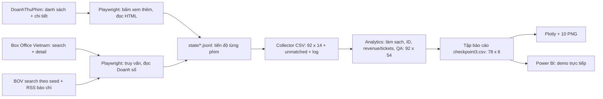
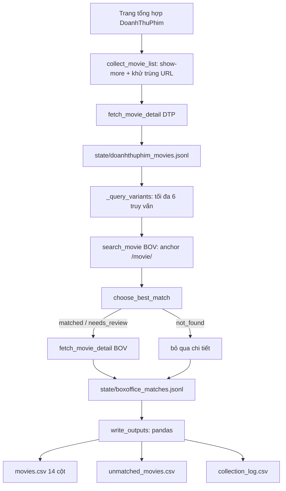

# Báo cáo Trình bày Dự án: Movie Data Scraper

- **Mục đích:** tài liệu nguồn cho bài thuyết trình academic về toàn bộ pipeline thu thập và xử lý dữ liệu phòng vé Việt Nam. Power BI chỉ được trình bày như một bản demo trực tiếp ngắn ở cuối.
- **Repository:** `/mnt/D/Projects/uni/movie-data-scraper/`.
- **Tài liệu tham khảo:** `reports/project_documentation/PROJECT_RESEARCH_AND_TECHNICAL_REPORT.md` (báo cáo kỹ thuật toàn diện, ngày kiểm kê 20/11/2026). Báo cáo này được tổ chức lại theo trình tự thuyết trình và đã đối chiếu lại mã nguồn, dữ liệu, test và cấu hình.
- **Phạm vi kiểm kê của báo cáo này:** chỉ đọc repository; không chạy scraper, không gọi mạng tới website nguồn, không cài đặt gói, không chạy lại pipeline ghi dữ liệu, không mở Power BI Desktop.

**Quy ước nhãn bằng chứng**

| Nhãn | Ý nghĩa |
|---|---|
| `ĐÃ XÁC MINH` | Đọc trực tiếp từ tệp mã nguồn/dữ liệu trong lần kiểm kê này. |
| `ĐÃ TRIỂN KHAI` | Có mã nguồn tương ứng; chưa chứng minh chạy thành công trên website thật trong lần này. |
| `KIỂM TRA TĨNH` | Cấu trúc tệp/đường dẫn/TMDL được kiểm tra, chưa đánh giá runtime. |
| `CHƯA XÁC MINH` | Không có đủ bằng chứng để khẳng định. |
| `DỰ KIẾN` / `CHƯA TRIỂN KHAI` | Ý tưởng cải tiến hoặc tính năng không có trong repository. |

> Nguyên tắc trình bày: nói "pipeline đã xây được" khi có mã và artifact; nói "cần xác nhận runtime" khi mới chỉ có thiết kế tĩnh. Không gọi dữ liệu ước lượng là dữ liệu đã kiểm chứng.

---

## 1. Tổng quan dự án

### Bài toán và động cơ

Dữ liệu phòng vé Việt Nam nằm rời rạc trên nhiều website. `AGENTS.md:1-12` và `README.md:3-6` đặt bài toán gốc: tự động lấy danh sách phim từ **DoanhThuPhim**, đối chiếu với **Box Office Vietnam**, rồi xuất CSV phục vụ trực quan hóa. Khó khăn được ghi nhận trực tiếp trong repository:

- Danh sách DoanhThuPhim tải thêm bằng nút "xem thêm" → không đọc được đầy đủ bằng HTTP tĩnh (`scrape_doanhthuphim.py:47-97`).
- Tên phim có subtitle, tên tiếng Anh, số thứ tự tiếp nối (`pipeline.py:46-92`, `matching.py:48-108`).
- Doanh thu bị làm tròn hoặc ghi dạng "hơn …"; số vé và suất chiếu có thể bị che (`scrape_boxofficevietnam.py:13-22`, `analytics/revenue.py:127-180`).
- Một phim có thể chỉ tồn tại ở một nguồn, nên không được giả định khớp 100%.

Việc tự động hóa có giá trị vì nó lặp được hàng chục trang và truy vấn, lưu vết nguồn và trạng thái, đồng thời tách biệt giá trị chắc chắn và giá trị cần review. Repository **không có** khảo sát định lượng về thời gian thủ công, nên báo cáo không đưa ra con số "tiết kiệm X giờ".

### Mục tiêu và phạm vi hệ thống

Mục tiêu đã triển khai: (1) khám phá và thu thập bản ghi DoanhThuPhim; (2) tìm trang Box Office Vietnam tương ứng; (3) trích doanh thu tích lũy, số vé/suất chiếu khi công khai; (4) lưu tiến độ để chạy lại; (5) làm sạch, gán ID ổn định, phân loại độ tin cậy; (6) xuất tập dữ liệu phân tích cho Plotly và Power BI.

Không nằm trong phạm vi: API server, cơ sở dữ liệu, scheduler, vượt CAPTCHA/login/paid access — các tính năng này không có mã trong repository (`CHƯA TRIỂN KHAI`).

### Luồng công việc tổng thể



### Nội dung cần trình bày

- Dự án biến hai nguồn web thành một chuỗi dữ liệu có truy vết: thu thập → đối chiếu → làm sạch → analytics → trực quan.
- Có ba mốc dữ liệu quan trọng, không trộn lẫn: **92 bản ghi thu thập**, **92 bản ghi QA 54 cột**, **78 bản ghi báo cáo 6 cột**.
- Điểm nhấn kỹ thuật: không che giấu độ bất định (làm tròn, cận dưới, cần review đều có cột/trạng thái riêng).

### Giải thích khi thuyết trình

"Bài toán bắt đầu từ một câu hỏi rất thực tế: làm sao biết phim nào thu về bao nhiêu, bán bao nhiêu vé, mà không nhầm giữa doanh thu tích lũy và doanh thu ngày hay tuần? Chúng tôi không đi tìm một nguồn 'duy nhất đúng'. Chúng tôi lấy danh sách từ DoanhThuPhim, rồi sang Box Office Vietnam để lấy con số `Doanh số` tích lũy, và ghi lại từng bước để sau này còn kiểm lại. Kết quả không chỉ là một file CSV, mà là một pipeline có trạng thái, có cờ cảnh báo và có tập dữ liệu phân tích riêng."

### Ví dụ minh họa

Phim **Mưa Đỏ**: DoanhThuPhim hiển thị `714 tỷ` (đã làm tròn); bản ghi đối chiếu lưu `revenue_bovn = 714,030,584,098₫` từ Box Office Vietnam, `match_score = 100.0`, `match_reason = auto`, hai URL nguồn đều được giữ (`state/boxoffice_matches.jsonl`, `data/processed/checkpoint3.csv`).

### Gợi ý hình ảnh

Sơ đồ 5 khối ngang: hai nguồn → Playwright → JSONL/CSV → Analytics → Checkpoint/Demo, đính kèm nhãn "92 / 92×54 / 78×6".

### Chuyển ý

"Để hiểu vì sao cần đến năm khối đó, chúng ta bắt đầu từ chính nguồn dữ liệu — mỗi nguồn cung cấp một phần thông tin và có một giới hạn riêng."

---

## 2. Nguồn dữ liệu — Data Sources

### 2.1. Các nguồn thực sự được triển khai

| Nguồn | URL / vị trí | Dữ liệu khai thác | Cách thu thập | Điểm vào pipeline |
|---|---|---|---|---|
| **DoanhThuPhim** (nguồn danh sách chính) | `https://doanhthuphim.vn/tong-hop` (`config.py:10`) | Tên phim, URL chi tiết `/phim/`, năm, thể loại, đạo diễn, doanh thu hiển thị | Playwright Chromium headless; JS `querySelectorAll('a[href*="/phim/"]')`, bấm "xem thêm", regex trên `body.innerText` | `scrape_doanhthuphim.py:12-264` → `pipeline.collect_doanhthuphim` → `state/doanhthuphim_movies.jsonl` |
| **Box Office Vietnam** (đối chiếu chính) | `https://v1.boxofficevietnam.com/` (`config.py:11`) | `Doanh số` (tích lũy), `Số vé`, `Suất chiếu`, title, release info | Playwright; fill input `input[name="s"][placeholder="Enter Movies or Series Title"]`, fallback `?post_type=movie&s=` và `?s=`; regex trên `body.innerText` | `scrape_boxofficevietnam.py:25-186` → `pipeline.match_and_enrich` → `state/boxoffice_matches.jsonl` |
| **BOV search theo seed** (khám phá mở rộng) | `seeds/bovn_anime_seed.txt` + cùng BOV search | Phim ngoài danh sách 92 của DoanhThuPhim (chủ yếu anime), release date từ context | Playwright; seed là từ khóa ngắn, lọc kết quả bằng `query_matches`, detail 502 vẫn giữ dòng | `discover_bovn.py:35-192` → `state/bovn_discovered.jsonl`, `data/bovn_discovered.csv` (10 dòng) |
| **Bing / Google News RSS** (bằng chứng bổ sung) | Query được sinh trong mã (`urllib` + XML stdlib) | Tiêu đề, snippet, URL làm bằng chứng số vé hoặc doanh thu báo chí | RSS công khai; không dùng `requests`/`feedparser` | `search_tickets_web.py:183-246` → `state/web_tickets_progress.jsonl`, `data/tickets_sold_web.csv`; `press_revenue.py:193-327` → `data/bovn_discovered_press.csv` (7 dòng) |
| **Press seed do con người kiểm chứng** | `seeds/bovn_press_seed.json` | Doanh thu báo chí kèm URL bài, ngày, snippet, cờ lower-bound | Đọc JSON, ưu tiên hơn RSS | `press_revenue.py:492-542`; mọi dòng đều `to_review_revenue=needs_review` |
| **Biên tập/tham khảo thủ công** | `consolidate_checkpoint2.py:37-78`; `data/reports/checkpoint3_genre_sources.md`; `data/reports/backfill_missing_summary.md` | 10 cặp đạo diễn kèm URL Wikipedia; 10 ô thể loại bổ sung | Hardcode có evidence, chỉ điền ô thiếu; không phải crawler tự động | Tầng checkpoint báo cáo (`checkpoint3.csv`) |

`ĐÃ XÁC MINH` về sự tồn tại của tất cả nguồn và tệp trên. `CHƯA XÁC MINH`: chạy live trên website trong lần kiểm kê này, cũng như việc tác giả đã đọc terms of service của từng site.

### 2.2. Vai trò và khác biệt giữa các nguồn

| Tiêu chí | DoanhThuPhim | Box Office Vietnam | RSS / press seed |
|---|---|---|---|
| Vai trò | Nền danh sách, tên gốc, năm, thể loại, đạo diễn, doanh thu hiển thị | Xác nhận trang phim và lấy `Doanh số` tích lũy | Bằng chứng bổ sung khi trang chi tiết lỗi hoặc cần số vé |
| Cấu trúc | HTML động, có nút tải thêm | HTML có search form, trang `/movie/` | RSS/XML snippet ngắn |
| Độ chi tiết doanh thu | Làm tròn (`714 tỷ`) hoặc cận dưới (`hơn 46 tỷ`) | Chuỗi chính xác theo từng đồng (`714,030,584,098₫`) | Hiển thị báo chí, có thể là cận dưới |
| Độ phủ | 92 phim trong state | 81 khớp tự động; 1 cần review; 10 không tìm thấy | 16 phim có ứng viên vé; 7 dòng press |
| Giới hạn | Có thể lấy nhầm số trong bảng xếp hạng nếu không cắt đoạn "Doanh thu các phim khác" (`scrape_doanhthuphim.py:214-227`) | Search trả nhiễu; chi tiết có thể 502; số vé/suất chiếu bị che (`0`, `888888`) | Snippet có thể nói về phim khác; không phải số đã kiểm chứng |

**Vì sao cần nhiều nguồn.** DoanhThuPhim cho biết *phim nào tồn tại* nhưng làm tròn doanh thu; BOV cho *con số tích lũy* nhưng chỉ khi có trang chi tiết và không có đầy đủ phim; RSS/seed chỉ là *bằng chứng*, không phải số chính xác. Nếu chỉ dùng một nguồn, ta hoặc thiếu phim, hoặc thiếu số liệu, hoặc dễ nhầm phạm vi doanh thu.

**Không được nhầm là nguồn:** Wikipedia chỉ xuất hiện dưới dạng URL bằng chứng trong mã biên tập và ghi chú backfill; `checkpoint3.csv` là đầu ra trung gian, không phải nguồn dữ liệu web. Không có API công khai, không có feed nội bộ, không có nguồn trả phí nào được triển khai.

### Nội dung cần trình bày

- Hai nguồn web đóng vai trò bổ trợ: DoanhThuPhim = danh sách và ngữ cảnh; BOV = doanh thu tích lũy.
- Ba nguồn bổ sung (BOV seed search, RSS, press seed) chỉ lấp khoảng trống, có cờ review.
- Mọi nguồn đều có giới hạn; vì thế dữ liệu đầu ra luôn kèm URL và trạng thái.

### Giải thích khi thuyết trình

"Chúng tôi dùng hai website chính vì chúng không thay thế được nhau. DoanhThuPhim có danh sách đầy đủ nhất nhưng ghi doanh thu kiểu '714 tỷ'. Box Office Vietnam có con số chính xác đến từng đồng, nhưng chỉ khi trang chi tiết tải được và chỉ cho những phim họ có. Với vài phim anime ngoài danh sách, chúng tôi phải tự tìm trên BOV bằng từ khóa ngắn. Còn báo chí chỉ là bằng chứng dự phòng — chúng tôi không bao giờ biến snippet thành số chính xác."

### Ví dụ minh họa

`data/bovn_discovered.csv` có 10 phim tìm được qua seed anime; khi chi tiết trả 502, mã ghi `detail_status=bovn_detail_502` và để `revenue_bovn` trống (`discover_bovn.py:162-164`) thay vì đoán số.

### Gợi ý hình ảnh

Bảng so sánh ba cột "Nguồn — Dữ liệu cung cấp — Giới hạn", kèm hai huy hiệu "chính" / "bổ sung".

### Chuyển ý

"Để tương tác được với những trang web động đó, chúng tôi chọn một stack nhỏ gồm Playwright, pandas và RapidFuzz — phần tiếp theo sẽ nói rõ từng công cụ làm gì."

---

## 3. Công cụ và công nghệ thu thập dữ liệu

### 3.1. Stack thực tế

| Công nghệ | Phiên bản khai báo/khóa | Mục đích và vị trí sử dụng | Vì sao phù hợp |
|---|---|---|---|
| Python | `>=3.13` (`pyproject.toml:7`) | Ngôn ngữ chính của collector và analytics | Có `asyncio`, `re`, `csv`, `json`, `Decimal` trong standard library |
| Playwright | `>=1.65.2`, khóa `1.65.2` (`uv.lock:203-204`) | Chromium headless trong cả hai scraper, `scripts/inspect_sites.py`, discovery | Cần thực thi JS và bấm nút "xem thêm", fill form search |
| pandas | `>=3.1.1`, khóa `3.1.1` | Ghi 14 cột CSV và log trong `pipeline.py:287-310`, đọc/ghi discovery và consolidation | Xuất bảng nhanh, `utf-8-sig` tương thích Excel |
| RapidFuzz | `>=3.14.6`, khóa `3.14.6` | `fuzz.ratio`, `token_sort_ratio`, `token_set_ratio` trong `matching.py:79-90` | So sánh tên tiếng Việt sau khi đã bỏ dấu |
| Standard library | — | `asyncio` + `urllib` + XML cho RSS; `json`/`csv` cho JSONL/CSV; `Decimal` cho tiền; `unittest` cho test | Giảm dependency, kiểm soát schema chặt |
| JSONL + `utf-8-sig` | — | `utils.py:45-71`; `pipeline.py:306-310`, `analytics/export.py` | JSONL append được từng dòng (resume); BOM giúp Excel mở tiếng Việt đúng |
| Matplotlib / Plotly | Cài trong môi trường, **không khai báo** trong `pyproject.toml` | Chỉ dùng ở generator báo cáo độc lập `reports/checkpoint3_plotly/generate_report.py` | Tạo PNG/HTML; là điểm yếu về tái tạo môi trường (`DỰ KIẾN` bổ sung dependency) |
| Power BI PBIP/TMDL/PBIR, DAX, Power Query M | — | `reports/powerbi_checkpoint3/` — chỉ là khâu tiêu thụ cuối | Kiểm tra tĩnh; chưa chạy runtime (`KIỂM TRA TĨNH`) |

Không có `requests`, `beautifulsoup4`, `lxml`, `feedparser`, `pytest` trong dependency cũng như trong import của collector. Bộ test dùng `unittest` dù tên file là `test_*.py`.

### 3.2. Kiến trúc scraper

**Khám phá URL.** Với DoanhThuPhim, `_discover_movie_links` chạy JavaScript trong trang, lấy mọi anchor có `/phim/`, chuẩn hóa thành URL tuyệt đối và chọn container nhỏ nhất chứa rank/doanh thu để lấy text. `_click_show_more_until_done` lặp tối đa 1000 lần, dừng sau 4 lần liên tiếp số link không tăng; nếu không tìm thấy nút thì cuộn xuống cuối trang, chờ 1,2 giây; sau mỗi lần bấm chờ `networkidle` (tối đa 8 giây) rồi delay 0,2–0,6 giây (`scrape_doanhthuphim.py:47-97`). Đây là cơ chế thay thế cho "chỉ lấy 15 bản ghi đầu".

**Truy cập trang.** Mọi `page.goto` được bọc trong `with_retry`: 3 lần thử, backoff `1.5^(attempt-1)` giây; giữa các bản ghi là `polite_delay()` ngẫu nhiên 0,8–1,8 giây (`config.py:32-36`, `utils.py:20-42`).

```python
# utils.py:24-42 — retry có backoff, lỗi được ném ra sau 3 lần
for attempt in range(1, retries + 1):
    try:
        return await func()
    except Exception as exc:
        last_exc = exc
        if attempt >= retries:
            break
        wait = base_backoff ** (attempt - 1)
        print(f"[retry] {label} attempt {attempt}/{retries} failed: {exc}; sleeping {wait:.1f}s")
        await asyncio.sleep(wait)
raise last_exc
```

**Trích xuất.** Trang chi tiết được đọc bằng `page.evaluate` lấy `body.innerText`, sau đó regex theo nhãn tiếng Việt. BOV ưu tiên `Doanh số`, rồi `Tổng doanh thu|Doanh thu tích lũy`; DTP cắt bỏ các đoạn "Doanh thu các phim khác", "Phim đang chiếu", "Bảng xếp hạng mọi thời đại", "Phòng vé toàn cầu" trước khi regex (`scrape_doanhthuphim.py:214-245`, `scrape_boxofficevietnam.py:145-177`). Một đoạn `getAfterLabel/findLineValue` trong JS của BOV thực ra không được Python dùng — đây là dead code, không phải nguồn giá trị.

**Xử lý lỗi.** Ở cấp bản ghi, exception được ghi vào `collection_status` (`dtp_detail_error:<Class>`, `bov_search_error:<Class>`, `bov_detail_error:<Class>`), bản ghi vẫn được lưu; job không chết giữa chừng (`pipeline.py:158-169`, `203-220`). Không có module `logging`; mã dùng `print()` (`CHƯA TRIỂN KHAI` logging có cấu trúc).

**Lưu trữ và checkpoint.** Mỗi bản ghi được append vào `state/*.jsonl` ngay sau khi xử lý; khi chạy lại, `load_progress_urls()` và `load_bov_progress()` bỏ qua URL/đã xử lý (`pipeline.py:142-145`, `174-199`). CSV `(unmatched, log)` được ghi từ state bằng pandas. Lưu ý đã xác minh: `--no-resume` của DTP/BOV không cắt JSONL (`pipeline.py:145,185`), nên re-run có thể tạo dòng trùng; ở press/tickets thì có cắt rõ ràng.

### Nội dung cần trình bày

- Stack gồm 3 dependency khai báo + standard library; Playwright là lựa chọn bắt buộc vì trang có JS.
- Scraper gồm bốn động tác: discovery → fetch → extract → append state; retry/delay là cơ chế crawling lịch sự.
- Lỗi được ghi thành trạng thái trên từng bản ghi, không làm sập toàn bộ job.

### Giải thích khi thuyết trình

"Chúng tôi không dùng BeautifulSoup vì trang tải danh sách bằng JavaScript; nếu chỉ tải HTML tĩnh sẽ thấy rất ít phim. Playwright giúp bấm nút 'xem thêm' giống người dùng. Sau khi có nội dung, chúng tôi chạy JavaScript trong trang để lấy link và dùng regex theo nhãn để lấy số. Mỗi lần bấm hoặc mở trang đều có delay ngẫu nhiên và retry — vừa lịch sự với website, vừa giảm rủi ro lỗi nhất thời."

### Ví dụ minh họa

```python
# scrape_boxofficevietnam.py:148-155 — ưu tiên nhãn tích lũy, không lấy doanh thu ngày/tuần
m = re.search(r"Doanh số\s*([0-9][0-9\.,\s]*₫|...)", body, flags=re.I)
if m:
    revenue = clean_text(m.group(1))
if not revenue:
    m = re.search(r"(Tổng doanh thu|Doanh thu tích lũy)\s*[:\-]?\s*(...)", body, flags=re.I)
```

### Gợi ý hình ảnh

Sơ đồ bốn bước kèm biểu tượng công cụ: Playwright (trình duyệt) → regex (kính lúp) → JSONL (ổ đĩa) → pandas (bảng CSV).

### Chuyển ý

"Với những công cụ đó, chúng ta đi tiếp vào trình tự cụ thể của một lần chạy — từ danh sách ban đầu đến bản ghi thô được lưu xuống ổ đĩa."

---

## 4. Quy trình thu thập dữ liệu — Data Collection Pipeline

### 4.1. Trình tự một lần chạy `full`

`cli.py:124-125` gọi `run_full` (`pipeline.py:313-317`): `collect_doanhthuphim()` → `match_and_enrich()` → `write_outputs()`.

1. **Discovery.** Mở `DOANHTHUPHIM_URL`, bấm "xem thêm" đến khi số link không tăng; khử trùng theo URL, giữ title guess ngắn hơn (`scrape_doanhthuphim.py:120-152`).
2. **Crawl/Fetch chi tiết DTP.** Với mỗi URL chưa có trong state, mở trang, retry nếu lỗi, trích `detail_title`, `original_title`, năm, thể loại, đạo diễn, doanh thu; append `state/doanhthuphim_movies.jsonl`, delay; record nền có `match_status=pending`, `collection_status=dtp_collected` (`pipeline.py:116-169`).
3. **Discovery BOV cho từng phim.** Tối đa 6 biến thể truy vấn: tên chính, original title, dạng chữ của số 0–9, phần trước dấu `:`, phần trước/sau separator, tên bỏ ngoặc (`pipeline.py:46-92`). Dừng sớm khi có ứng viên score ≥ 90 (`pipeline.py:106-107`).
4. **Fetch BOV.** Search input hoặc URL fallback; lấy tối đa 30 anchor `/movie/`, bỏ anchor điều hướng, khử trùng theo href, giữ title dài hơn (`scrape_boxofficevietnam.py:25-97`). Nếu match được chấp nhận, mở chi tiết và lấy `Doanh số`, `Số vé`, `Suất chiếu`, release info.
5. **Validation ban đầu.** Loại placeholder `-`, `n/a`, `đang cập nhật`, `0`, `888888`; revenue trống khi trang lỗi; gán `match_status` = `matched` / `needs_review` / `not_found`.
6. **Storage.** Append `state/boxoffice_matches.jsonl`; state giữ cả raw (`_dtp_raw`, `_bov_candidate`, `_bov_detail_raw`, `match_score`, `match_reason`) — các trường này **không** nằm trong 14 cột CSV.
7. **Export.** `write_outputs` tạo `movies.csv` (14 cột), `unmatched_movies.csv` (các dòng `not_found`/`needs_review` hoặc thiếu URL BOV), `collection_log.csv` (8 cột gồm score và reason), đều `utf-8-sig` (`pipeline.py:287-310`).
8. **Recovery.** Chạy lại với `resume=True` bỏ qua bản ghi đã có; `rematch` chỉ thử lại `not_found`/`needs_review` (`pipeline.py:253-274`).

### 4.2. Sơ đồ luồng



### 4.3. Ví dụ bản ghi thô (trước xử lý analytics)

```json
{
  "movie_name": "Mưa Đỏ",
  "release_year": "2025",
  "genre": "Lịch sử, Chiến tranh, Chính kịch",
  "director": "Đặng Thái Huyền",
  "revenue_doanhthuphim": "714 tỷ",
  "revenue_bovn": "714,030,584,098₫",
  "tickets_sold": null,
  "screening_count": null,
  "source_url_doanhthuphim": "https://doanhthuphim.vn/phim/mua-do",
  "source_url_bovn": "https://v1.boxofficevietnam.com/movie/mua-do/",
  "match_status": "matched",
  "collection_status": "matched",
  "match_score": 100.0,
  "match_reason": "auto"
}
```

Đây là trích từ `state/boxoffice_matches.jsonl` (`ĐÃ XÁC MINH`). Các cột `tickets_sold`/`screening_count` để trống vì trang BOV không công khai — đúng nguyên tắc "không bịa giá trị thiếu".

### 4.4. Các lệnh khác và trạng thái

| Lệnh | Mục đích | Output chính |
|---|---|---|
| `test --limit 5` | Kiểm tra nhỏ theo spec gốc | Có hành vi đã xác minh: do state DTP đọc toàn bộ, CSV có thể chứa 92 dòng nhưng chỉ 5 dòng được enrich mới; các dòng còn lại `pending` |
| `collect-dtp`, `rematch`, `discover-bovn` | Thu riêng DTP / thử lại match / khám phá BOV | JSONL tương ứng; discovery không đụng `movies.csv` |
| `press-revenue`, `tickets-web` | Bổ sung doanh thu báo chí / bằng chứng vé | `data/bovn_discovered_press.csv`, `data/tickets_sold_web.csv` |
| `export-full`, `consolidate-checkpoint2` | Gộp export review / gộp checkpoint 2 | `data/full_export.csv`, checkpoint consolidated |

### Nội dung cần trình bày

- Một lần chạy `full` gồm discovery → crawl → parse → extract → validate → store → resume.
- State JSONL là "bộ nhớ" của pipeline; CSV chỉ là bản trình bày cuối.
- Lỗi từng phim được ghi thành trạng thái riêng, không dừng toàn bộ job.

### Giải thích khi thuyết trình

"Chạy lệnh `full` là chạy ba việc liên tiếp. Đầu tiên lấy danh sách và chi tiết phim từ DoanhThuPhim, lưu ngay từng dòng vào file state. Sau đó mới sang BOV: với mỗi phim chúng tôi thử vài cách viết tên, lấy ứng viên, chấm điểm rồi mới mở trang chi tiết nếu ứng viên đủ tin. Cuối cùng xuất ba file CSV. Nhờ lưu state từng dòng, nếu máy tắt giữa chừng thì chạy lại chỉ xử lý phần thiếu."

### Ví dụ minh họa

`collection_log.csv` có đúng 92 dòng, trong đó dòng của Mưa Đỏ ghi `match_score=100.0`, `match_reason=auto`, hai URL nguồn — presenter có thể chỉ vào đây khi giải thích truy vết.

### Gợi ý hình ảnh

Pipeline flowchart dọc với bảy bước và nhãn tệp đầu ra ở hai nhánh JSONL/CSV.

### Chuyển ý

"Dữ liệu thô thu được đã có cấu trúc, nhưng vẫn còn nhiều dạng viết khác nhau; phần tiếp theo giải thích cách chúng tôi làm sạch mà không làm mất thông tin gốc."

---

## 5. Làm sạch và chuẩn hóa dữ liệu — Data Cleaning & Normalization

### 5.1. Pipeline analytics thực tế

`build_analytics_dataset` (`analytics/build_dataset.py:538-584`) gọi theo thứ tự: `load_raw_inputs` → `clean_raw_inputs` → gán stable ID (`analytics/ids.py`) → `process_revenue` → `process_tickets` → build base rows → apply fields → data-quality flags → `validate_dataset`. Orchestrator này `ĐÃ TRIỂN KHAI`; không được chạy lại trong lần kiểm kê này.

| Vấn đề gốc | Vì sao quan trọng | Việc mã thực hiện | Kết quả |
|---|---|---|---|
| **Thiếu giá trị** (`None`, ô trống) | Điền số giả sẽ tạo ra doanh thu/vé sai | Giữ trống; analytics export ghi `None` thành ô rỗng; EDA định nghĩa missing rõ ràng (`analytics/clean.py`, `export.py`) | 92 ô `ticket_verified_admissions` trống; 13 ô `bov_revenue_quality` trống; 90/92 `original_title_raw` trống, 3/92 `director_raw` trống; `genre_grouped` trống ở cả 92 nên không dùng làm nhãn chuẩn |
| **Tên phim không thống nhất** (dấu, subtitle, số 5/Năm) | Nếu so sánh chuỗi thô, cùng phim bị thành hai bản | `utils.py:74-105`: bỏ dấu, đổi `đ→d`, `&→and`, đổi chữ số 0–10 thành từ, bỏ punctuation, gộp whitespace; `split_titles` tách title phụ | `Mưa Đỏ` → `mua do`; `Heo 5 Móng` và `Heo Năm Móng` cùng khóa so sánh |
| **Tên gốc phải giữ lại** | Cần truy vết và hiển thị đúng tên website | Lưu riêng `movie_name`, `original_title`, `bov_title_raw`, `canonical_title`, `original_title_raw`; không ghi đè | Checkpoint vẫn hiện `Mưa Đỏ`, không hiện `mua do` |
| **Năm/ngày nhiều dạng** (`15/08/2025`, `2025-08-15`, chỉ năm) | Không thể nhóm theo năm nếu lẫn định dạng | `clean.py:219-227` parse năm, không suy diễn khi thiếu; `discover_bovn.parse_release_date` (`:35-55`) hỗ trợ DMY/YMD/year-only | Checkpoint 78 phim chỉ 2020–2026; phim 2019 bị loại ở bước biên tập |
| **Doanh thu `₫`, `tỷ`, `triệu`, `nghìn`, "hơn …"** | Cộng trực tiếp các chuỗi này là sai đơn vị | `analytics/revenue.py:127-180` dùng `Decimal`; DTP quality = `rounded` hoặc `lower_bound`, BOV = `exact` hoặc unusable | 90 `rounded`, 2 `lower_bound` (`Án Mạng Karaoke`: `hơn 46 tỷ` → 46.000.000.000 nhưng vẫn gắn cận dưới) |
| **Thể loại là chuỗi nhiều token** | Slicer theo thể loại không hoạt động đúng nếu cả chuỗi là một giá trị | `clean.py:205-217` tách deterministic; Power Query tách tiếp thành 29 token riêng | `Lịch sử, Chiến tranh, Chính kịch` → 3 token; top: Hài 30, Hành động 19 |
| **Placeholder số liệu** (`0`, `888888`, `n/a`) | Số giả có thể thành "số vé bán được" | `scrape_boxofficevietnam.py:13-22,166-172` đưa về `None` | `tickets_sold` của Mưa Đỏ để trống dù trang có vùng số liệu bị che |
| **Trùng bản ghi** | Một phim đếm hai lần làm sai tổng | Collector khử trùng theo URL (`scrape_doanhthuphim.py:129-152`) và href BOV (`scrape_boxofficevietnam.py:89-97`); analytics gán ID ổn định `M####` từ mapping file, **không** fuzzy tự gộp danh tính (`analytics/ids.py`) | 92 ID duy nhất, pattern `^M\d{4}$`; checked bởi `analytics/schema.py:137-142` |
| **Giá trị đáng ngờ / mâu thuẫn** | Xóa thì mất bằng chứng, giữ thì nhiễu báo cáo | Tách cột `bov_quarantined_revenue_*`, `bov_candidate_revenue_*`, `magnitude_gap_warning` thay vì gộp vào accepted | `Chị Mười Ba: 3 Ngày Sinh Tử`: `108,654,235,000₫` bị cô lập, lý do `sequel_number_error` |
| **Dữ liệu chưa chắc chắn** | Dễ bị đọc nhầm là đã duyệt | Cờ `review_status`, `mapping_human_reviewed`, `to_review_*`; mọi dòng press đều `needs_review` | `review_status`: 76 `auto_accepted`, 6 `pending`, 10 `not_applicable`; `mapping_human_reviewed=0` ở cả 92 dòng |

### 5.2. Ví dụ before/after cô đọng

| Trường | Trước | Sau | Diễn giải |
|---|---|---|---|
| Doanh thu | `714 tỷ` (state DTP) | `714,030,584,098₫` (checkpoint) | BOV exact được ưu tiên; giá trị DTP vẫn lưu ở cột riêng |
| Tên để so khớp | `Mưa Đỏ` | `mua do` (chỉ trong `score_pair`) | Tên hiển thị không bị thay đổi |
| Số vé | `888888` (placeholder) | `None` | Không quy đổi hay suy diễn |
| Thể loại | `Lịch sử, Chiến tranh, Chính kịch` | 3 token trong bảng `Genre Tokens` | Hỗ trợ lọc đúng |
| Doanh thu BOV mâu thuẫn | `108,654,235,000₫` | `bov_quarantined_revenue_vnd` | Cô lập, không vào so sánh accepted |

**Phân biệt doanh thu tích lũy và doanh thu theo kỳ.** Ở scraper BOV, mã ưu tiên nhãn `Doanh số` / `Tổng doanh thu` / `Doanh thu tích lũy` (`scrape_boxofficevietnam.py:145-155`), nhưng không có bộ lọc cụm từ theo kỳ. Bộ lọc đó nằm ở tầng bằng chứng RSS: `search_tickets_web.py:365-377` và `press_revenue.py:289-299` cộng 15 điểm cho cụm tích lũy ("đến nay", "tổng", "lũy kế", "đã bán"), trừ 30 cho cụm theo kỳ ("ngày đầu", "cuối tuần", "opening", "weekend") và trừ 30 cho cụm dự báo ("dự kiến", "dự báo"). Đây là điểm cần nói rõ nếu giảng viên hỏi "chỗ nào phân biệt ngày/tuần với tích lũy?".

**Giới hạn cần nói rõ:** hệ thống *phát hiện và gắn cờ* dữ liệu không chắc chắn, chứ không tự sửa thành đúng. Backfill 10 thể loại và 10 đạo diễn là biên tập có URL bằng chứng, không phải suy luận tự động (`data/reports/checkpoint3_genre_sources.md`, `consolidate_checkpoint2.py:37-78`). Không có chuẩn hóa hệ thống cho tên đạo diễn theo kiểu fuzzy merge — `director_norm_key` chỉ là khóa chuẩn. Bản thân nội dung HTML thô của trang BOV không được lưu lại (`bov_evidence_available = 0` ở cả 92 dòng), nên không thể tự kiểm tra lại phạm vi doanh thu từ repository.

### Nội dung cần trình bày

- Chuẩn hóa phục vụ hai mục đích: so khớp đúng và phân tích đúng đơn vị.
- Nguyên tắc "giữ bản gốc, tách bản chuẩn, gắn cờ nghi ngờ".
- Không tự điền số thiếu; giá trị làm tròn và cận dưới luôn được nhãn hóa.

### Giải thích khi thuyết trình

"Ở bước này có một nguyên tắc chúng tôi giữ suốt: không bao giờ ghi đè dữ liệu gốc. Tên phim tiếng Việt được giữ nguyên để hiển thị, còn một bản bỏ dấu chỉ dùng để chấm điểm. Doanh thu '714 tỷ' được giữ trong cột của DoanhThuPhim, còn số chính xác từ BOV nằm ở cột khác. Nếu một số có vẻ sai — ví dụ do nhầm phần tiếp nối — chúng tôi không xóa nó, mà chuyển vào cột 'bị cô lập' kèm lý do."

### Ví dụ minh họa

`Kính Vạn Hoa: Phim Điện Ảnh`: số `6,046,923,245₫` nằm ở `bov_candidate_revenue_raw` với lý do `different_subtitle`, không được tính vào doanh thu accepted (`data/analytics/movie_analytics.csv`, bản ghi M0043).

### Gợi ý hình ảnh

Bảng before/after 4 dòng: tên phim, doanh thu, số vé placeholder, thể loại — mỗi dòng có nhãn "giữ gốc / bản chuẩn".

### Chuyển ý

"Sau khi tên đã được chuẩn hóa, câu hỏi tiếp theo là: làm sao biết hai tên ở hai website là cùng một phim? Đó là bài toán entity resolution."

---

## 6. Matching dữ liệu giữa các nguồn — Entity Resolution

### 6.1. Khóa, điểm và ngưỡng

- **Trường nguồn:** `movie_name`, `original_title`, `detail_title`, `bov_title_hint`; `split_titles` tách phần trước/sau separator (`matching.py:21-45`).
- **Trường ứng viên BOV:** `title`, `bov_title`, `original_title`, cộng `context` từ thẻ chứa anchor.
- **Chuẩn hóa:** dùng `normalize_title` ở trên cho cả hai phía; so sánh mọi cặp tên (`matching.py:73-97`).
- **Điểm tương đồng (`score_pair`, `matching.py:57-108`):**
  - `score = max(fuzz.ratio, fuzz.token_sort_ratio)`;
  - `token_set_ratio` được phạt theo chênh độ dài: `tsr * (1 - 0.45 * len_penalty)`;
  - tên hoàn toàn giống sau chuẩn hóa → 100;
  - số tiếp nối khác nhau (vd. phim 3 vs 7) → trừ 35;
  - năm trùng trong context → +4; năm khác → −6.
- **Quyết định (`choose_best_match`, `matching.py:136-158`):**
  - `matched` nếu `score ≥ 92` (`AUTO_MATCH_THRESHOLD`, `config.py:38`) **và** (`margin ≥ 3` **hoặc** tên chính xác + năm khớp);
  - `needs_review` nếu `score ≥ 80` (`REVIEW_THRESHOLD`);
  - `not_found` nếu thấp hơn; lý do `no_candidates`, `ambiguous_or_low_confidence`, `below_threshold`.
- **Chiến lược tìm ứng viên:** thử tối đa 6 biến thể, gom theo href, dừng khi có ứng viên `score ≥ 90` (`pipeline.py:95-108`).

### 6.2. Kết quả và rủi ro

| Trường hợp thực tế | Điểm / lý do | Quyết định |
|---|---|---|
| `Mưa Đỏ` ↔ `/movie/mua-do/` | 100.0, `auto` | `matched`, lấy `714,030,584,098₫` |
| `Kính Vạn Hoa: Phim Điện Ảnh` ↔ `/movie/kinh-van-hoa-bat-den-con-ma/` | 83.25, `ambiguous_or_low_confidence` | `needs_review`, đưa vào `unmatched_movies.csv` |
| `Siêu Sao Siêu Ngố` | 53.69, `below_threshold` | `not_found`, không có URL BOV |
| `Chị Mười Ba: 3 Ngày Sinh Tử` | Ứng viên sai số tiếp nối | Bị cô lập doanh thu, lý do `sequel_number_error` |

**False positive:** tự động chấp nhận ở 92 có thể gán nhầm phần tiếp nối hoặc phim cùng tên khác năm; dù có phạt −35 và kiểm tra margin, đây vẫn là rủi ro thật. Điều này **lệch** với yêu cầu gốc trong `AGENTS.md:33-39` ("fuzzy chỉ để gợi ý possible matches") — báo cáo ghi là `ĐÃ TRIỂN KHAI` nhưng không tuyên bố tuân thủ hoàn toàn.

**False negative:** search BOV trả "No Movie Found" với tên đầy đủ, nên mã thử thêm các biến thể ngắn hơn; nếu tất cả thất bại thì `not_found`, dù phim có thể tồn tại dưới tên khác (`README.md:85-102`).

**Trùng lặp danh tính:** collector khử trùng theo URL/href, không có global entity ID. Analytics có `movie_id` ổn định nhưng dựa trên file mapping có review metadata, không phải automatic global resolution; `mapping_human_reviewed = 0` ở cả 92 dòng.

### Nội dung cần trình bày

- Matching gồm: chuẩn hóa tên → sinh biến thể → chấm điểm → phạt theo số tiếp nối/năm → ngưỡng 92/80 → trạng thái.
- `needs_review` và `not_found` được tách file riêng; không tự nâng cấp thành `matched`.
- Ngưỡng 92 là tự động chấp nhận, nên cần nói rủi ro.

### Giải thích khi thuyết trình

"Khớp tên không đơn giản vì cùng một phim có thể viết 'Mưa Đỏ', 'Mua Do', hoặc kèm subtitle tiếng Anh. Chúng tôi bỏ dấu, đổi số thành chữ, thử sáu cách viết, rồi chấm điểm bằng ba công thức tương đồng. Nếu khác số thứ tự như phim 3 và phim 7 thì trừ 35 điểm; nếu năm khớp thì cộng 4. Từ 92 điểm trở lên và cách ứng viên hai ít nhất 3 điểm thì tự nhận; từ 80 đến dưới 92 thì để lại hàng đợi review. Ở mức 92 vẫn có rủi ro nhầm, và chúng tôi thừa nhận điểm này khác với yêu cầu ban đầu là fuzzy chỉ nên gợi ý."

### Ví dụ minh họa

Sơ đồ ba nhánh với số thật: `100.0 → matched`, `83.25 → needs_review`, `53.69 → not_found` (trích từ `state/boxoffice_matches.jsonl`).

### Gợi ý hình ảnh

Matching workflow: tên nguồn → 6 biến thể → 3 công thức similarity → bộ lọc năm/số tiếp nối → ba nhánh trạng thái.

### Chuyển ý

"Khi đã có các bản ghi được đối chiếu và gắn cờ, chúng ta biến chúng thành hai tập dữ liệu có mục đích khác nhau: một để kiểm soát chất lượng, một để phân tích và trình bày."

---

## 7. Tổng hợp và xây dựng dữ liệu phân tích — Analytics Dataset

### 7.1. Ba tầng dữ liệu

| Tầng | Đường dẫn | Kích thước `ĐÃ XÁC MINH` | Vai trò |
|---|---|---|---|
| Collector state | `state/doanhthuphim_movies.jsonl`, `state/boxoffice_matches.jsonl` | 92 + 92 dòng JSON | Tiến độ, raw payload, điểm match |
| Collector CSV | `data/data_dirty/movies.csv`, `unmatched_movies.csv`, `collection_log.csv` | 92×14 / 11×14 / 92×8 | Output chuẩn 14 cột của scraper (bản hiện tại nằm ở `data/data_dirty/` do drift đường dẫn) |
| Analytics QA | `data/analytics/movie_analytics.csv` | 92×54 | Kiểm soát chất lượng, tách accepted/quarantine/candidate, ID ổn định |
| Tập báo cáo | `data/processed/checkpoint3.csv` | 78×6 | Nguồn duy nhất của Plotly và Power BI |

`checkpoint3.csv` **không phải** là analytics 92×54 thu nhỏ về mặt quy trình: nó là checkpoint đã biên tập (lọc 2020–2026, bổ sung thể loại/vé). `src/main.ipynb` vẫn trỏ tới snapshot cũ 69 dòng, không dùng làm nguồn số liệu hiện tại.

### 7.2. Từ dữ liệu xử lý sang dữ liệu phân tích

Pipeline analytics (`analytics/build_dataset.py`) thêm bốn nhóm giá trị:

1. **Định danh & provenance:** `movie_id` (`M0001…`), `canonical_title`, `source_url_dtp`, `raw_source_row_dtp` (`analytics/ids.py`).
2. **Match & review:** `bov_match_status`, `match_score`, `match_reason`, `review_status`, `review_priority`.
3. **Revenue Separation:** parse `Decimal`, quality `rounded`/`lower_bound`/`exact`, `revenue_gap_pct = |DTP−BOV| / DTP × 100`, tách `bov_quarantined_*` và `bov_candidate_*`, cờ `magnitude_gap_warning`, `revenue_conflict_flag`, `revenue_scope_verified`.
4. **Tickets & quality flags:** đếm ứng viên vé, `ticket_data_status`, `ticket_context_status`, `ticket_evidence_urls`, và các cờ `has_missing_core_data`, `has_pending_review`, `data_quality_status`.

Export (`analytics/export.py`).validate schema → ghi file tạm → đọc lại → thay thế atomic; schema được khóa 54 cột và 92 hàng trong `analytics/schema.py:54-182`.

### 7.3. Từ điển dữ liệu rút gọn

**Tập báo cáo `checkpoint3.csv` (6 cột, nguồn demo)**

| Cột | Ý nghĩa | Ví dụ thực tế | Lưu ý |
|---|---|---|---|
| `movie_name` | Tên hiển thị đã biên tập | `Mưa Đỏ` | Giữ tên gốc, không dùng slug |
| `release_year` | Năm 2020–2026 | `2025` | 2026 có 22 phim, nhiều nhất |
| `genre` | Nhiều thể loại cách dấu phẩy | `Lịch sử, Chiến tranh, Chính kịch` | Power BI tách thành 29 token |
| `director` | Đạo diễn | `Đặng Thái Huyền` | 10 giá trị có bằng chứng Wikipedia |
| `revenue` | Doanh thu hiển thị | `714,030,584,098₫` | 70 dạng `₫`, 8 dạng `tỷ đồng` (đã làm tròn) |
| `tickets_sold` | Số vé dùng trên dashboard | `8100000` | Hỗn hợp nguồn/ước lượng; **không phải vé đã xác minh** |

**Các trường analytics quan trọng**

| Trường | Nhóm | Ý nghĩa | Giá trị hiện tại |
|---|---|---|---|
| `movie_id` | A | ID ổn định, anchor là URL DTP | 92 ID duy nhất |
| `bov_match_status` | B | Kết quả đối chiếu | 81 `matched`, 1 `needs_review`, 10 `not_found` |
| `dtp_revenue_quality` | C | `rounded` / `lower_bound` | 90 / 2 |
| `bov_revenue_quality` | C | `exact` hoặc trống | 79 `exact`, 13 trống |
| `bov_quarantined_revenue_*` | C | Giá trị BOV bị cô lập | 1 bản ghi |
| `revenue_gap_pct`, `magnitude_gap_warning` | C | Chênh DTP-BOV và cảnh báo khi chênh >10% | 21 cảnh báo; `revenue_conflict_flag` vẫn bằng 0 |
| `revenue_scope_verified` | C | Phạm vi doanh thu đã xác minh | 0 ở cả 92 dòng |
| `ticket_candidate_count`, `ticket_found_count` | D | Ứng viên vé / ứng viên found | 16 / 5; 15 ứng viên rạp chưa xác minh, 1 bị cô lập do là lượng khán giả sự kiện |
| `ticket_verified_admissions` | D | Số vé đã xác minh | Trống ở cả 92 dòng |
| `data_quality_status` | E | Trạng thái chất lượng tổng hợp | ok 58, gap 16, no match 10, pending 6, missing 2 |

### 7.4. Câu hỏi phân tích có thể trả lời — và không thể

**Có thể (mang tính mô tả tập dữ liệu):** phân bố phim theo năm và thể loại; đạo diễn xuất hiện nhiều nhất; phim có doanh thu hiển thị cao nhất trong tập 78; mức chênh giữa doanh thu làm tròn của DTP và `Doanh số` của BOV; nhóm phim cần review trước khi dùng.

**Không nên khẳng định:** "doanh thu tăng X%/năm", "phim A hiệu quả hơn phim B", "tương quan vé–doanh thu", hay dự báo. Lý do: EDA được thiết kế chủ động cấm ranking/forecast/hiệu quả (`analytics/eda.py`), `revenue_scope_verified=0`, vé chưa xác minh, 8 revenue bị làm tròn và 2 là cận dưới.

### Nội dung cần trình bày

- Có hai tập analytics: 92×54 để kiểm soát chất lượng, 78×6 để dashboard.
- Mỗi cột doanh thu/vé có cột chất lượng đi kèm; không đọc một mình cột số.
- Dataset trả lời câu hỏi mô tả, không trả lời câu hỏi thị trường đã kiểm chứng.

### Giải thích khi thuyết trình

"Nếu chỉ có một file CSV, chúng tôi không biết số nào đáng tin. Vì vậy tập 92×54 được tạo ra với các cột chất lượng đi cùng: doanh thu DTP thì có cột 'làm tròn hay cận dưới', doanh thu BOV thì có vùng 'bị cô lập' riêng. Từ đó chúng tôi lọc và biên tập thành tập 78×6 — đây là tập duy nhất được đưa vào biểu đồ và dashboard. Khi nhìn biểu đồ, khán giả cần nhớ đó là mô tả tập dữ liệu, không phải báo cáo tài chính."

### Ví dụ minh họa

Bảng data dictionary 6 cột của `checkpoint3.csv`, với dòng Mưa Đỏ làm mẫu: `2025 | Lịch sử, Chiến tranh, Chính kịch | Đặng Thái Huyền | 714,030,584,098₫ | 8100000`.

### Gợi ý hình ảnh

Schema 6 cột dạng card, dưới đó là bảng nhóm 5 nhóm cột của analytics 54 cột (A–E).

### Chuyển ý

"Vậy pipeline chạy được đến đâu, số liệu thực tế thế nào? Chúng ta chuyển sang phần kết quả và đánh giá."

---

## 8. Kết quả và đánh giá pipeline

### 8.1. Chỉ số đã xác minh

Tất cả số dưới đây được đọc trực tiếp từ tệp trong repository lần này (`ĐÃ XÁC MINH`).

| Nhóm | Chỉ số | Giá trị | Nguồn |
|---|---|---:|---|
| Thu thập | Bản ghi DTP / BOV / web-ticket / discovery / press trong state | 92 / 92 / 92 / 10 / 7; 0 lỗi parse JSON | `state/*.jsonl` |
| Collector | `movies.csv` / `unmatched_movies.csv` / `collection_log.csv` | 92×14 / 11×14 / 92×8 | `data/data_dirty/` |
| Analytics | Kích thước tập QA | 92×54 | `data/analytics/movie_analytics.csv` |
| Match | `matched` / `needs_review` / `not_found` | 81 / 1 / 10 | `movie_analytics.csv` |
| Review | `review_status`: auto_accepted / pending / not_applicable | 76 / 6 / 10 | `movie_analytics.csv` |
| Revenue | DTP `rounded` / `lower_bound` | 90 / 2 | `movie_analytics.csv` |
| Revenue | BOV accepted `exact` / bị cô lập / candidate | 79 / 1 / 1 | `movie_analytics.csv` |
| Revenue | Eligible comparison / gap warning / conflict / scope verified | 79 / 21 / 0 / 0 | `movie_analytics.csv` |
| Ticket | Ứng viên / found / needs_review / không có / verified admissions | 16 / 5 / 11 / 76 / 0 | `movie_analytics.csv` |
| Suất chiếu | `screening_count` trống ở collector CSV | 92/92 | `data/data_dirty/movies.csv` |
| Chất lượng | `data_quality_status`: ok / gap / no match / pending / missing | 58 / 16 / 10 / 6 / 2 | `movie_analytics.csv` |
| Chất lượng | `has_missing_core_data=1` nhưng `data_quality_status=missing_core_data` | 3 dòng / 2 dòng (do thứ tự ưu tiên trạng thái) | `movie_analytics.csv` |
| Checkpoint | Hàng × cột; khoảng năm | 78×6; 2020–2026 | `checkpoint3.csv` |
| Checkpoint | Phân bố năm | 2020:3, 2021:5, 2022:7, 2023:9, 2024:15, 2025:17, 2026:22 | `checkpoint3.csv` |
| Checkpoint | Token thể loại distinct / top 5 | 29; Hài 30, Hành động 19, Tâm lý 17, Gia đình 17, Kinh dị 15 | `checkpoint3.csv` |
| Checkpoint | Revenue `₫` / `tỷ đồng`; tổng quy đổi | 70 / 8; ≈ 12.130.448.158.377₫ (ước lượng) | `checkpoint3.csv` |
| Checkpoint | Tổng / min / max `tickets_sold` | 138.803.541 / 34.942 / 8.100.000 (hỗn hợp, estimated) | `checkpoint3.csv` |
| Checkpoint | SHA-256 | `9de3cb115f4e8b8833508b98363f9163e261dd3f756b10d35007ee796ab5c51a` | `checkpoint3.csv` |
| Test | Tệp / class / hàm `test_*` | 16 / 32 / 336 (đếm tĩnh bằng AST) | `tests/test_*.py` |
| Power BI | Trang / visual / bảng / measure | 4 / 40 / 2 / 16 (`KIỂM TRA TĨNH`) | `reports/powerbi_checkpoint3/` |

### 8.2. Ý nghĩa của con số

- **81/92 khớp tự động** cho thấy normalization + fuzzy hoạt động với đa số phim, nhưng 10 `not_found` và 1 `needs_review` là bằng chứng không được giả định coverage đầy đủ.
- **21 cảnh báo chênh doanh thu** (ngưỡng chênh >10%) không có nghĩa là 21 phim có số sai; đó là tín hiệu cần đối chiếu thêm vì DTP làm tròn còn BOV hiển thị chính xác và phạm vi chưa được xác minh (`revenue_scope_verified=0`). Cờ `revenue_conflict_flag` vẫn bằng 0 vì điều kiện so sánh không bao giờ thỏa mãn đầy đủ.
- **16 ứng viên vé nhưng 0 vé xác minh** — con số 138.803.541 trên dashboard là tổng của trường `tickets_sold` hỗn hợp, phải gắn nhãn estimated.
- **336 hàm test** là quy mô source, không phải kết quả chạy: repository không lưu artifact JUnit/log pytest, nên `CHƯA XÁC MINH` việc tất cả test pass.
- **Tổng doanh thu ≈12,13 nghìn tỷ** được tính từ 70 giá trị `₫` và 8 giá trị `tỷ đồng` đã làm tròn → chỉ là ước lượng tính từ giá trị hiển thị.

### 8.3. Điểm mạnh, hạn chế và cải tiến

**Điểm mạnh:** tách bạch bốn tầng dữ liệu (state, collector CSV, analytics QA, checkpoint); schema cứng 54 cột + export read-back; giá trị nghi ngờ được cô lập thay vì xóa; retry/delay và resume bằng JSONL; Fuzzy có phạt theo số tiếp nối và năm.

**Hạn chế đã xác minh:** fuzzy tự chấp nhận ở 92 lệch yêu cầu gốc; không có PBIX thật và chưa refresh Power BI (`KIỂM TRA TĨNH`); đường dẫn CSV trong TMDL là Windows tuyệt đối (`E:\Projects\uni\...`) trong khi README Power BI còn ghi đường dẫn tương đối; `analytics/schema.py:33-36` cũng gọi `movie_analytics.csv` là "only Power BI input" nhưng PBIP hiện lại đọc `checkpoint3.csv` — tài liệu thiết kế và implementation chưa khớp nhau; vé và phạm vi doanh thu chưa xác minh; mapping chưa có human review; raw input path của analytics build (`data/*.csv`) đã lệch so với thực tế (`data/data_dirty/`); `--no-resume` của DTP/BOV có thể tạo dòng trùng; có dead code trong parser BOV; chỉ dùng `print()` thay logging; Plotly/Matplotlib thiếu khai báo dependency; không có test cho scraper/pipeline/matching/CLI. Báo cáo audit thời kỳ đầu (`reports/data_quality_audit/06_executive_summary.md`) từng kết luận "NOT READY FOR ANALYSIS" cho `full_export.csv`; đây là đánh giá tập export review cũ, không phải tập QA 92×54 đã xây sau đó, nhưng vẫn là lời nhắc không nên dùng `full_export.csv` làm nguồn phân tích.

**Ưu tiên cải tiến (`DỰ KIẾN`):** đổi fuzzy thành suggestion-only hoặc hạ ngưỡng; lưu artifact test; sửa path/README và refresh PBIP để export PBIX; gắn provenance cho 8 revenue làm tròn và 78 ô vé; test scraper + integration opt-in để phát hiện selector drift; thay `print()` bằng `logging`; đồng nhất `--no-resume`.

### Nội dung cần trình bày

- Trình bày số liệu theo cặp "con số + ý nghĩa", không chỉ liệt kê.
- Nhấn mạnh 0 verified admissions và 0 scope verified — đây là ranh giới tin cậy của dự án.
- Kết thúc bằng ba việc cần làm tiếp: xác nhận runtime, khóa quy trình review, bổ sung provenance.

### Giải thích khi thuyết trình

"Con số 81 phần trăm khớp nghe thì ổn, nhưng phần còn lại mới là phần đáng nói: 10 phim không tìm thấy và 1 phim cần người xem lại. Tương tự, 21 cảnh báo chênh doanh thu không có nghĩa là 21 phim sai — đó là tín hiệu cần đối chiếu, vì hai website hiển thị doanh thu khác nhau. Và dù có 16 bằng chứng số vé, chúng tôi vẫn để cột 'số vé đã xác minh' trống. Trình bày trung thực những chỗ đó quan trọng hơn là chỉ khoe tổng doanh thu."

### Ví dụ minh họa

Bảng ba cột "Đã xác minh / Kiểm tra tĩnh / Chưa xác minh": 92×54 và 78×6 ở cột một; PBIP 4 trang ở cột hai; test pass, runtime DAX, PBIX ở cột ba.

### Gợi ý hình ảnh

Biểu đồ cột ngang cho match status (81/1/10) + biểu đồ thanh cho `data_quality_status` (58/16/10/6/2), kèm nhãn "0 verified".

### Chuyển ý

"Từ tập 78×6 đã kiểm tra ở trên, chúng ta chỉ cần một bước chuyển giao ngắn nữa trước khi mở ứng dụng: đưa dữ liệu vào Power BI và demo trực tiếp."

---

## 9. Đưa dữ liệu vào Power BI — Live Demonstration

Phần này chỉ là bàn giao dữ liệu; presenter sẽ mở Power BI Desktop trực tiếp, không dùng slide mô tả từng trang/visual.

**Dataset được tiêu thụ:** `data/processed/checkpoint3.csv` (78 dòng × 6 cột, SHA-256 như mục 8.1). Power Query trong `Movies.tmdl:179-225` và `Genre Tokens.tmdl:16-32` đều đọc cùng tệp này, kiểm tra đúng 6 cột/78 dòng, parse revenue theo đơn vị `₫` hoặc `tỷ đồng`, parse `tickets_sold` thành số nguyên và tách thể loại thành 29 token. `SourcePath` hiện là đường dẫn Windows tuyệt đối `E:\Projects\uni\movie-data-scraper\data\processed\checkpoint3.csv` (`KIỂM TRA TĨNH`; runtime refresh `CHƯA XÁC MINH`).

**Điểm nối pipeline → visualization:** checkpoint3.csv → Power Query (validate) → bảng `Movies` + bảng rời `Genre Tokens` → 16 measure DAX. Không có quan hệ vật lý giữa hai bảng; DAX dùng `PATHCONTAINS` để slicer genre lọc chuỗi nhiều thể loại. Đây là thiết kế đã kiểm tra tĩnh, chưa đánh giá runtime. Lưu ý tài liệu thiết kế (`analytics/schema.py:33-36`, thư mục `reports/analytics/`) từng ghi `movie_analytics.csv` là đầu vào Power BI; implementation hiện tại đã khác, nên presenter phải nói theo PBIP thực tế.

**Checklist demo trực tiếp (ngắn):**

1. Mở dashboard tổng quan → nói nguồn là checkpoint3.csv, 78 phim 2020–2026.
2. Chỉ một insight mô tả có ý nghĩa: 2026 có 22 phim, Hài là thể loại phổ biến nhất (30).
3. Thay đổi slicer Năm hoặc Genre → giải thích measure lọc lại dữ liệu hiển thị (demo bằng ứng dụng, không giải thích từng visual).
4. Chỉ vào một chỉ số doanh thu/vé → nhắc lại nhãn "tỷ đồng đã làm tròn" và "Estimated Tickets", không phải số kiểm chứng.
5. Trỏ ngược lại pipeline: giá trị này đi từ đâu trong chuỗi thu thập → làm sạch → checkpoint.

---

## 10. Kết luận

Dự án đã xây được một pipeline hoàn chỉnh ở mức kỹ thuật: khám phá và thu thập 92 phim từ DoanhThuPhim, đối chiếu với Box Office Vietnam bằng normalized title + fuzzy scoring có ngưỡng và trạng thái review, lưu tiến độ JSONL để chạy lại, xây tập QA 92×54 với các cờ chất lượng, và biên tập thành tập báo cáo 78×6 dùng cho Plotly và Power BI.

Giá trị của pipeline nằm ở việc **giữ vết và giữ sự bất định**: tên gốc, URL nguồn, điểm match, doanh thu làm tròn/cận dưới, giá trị bị cô lập và vé chưa xác minh đều có chỗ riêng. Đây là nền tảng tốt để thuyết trình về web scraping có trách nhiệm và data cleaning trung thực.

Vẫn còn khoảng cách tới một sản phẩm hoàn chỉnh: chưa có PBIX và chưa refresh DAX runtime; đường dẫn và README Power BI chưa đồng nhất; fuzzy tự chấp nhận lệch yêu cầu gốc; vé và phạm vi doanh thu chưa xác minh; raw input path của analytics build cần chỉnh lại; test chưa có artifact kết quả. Các bước tiếp theo nên ưu tiên xác nhận runtime, khóa quy trình human review và bổ sung provenance cho các giá trị ước lượng.

---

## Phụ lục A — Presentation Outline

9 slide, tập trung vào pipeline trước visualization. Power BI không được chiếm một slide riêng; nó là demo trực tiếp sau slide 9.

### Slide 1 — Từ dữ liệu phòng vé đến tập dữ liệu có truy vết

- **Thông điệp chính:** Dự án biến hai web Việt Nam thành dữ liệu phân tích có nguồn gốc rõ ràng.
- **Ý chính:** bài toán doanh thu rời rạc; 92 phim thu thập; 81 khớp BOV; tập báo cáo 78 phim; mục tiêu là CSV phục vụ phân tích.
- **Trực quan:** sơ đồ 4 khối ngắn (nguồn → thu thập → xử lý → dashboard).
- **Bằng chứng:** `AGENTS.md:1-12`, `README.md:3-6`, `state/*.jsonl`, `data/processed/checkpoint3.csv`.
- **Speaker notes:** mở bằng câu hỏi "Làm sao không nhầm doanh thu tích lũy với doanh thu ngày?"; chốt bằng ba con số 92 / 92×54 / 78×6.

### Slide 2 — Hai nguồn web, vai trò bổ trợ

- **Thông điệp chính:** DoanhThuPhim cho danh sách; BOV cho doanh thu tích lũy; nguồn bổ sung chỉ lấp khoảng trống.
- **Ý chính:** DTP 92 phim, doanh thu làm tròn; BOV `Doanh số` chính xác nhưng có trang 502; seed anime mở rộng 10 phim; RSS/press là bằng chứng, luôn `needs_review`.
- **Trực quan:** bảng so sánh 3 nguồn (dữ liệu / độ tin cậy / giới hạn).
- **Bằng chứng:** `config.py:10-11`, `scrape_doanhthuphim.py`, `scrape_boxofficevietnam.py`, `discover_bovn.py`, `press_revenue.py`.
- **Speaker notes:** nhấn mạnh "không có nguồn duy nhất đúng", nên phải ghi URL và trạng thái.

### Slide 3 — Stack và kiến trúc scraper

- **Thông điệp chính:** Python 3.13 + Playwright + pandas + RapidFuzz, bổ trợ bởi standard library.
- **Ý chính:** Playwright bấm "xem thêm" và fill search; retry 3 lần/backoff 1.5; delay 0,8–1,8 giây; JSONL làm bộ nhớ tiến độ.
- **Trực quan:** sơ đồ 4 bước discovery → fetch → extract → append state.
- **Bằng chứng:** `pyproject.toml:7-16`, `utils.py:20-71`, `scrape_doanhthuphim.py:47-97`.
- **Speaker notes:** giải thích vì sao không dùng HTTP tĩnh/BeautifulSoup; không nhắc đến thư viện không tồn tại.

### Slide 4 — Một lần chạy `full`: từ trang web đến bản ghi thô

- **Thông điệp chính:** Pipeline lưu state từng dòng, nên gián đoạn vẫn resume được.
- **Ý chính:** show-more đến khi số link không tăng; 6 biến thể truy vấn BOV; lỗi ghi thành `collection_status`; xuất 3 CSV `utf-8-sig`.
- **Trực quan:** pipeline flowchart dọc với nhãn file/JSL.
- **Bằng chứng:** `pipeline.py:46-108,142-246,287-317`, `state/boxoffice_matches.jsonl`.
- **Speaker notes:** chỉ vào bản ghi Mưa Đỏ trong JSONL; nhắc lỗi `test --limit 5` đã xác minh nếu bị hỏi.

### Slide 5 — Làm sạch: giữ gốc, tách bản chuẩn, gắn cờ

- **Thông điệp chính:** Chuẩn hóa để so khớp và tính đúng đơn vị, không ghi đè dữ liệu gốc.
- **Ý chính:** bỏ dấu/đổi số thành chữ; parse năm không suy diễn; `Decimal` cho `₫/tỷ/triệu/nghìn`; tách 29 token thể loại; placeholder `888888` → `None`.
- **Trực quan:** bảng before/after 4 dòng.
- **Bằng chứng:** `utils.py:74-105`, `analytics/clean.py:205-227`, `analytics/revenue.py:127-180`.
- **Speaker notes:** dùng ví dụ `714 tỷ` → `714,030,584,098₫` và `hơn 46 tỷ` vẫn là cận dưới.

### Slide 6 — Entity resolution: chấm điểm có ngưỡng, có hàng đợi review

- **Thông điệp chính:** Fuzzy chỉ là một phần của quyết định, có phạt và có ngưỡng rõ ràng.
- **Ý chính:** 3 công thức RapidFuzz + phạt chênh độ dài; −35 cho số tiếp nối khác, +4/−6 cho năm; auto ≥92 và margin ≥3; review ≥80; else not_found.
- **Trực quan:** sơ đồ ba nhánh kèm điểm thật 100 / 83,25 / 53,69.
- **Bằng chứng:** `matching.py:57-158`, `config.py:38-39`, `state/boxoffice_matches.jsonl`.
- **Speaker notes:** thừa nhận ngưỡng 92 là tự động chấp nhận, lệch yêu cầu "fuzzy chỉ gợi ý".

### Slide 7 — Từ 92×54 đến 78×6: hai tập dữ liệu, hai mục đích

- **Thông điệp chính:** Analytics QA đo độ tin cậy; checkpoint là nguồn dashboard.
- **Ý chính:** 5 nhóm cột analytics (identity, match, revenue, ticket, quality); export validate + read-back; checkpoint lọc 2020–2026 và bổ sung có bằng chứng.
- **Trực quan:** schema 6 cột checkpoint + 5 nhóm cột analytics.
- **Bằng chứng:** `analytics/schema.py:54-182`, `analytics/build_dataset.py:538-584`, `data/analytics/movie_analytics.csv`, `data/processed/checkpoint3.csv`.
- **Speaker notes:** nhấn mạnh 0 scope verified và 0 verified admissions ngay tại slide này.

### Slide 8 — Kết quả pipeline và ranh giới tin cậy

- **Thông điệp chính:** Số liệu chứng minh pipeline chạy được, nhưng không chứng minh dữ liệu đã audit.
- **Ý chính:** 81/1/10 match; 90 rounded + 2 lower bound; 79 exact BOV + 1 quarantine + 1 candidate; 21 gap warning; 16/5/11/76 ticket; 78 phim/29 token/≈12,13 nghìn tỷ ước lượng.
- **Trực quan:** biểu đồ cột match status + quality status.
- **Bằng chứng:** `data/analytics/movie_analytics.csv`, `data/processed/checkpoint3.csv`.
- **Speaker notes:** giải thích ý nghĩa 21 cảnh báo; không đọc tổng doanh thu như báo cáo tài chính.

### Slide 9 — Điểm chưa xong và bước sang demo

- **Thông điệp chính:** Nền tảng đã có; cần xác nhận runtime và khóa quy trình review.
- **Ý chính:** chưa PBIX/chưa refresh DAX; path Windows cứng; plotly/matplotlib thiếu dependency; test 336 hàm nhưng không artifact pass; ưu tiên: validate → provenance → govern.
- **Trực quan:** bảng ba cột "Đã xác minh / Kiểm tra tĩnh / Chưa xác minh".
- **Bằng chứng:** Chương 8, `reports/powerbi_checkpoint3/`, `tests/`, `pyproject.toml`.
- **Speaker notes:** chốt bằng câu "Sẵn sàng demo có điều kiện, chưa tuyên bố production-ready"; sau slide này mở Power BI Desktop, không thêm slide dashboard.

---

## Phụ lục B — Câu hỏi có thể được giảng viên đặt ra

**1. Vì sao dùng nhiều nguồn dữ liệu?**
Vì mỗi nguồn thiếu một phần: DoanhThuPhim có danh sách 92 phim nhưng doanh thu làm tròn; Box Office Vietnam có `Doanh số` tích lũy chính xác nhưng chỉ khi trang chi tiết tải được; RSS/press chỉ là bằng chứng bổ sung. Bằng chứng: `config.py:10-24`, `README.md:85-129`, `data/bovn_discovered.csv`.

**2. Vì sao không lấy mọi thứ từ một website?**
Vì BOV search trả nhiễu và không có đầy đủ phim trong danh sách gốc; README ghi rõ tìm trực tiếp BOV bằng seed từ khóa ngắn để tìm anime ngoài 92 phim (`README.md:85-102`, `discover_bovn.py:98-113`). Ngược lại DTP có danh sách nhưng làm tròn doanh thu.

**3. Scraper xử lý thay đổi cấu trúc website thế nào?**
Rủi ro này vẫn còn. Mã phụ thuộc selector `a[href*="/phim/"]`, input có placeholder cụ thể và nhãn tiếng Việt; nếu markup đổi, scraper có thể trả ít bản ghi mà không báo lỗi rõ ràng. Hiện có retry/delay và ghi `collection_status` khi lỗi, nhưng **không có** test phát hiện selector drift (`DỰ KIẾN` thêm integration test opt-in). Bằng chứng: `scrape_doanhthuphim.py:21`, `scrape_boxofficevietnam.py:38`, Chương 13 của báo cáo kỹ thuật.

**4. Phim trùng được phát hiện ra sao?**
Collector khử trùng theo URL DTP và href BOV, giữ title guess ngắn hơn/title dài hơn tùy ngữ cảnh (`scrape_doanhthuphim.py:129-152`, `scrape_boxofficevietnam.py:89-97`). Analytics gán `movie_id` `M####` từ file mapping, có kiểm tra pattern/duplicate; không fuzzy tự gộp danh tính và `mapping_human_reviewed=0` ở cả 92 dòng (`analytics/ids.py`, `analytics/schema.py:137-142`).

**5. Fuzzy matching hoạt động như thế nào?**
Sau khi bỏ dấu và chuẩn hóa số, mã tính `max(ratio, token_sort_ratio, token_set_ratio × (1 − 0.45 × chênh độ dài))` cho mọi cặp tên, cộng/trừ theo năm, trừ 35 nếu số tiếp nối khác; đây là RapidFuzz (`matching.py:57-108`). Không có mô hình học máy hay embedding.

**6. Vì sao matching có thể sai?**
Vì tự chấp nhận ở ngưỡng 92 (`config.py:38`) mà yêu cầu gốc chỉ muốn fuzzy gợi ý; subtitle, cùng tên phim và số tiếp nối có thể gây giả dương. Giả âm xảy ra khi BOV search trả "No Movie Found" dù phim tồn tại. Mã đã giảm rủi ro bằng margin ≥3, phạt −35 và hàng đợi `needs_review`, nhưng không triệt tiêu (`state/boxoffice_matches.jsonl`, `AGENTS.md:33-39`).

**7. Giá trị thiếu được xử lý thế nào?**
Giữ trống, không điền. Placeholder `0`/`888888`/`n/a` bị đưa về `None`; detail 502 vẫn giữ dòng nhưng revenue trống; export ghi `None` thành ô rỗng. `ticket_verified_admissions` trống ở cả 92 dòng vì chưa có nguồn xác minh (`scrape_boxofficevietnam.py:13-22`, `discover_bovn.py:162-164`, `analytics/tickets.py:323`).

**8. Số doanh thu đáng tin đến mức nào?**
Chuỗi BOV `Doanh số` được ưu tiên và parse bằng `Decimal` → 79 giá trị `exact`. Nhưng DTP có 90 giá trị `rounded` và 2 `lower_bound`, 8 ô checkpoint là `tỷ đồng` đã làm tròn; `revenue_scope_verified=0`, `bov_evidence_available=0` (không lưu HTML gốc để kiểm tra lại) và có 21 cảnh báo chênh >10%. Vì vậy tổng ≈12,13 nghìn tỷ chỉ là ước lượng từ giá trị hiển thị, không phải tổng đã audit (`analytics/revenue.py`, `checkpoint3.csv`). Bộ lọc cụm tích lũy/trừ theo kỳ nằm ở RSS (`search_tickets_web.py:365-377`), không nằm trong scraper BOV trực tiếp.

**9. Vì sao một số giá trị vé chưa xác minh?**
Vì BOV che số vé/suất chiếu, còn RSS chỉ cho snippet báo chí. Mã lưu 16 ứng viên (5 found, 11 needs_review), loại bỏ trường hợp "event attendance" và cố tình để `ticket_verified_admissions` trống (`analytics/tickets.py:336-357`, `data/tickets_sold_web.csv`). Checkpoint có 138.803.541 vé nhưng Power BI gắn nhãn Estimated Tickets.

**10. Làm sao biết tập dữ liệu cuối đáng tin?**
Có bằng chứng ở ba mức: schema khóa 54 cột/92 hàng và validate export read-back (ghi file tạm, đọc lại, thay thế atomic); object count khớp contract (81/1/10, 90/2, 79/1/1, 16/5/11/76); checkpoint 78×6 có SHA-256 cố định được cả generator Plotly lẫn semantic model đọc. Tuy nhiên contract chủ động đặt scope verified và verified admissions về 0/không, còn bản ghi HTML BOV gốc không được lưu — nên "đáng tin" ở đây nghĩa là **nhất quán và truy vết được**, không phải đã kiểm chứng thực tế (`analytics/schema.py`, `analytics/export.py`, `MovieAnalytics.SemanticModel`). Báo cáo audit cũ cũng đánh giá `full_export.csv` là chưa sẵn sàng phân tích, nên tập này không được dùng làm nguồn số liệu.

**11. Hạn chế lớn nhất hiện tại là gì?**
Bốn nhóm: (1) fuzzy tự chấp nhận lệch spec và chưa có human review; (2) Power BI là source-only, chưa refresh/export PBIX, path Windows cứng và README lỗi thời; (3) vé/doanh thu chưa verified; (4) raw input path của analytics build lệch, `--no-resume` có thể tạo dòng trùng, thiếu test scraper/logging/dependency khai báo. `CHƯA XÁC MINH`: kết quả chạy test và runtime website.

**12. Việc gì sẽ làm tiếp?**
Theo thứ tự: sửa path/README rồi refresh PBIP và export PBIX; đổi fuzzy thành suggestion-only hoặc hạ ngưỡng; thêm provenance cho 8 revenue `tỷ đồng` và 78 ô vé; lưu artifact test, thêm test cho matching/pipeline/scraper; thay `print()` bằng logging và đồng nhất `--no-resume`. Tất cả là `DỰ KIẾN`, chưa triển khai.
