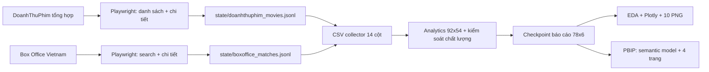
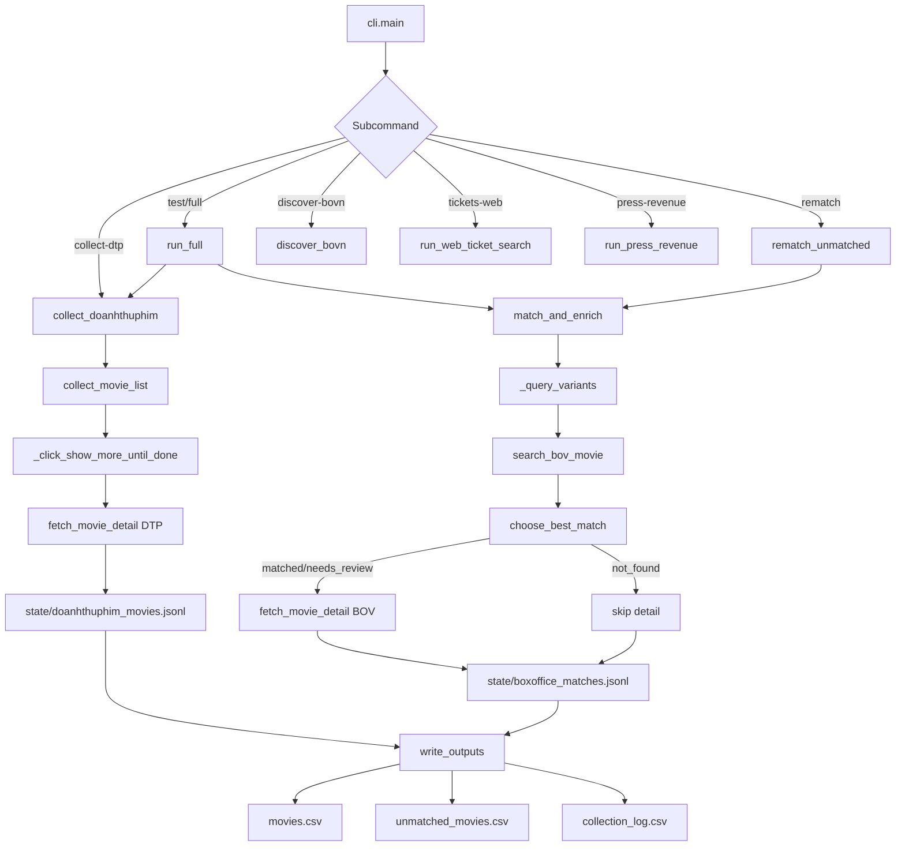
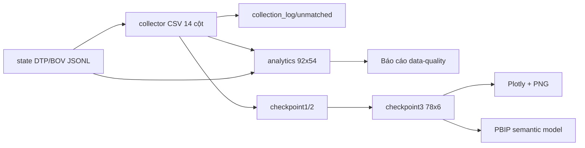
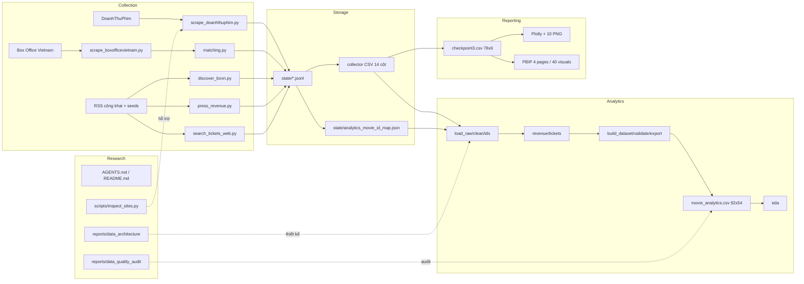
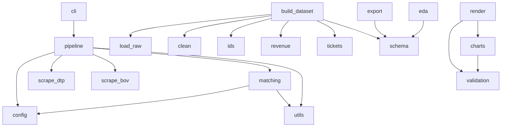

# Báo cáo Nghiên cứu và Kỹ thuật Dự án Movie Data Scraper

- **Ngày kiểm kê trạng thái:** 20/11/2026.
- **Mục đích tài liệu:** cung cấp nguồn sự thật có bằng chứng cho công cụ tạo bài thuyết trình về toàn bộ dự án.
- **Phạm vi:** chỉ đọc và phân tích repository; không chạy scraper, không gọi mạng tới website nguồn, không cài đặt gói, không chạy test ghi artifact, không mở Power BI Desktop, không tạo PBIX và không chỉnh sửa mã nguồn hay dữ liệu.
- **Cách đọc nhãn bằng chứng:**

| Nhãn | Ý nghĩa trong báo cáo này |
|---|---|
| `IMPLEMENTED` | Có mã nguồn tương ứng trong repository. |
| `VERIFIED` | Đã đối chiếu trực tiếp với tệp/dữ liệu trong repository trong lần kiểm kê này. |
| `STATICALLY VALIDATED` | Cấu trúc tệp, JSON/TMDL, đường dẫn hoặc tham chiếu được kiểm tra tĩnh; chưa chạy runtime. |
| `RUNTIME VALIDATION PENDING` | Cần chạy môi trường thật để xác nhận hành vi; không được xem là đã hoạt động. |
| `PLANNED` | Ý tưởng/cải tiến được đề xuất, chưa triển khai. |
| `NOT IMPLEMENTED` | Không tìm thấy triển khai trong repository. |
| `NOT VERIFIED` | Không có đủ bằng chứng để khẳng định. |

> **Nguyên tắc quan trọng:** báo cáo mô tả repository hiện tại, không phải kiến trúc lý tưởng. Khi mã nguồn, README và dữ liệu mâu thuẫn nhau, phần dưới đây nêu rõ mâu thuẫn và chọn nguồn có bằng chứng mạnh hơn cho từng mục đích.

### Quy ước đường dẫn tắt trong báo cáo

Để bảng và đoạn văn ngắn gọn, một số path được viết tắt. Bảng đối chiếu dưới đây là path đầy đủ; tất cả đã tồn tại khi kiểm kê (trừ các path được ghi rõ là **mục tiêu code nhưng hiện vắng mặt** ở Chương 6).

| Path tắt trong báo cáo | Path đầy đủ trong repository |
|---|---|
| `cli.py`, `config.py`, `pipeline.py`, `utils.py`, `matching.py`, `full_export.py`, `consolidate_checkpoint2.py`, `discover_bovn.py`, `press_revenue.py`, `search_tickets_web.py`, `scrape_doanhthuphim.py`, `scrape_boxofficevietnam.py` | `src/movie_data_collector/<tên file>` |
| `analytics/<file>.py` | `src/movie_data_collector/analytics/<file>.py` |
| `visualization/<file>.py` | `src/movie_data_collector/visualization/<file>.py` |
| `inspect_sites.py`, `search_tickets_web.py` (script) | `scripts/<tên file>` |
| `Movies.tmdl`, `Genre Tokens.tmdl`, `model.tmdl`, `definition/database.tmdl` | `reports/powerbi_checkpoint3/MovieAnalytics.SemanticModel/definition/tables/<tên>` hoặc `reports/powerbi_checkpoint3/MovieAnalytics.SemanticModel/definition/<tên>` |
| `MovieAnalytics.pbip`, `definition.pbir`, `pages.json`, `page.json`, `visual.json`, `report.json` | nằm dưới `reports/powerbi_checkpoint3/` và `reports/powerbi_checkpoint3/MovieAnalytics.Report/definition/` theo đúng cây thư mục đã nêu ở Chương 10 |
| `generate_report.py`, `index.html`, `style.css` | `reports/checkpoint3_plotly/<tên file>` (CSS nằm trong `assets/css/`) |
| `01_dataset_overview.png` … `10_avg_revenue_per_ticket.png` | `reports/checkpoint3_visualizations/<tên file>` |
| `data/movies.csv`, `data/collection_log.csv`, `data/tickets_sold_web.csv`, `data/unmatched_movies.csv`, `data/full_export.csv` | mục tiêu cấu hình trong `config.py:13-17`; bản sao hiện tại nằm ở `data/data_dirty/` |

---

## Chương 1 — Tóm tắt điều hành

### 1.1. Định danh và mục tiêu dự án

Dự án có tên **`movie-data-collector`** (`pyproject.toml:1-3`), là hệ thống thu thập dữ liệu phòng vé Việt Nam phục vụ phân tích và trực quan hóa. Mục tiêu gốc được ghi trực tiếp trong `AGENTS.md:1-12` và `README.md:3-6`: thu thập phim từ **DoanhThuPhim** (`https://doanhthuphim.vn/tong-hop`) và đối chiếu với **Box Office Vietnam** (`https://v1.boxofficevietnam.com/`), sau đó tạo CSV cho dự án trực quan hóa.

**Vấn đề kinh doanh/phân tích được ghi nhận:** dữ liệu phòng vé nằm rải rác trên nhiều trang web, có giá trị hiển thị ở các định dạng khác nhau, có phim chỉ tồn tại ở một nguồn, và một số chỉ số bị ẩn hoặc làm tròn. Việc gom thủ công vừa chậm vừa dễ nhầm giữa doanh thu tích lũy và doanh thu ngày/tuần. README nhấn mạnh chỉ dùng `Doanh số` tích lũy của Box Office Vietnam và để trống giá trị bị che/missing (`README.md:71-76`).

**Người dùng và use case có bằng chứng:** người học/nghiên cứu dữ liệu cần một tập CSV để phân tích doanh thu, số vé, thể loại, đạo diễn và năm phát hành; người xây dashboard cần một nguồn đã chuẩn hóa cho Power BI và Plotly; người kiểm tra dữ liệu cần các cờ `needs_review` để truy vết giá trị chưa chắc chắn. Đây là suy luận từ outputs thực tế (`README.md:8-19`, `reports/powerbi_checkpoint3/README.md:3-24`), không phải yêu cầu phỏng vấn stakeholder — repository không có bằng chứng phỏng vấn/khảo sát (`NOT VERIFIED`).

### 1.2. Đầu vào, đầu ra và chuỗi giá trị

| Tầng | Đầu vào chính | Xử lý | Đầu ra chính | Trạng thái |
|---|---|---|---|---|
| Nghiên cứu nguồn | Hai website mục tiêu | Dò cấu trúc HTML, pagination, search input | `scripts/inspect_sites.py` | `IMPLEMENTED` |
| Thu thập | Trang tổng hợp DoanhThuPhim | Playwright, bấm “xem thêm”, đọc chi tiết từng phim | `state/doanhthuphim_movies.jsonl` | `IMPLEMENTED`; state có 92 bản ghi |
| Đối chiếu | Box Office Vietnam search/detail | Tạo tối đa 6 biến thể truy vấn, fuzzy score, lấy chi tiết | `state/boxoffice_matches.jsonl` | `IMPLEMENTED`; state có 92 bản ghi |
| Export thô | State JSONL | Chuẩn 14 cột, tách unmatched và log | `data/movies.csv`, `data/unmatched_movies.csv`, `data/collection_log.csv` | `IMPLEMENTED` trong code; bản sao hiện nằm ở `data/data_dirty/` (`VERIFIED`) |
| analytics chất lượng cao | Collector CSV/JSONL | Làm sạch, ID ổn định, phân ly doanh thu/bằng chứng vé | `data/analytics/movie_analytics.csv` | `IMPLEMENTED`; 92 hàng, 54 cột |
| Tập báo cáo | Checkpoint sau biên tập | Lọc/gộp 2020–2026, bổ sung thể loại/ vé | `data/processed/checkpoint3.csv` | `VERIFIED`; 78 hàng, 6 cột |
| Trực quan | Tập báo cáo | Plotly/Matplotlib và Power BI PBIP | `reports/checkpoint3_plotly/`, `reports/checkpoint3_visualizations/`, `reports/powerbi_checkpoint3/` | `IMPLEMENTED`/`STATICALLY VALIDATED`; runtime Power BI chưa xác nhận |

### 1.3. Công nghệ chính

Python 3.13+, Playwright (trình duyệt Chromium headless), pandas, RapidFuzz, CSV/JSONL, chuẩn `utf-8-sig`, `unittest`, Matplotlib/Plotly trong generator độc lập, và Power BI PBIP/TMDL/PBIR với DAX cùng Power Query M (`pyproject.toml:8-16`, `scripts/inspect_sites.py:3`, `src/movie_data_collector/matching.py:7`, `reports/checkpoint3_plotly/generate_report.py:13-20`, `reports/powerbi_checkpoint3/MovieAnalytics.pbip:1-12`). Chi tiết hơn ở Chương 4.

### 1.4. Trạng thái hiện tại và thành tựu chính

- **Thu thập và đối chiếu đã được triển khai bằng mã thật**, có state lũy tiến; repository lưu 92 bản ghi DoanhThuPhim và 92 bản ghi đã đối chiếu (`state/doanhthuphim_movies.jsonl`, `state/boxoffice_matches.jsonl`). `VERIFIED`.
- **Tập analytics đầy đủ** `data/analytics/movie_analytics.csv` có 92 hàng, 54 cột và schema được khóa trong `src/movie_data_collector/analytics/schema.py:54-182`. `VERIFIED`.
- **Tập báo cáo được dùng thực tế** là `data/processed/checkpoint3.csv`: 78 hàng, 6 cột, SHA-256 `9de3cb115f4e8b8833508b98363f9163e261dd3f756b10d35007ee796ab5c51a`; được cả generator Plotly và semantic model Power BI đọc (`reports/checkpoint3_plotly/generate_report.py:25`, `reports/powerbi_checkpoint3/MovieAnalytics.SemanticModel/definition/tables/Movies.tmdl:179-186`). `VERIFIED`.
- **Bộ test lớn về mặt source**: 16 tệp `/tests/test_*.py`, 32 class test, 336 hàm `test_*` (đếm tĩnh bằng AST). Tuy nhiên repository không có artifact pytest/JUnit/log kết quả, nên không khẳng định “đã pass”. `VERIFIED` về số lượng, `NOT VERIFIED` về kết quả chạy.
- **Dashboard**: PBIP gồm 4 trang, 40 visual, 2 bảng, 16 measure; Genre Tokens là bảng rời 29 token. Đã kiểm tra tĩnh; chưa refresh Power BI Desktop, chưa export PBIX. `STATICALLY VALIDATED` / `RUNTIME VALIDATION PENDING`.
- **Hạn chế lớn nhất**: không có PBIX thật trong repository; đường dẫn CSV Windows trong TMDL là tuyệt đối và README đã lỗi thời; giá trị vé là hỗn hợp nguồn, không phải số vé đã xác minh; fuzzy matching tự động chấp nhận ở ngưỡng 92 dù yêu cầu gốc nói chỉ dùng fuzzy để gợi ý. Chi tiết Chương 13.

### 1.5. Tổng quan end-to-end



Hình trên chỉ gồm thành phần có bằng chứng trong repository. Các bước “lưu vào database”, “đăng API” hay “tự động lên lịch” không tồn tại và không được thêm vào.

---

## Chương 2 — Nghiên cứu vấn đề và động cơ dự án

### 2.1. Điều repository ghi nhận trực tiếp

`AGENTS.md:1-12` mô tả bài toán gốc: xây bộ thu thập tự động cho dữ liệu phòng vé Việt Nam từ hai nguồn, xuất CSV phục vụ trực quan hóa. `README.md:3-6` lặp lại hai nguồn và phạm vi trường dữ liệu: danh sách phim, trang chi tiết, doanh thu tích lũy, số vé và suất chiếu khi công khai. Các yêu cầu cụ thể tiếp theo nằm ở `AGENTS.md:16-39` và `README.md:62-81`:

- lấy toàn bộ bản ghi thay vì chỉ 15 bản ghi đầu;
- xử lý nút “Show more”/pagination;
- giữ tên gốc của cả hai website;
- phân biệt doanh thu tích lũy với doanh thu ngày/tuần;
- không bịa giá trị thiếu;
- gán `not_found` và `needs_review`;
- retry, delay hợp lý, resume theo progress;
- không vượt CAPTCHA/login/paid access.

`README.md:85-102` ghi rõ lý do mở rộng tìm kiếm trực tiếp trên Box Office Vietnam: danh sách DoanhThuPhim chỉ có 92 phim, nên các phim anime ngoài danh sách cần được phát hiện riêng; full title thường trả “No Movie Found”, nên seed dùng từ khóa ngắn.

### 2.2. Diễn giải phân tích hợp lý

Dựa trên cấu trúc dữ liệu và dashboard hiện có, tập dữ liệu có thể trả lời các câu hỏi sau. Đây là **diễn giải từ outputs**, không phải stakeholder requirement được ghi nhận:

1. Phim nào có doanh thu cao nhất trong tập 78 phim 2020–2026?
2. Số lượng phim phân bố theo năm và thể loại nào phổ biến?
3. Đạo diễn nào xuất hiện nhiều nhất trong tập đã lọc?
4. Mức chênh giữa doanh thu đã làm tròn từ DoanhThuPhim và `Doanh số` từ BOV lớn đến mức nào? (`analytics/revenue.py:172-180`, `reports/data_quality_audit/02_data_quality_report.md`).
5. Bằng chứng số vé từ RSS có đủ tin cậy để dùng không? (`analytics/tickets.py:336-357` luôn giữ `ticket_verified_admissions` trống).
6. Nhóm phim nào cần review trước khi đưa vào báo cáo? (`analytics/eda.py:953-1099`).

### 2.3. Khó khăn khi thu thập dữ liệu phim

| Khó khăn | Bằng chứng trong repository | Hệ quả thiết kế |
|---|---|---|
| Danh sách tải thêm động | `scrape_doanhthuphim.py:47-97` bấm nhiều nút có text “xem thêm/load more/tải thêm” | Dùng Playwright thay vì requests tĩnh |
| Search BOV trả kết quả nhiễu | `discover_bovn.py:76-95`; `README.md:101-102` | Lọc query_matches và loại anchor điều hướng |
| Tên phim có subtitle, tiếng Anh, số tiếp nối | `pipeline.py:46-92`, `matching.py:48-108` | Tạo biến thể truy vấn và chuẩn hóa title |
| Doanh thu bị làm tròn hoặc dạng “hơn …” | `analytics/revenue.py:127-180`, `schema.py:151-161` | Tách `rounded`, `lower_bound`, `valid`, `quarantined`, `candidate_held` |
| Số vé/suất chiếu bị che | `scrape_boxofficevietnam.py:13-22,166-172`; `README.md:73-74` | placeholder `0`, `888888` bị đưa về `None` |
| Hai nguồn có giá trị không đồng nhất | `data/data_dirty/movies.csv`; `analytics/revenue.py:242-270` | Không gộp mù; ghi gap, comparability class và cờ cảnh báo |
| Trang chi tiết có thể 502 | `discover_bovn.py:68-70,154-181`; `README.md:98-100` | Giữ bản ghi với revenue trống, không bịa số |

### 2.4. Vì sao tự động hóa

Không có nghiên cứu định lượng về chi phí thủ công trong repository, nên không đưa ra con số “tiết kiệm X giờ”. Điều có thể khẳng định: mã nguồn implement retry/delay (`utils.py:20-42`), resume (`utils.py:45-71`), xử lý 92 bản ghi (`state/*.jsonl`) và tách review (`matching.py:136-158`). Những cơ chế này phù hợp với việc lặp lại nhiều trang và nhiều truy vấn mà con người dễ bỏ sót. Mọi tuyên bố về hiệu năng/thời gian chạy đều `NOT VERIFIED`.

---

## Chương 3 — Nghiên cứu nguồn dữ liệu

### 3.1. Danh mục nguồn

| Nguồn | URL/cấu hình | Loại | Trường khai thác | Cách truy cập | Bằng chứng |
|---|---|---|---|---|---|
| DoanhThuPhim | `https://doanhthuphim.vn/tong-hop` (`config.py:10`) | Trang web động | tên phim, URL chi tiết, năm, thể loại, đạo diễn, doanh thu hiển thị | Playwright Chromium headless | `scrape_doanhthuphim.py:12-264`; `pipeline.py:146-170` |
| Box Office Vietnam | `https://v1.boxofficevietnam.com/` (`config.py:11`) | Website có search/detail | `Doanh số`, `Số vé`, `Suất chiếu`, release info, title | Playwright; search input và fallback query URL | `scrape_boxofficevietnam.py:25-186` |
| Bing/Google News RSS | sinh query trong code | RSS công khai | headline/snippet/URL làm bằng chứng số vé hoặc doanh thu báo chí | `urllib` + XML stdlib | `search_tickets_web.py:183-246`; `press_revenue.py:193-327` |
| Press seed | `seeds/bovn_press_seed.json` | Dữ liệu seed do con người kiểm chứng | revenue báo chí, display text, lower-bound flag, URL/article | đọc JSON, ưu tiên hơn RSS | `press_revenue.py:492-542`; `README.md:116-129` |
| Anime seed | `seeds/bovn_anime_seed.txt` | Danh sách query ngắn | Doraemon/Conan… | discover-bovn | `discover_bovn.py:58-65`; `README.md:83-102` |
| Wikipedia (bổ sung thủ công) | URL lưu trong `to_review_director` | Nguồn tham khảo ngoài collector | 10 director evidence pairs | hardcode trong consolidation | `consolidate_checkpoint2.py:37-78`; `README.md:140-141` |

### 3.2. DoanhThuPhim: cấu trúc và phân trang

`_discover_movie_links` (`scrape_doanhthuphim.py:12-44`) chạy JavaScript trong trang, chọn mọi anchor có href chứa `/phim/` (`line 21`), chuyển href thành URL tuyệt đối (`line 16`), tìm container nhỏ nhất có rank/revenue (`lines 26-35`) và trả `{href, title, text}`. Thuật toán “Show more” (`lines 47-97`) lặp tối đa 1000 lần, đếm số link, dừng sau 4 lần liên tiếp không tăng (`stagnant >= 4`); nếu không tìm thấy nút thì cuộn xuống cuối trang và chờ 1,2 giây; sau mỗi lần bấm chờ `networkidle` tối đa 8 giây rồi delay 0,2–0,6 giây.

`collect_movie_list` (`lines 120-152`) mở URL với retry, chờ 1,8 giây, gọi pagination, rồi khử trùng theo URL. Khi cùng một URL xuất hiện nhiều lần, mã chọn title guess ngắn hơn (`lines 144-151`). `_clean_title_guess` (`lines 100-117`) bỏ rank đầu dòng, cắt ở “Chi tiết”, “ĐD:”, “tỷ đồng”… và bỏ năm đầu title.

Trang chi tiết `fetch_movie_detail` (`lines 155-264`) mở từng URL với retry, chờ `networkidle`, đọc text bằng `page.evaluate`, dùng regex để lấy title, original title, năm, genre, director và doanh thu. `pipeline.py:214-245` (theo forensic read trong subagent) cắt các đoạn “Doanh thu các phim khác”/“Phim đang chiếu” trước khi regex để tránh lấy nhầm tổng bảng xếp hạng. `VERIFIED` về sự tồn tại của parser; không có chạy live trong báo cáo này.

### 3.3. Box Office Vietnam: search và detail

`search_movie` (`scrape_boxofficevietnam.py:25-97`) mở homepage với retry, điền vào selector cụ thể:

```python
input[name="s"][placeholder="Enter Movies or Series Title"]
```

(`lines 38-42`). Nếu không có input, fallback lần lượt tới `/?post_type=movie&s=...` và `/?s=...` (`lines 47-56`). JavaScript ở `lines 64-87` lấy tối đa 30 anchor có `/movie/`, bỏ anchor điều hướng như “Trang chủ/Blog/Fanpage…” và trả kèm `context`. Python khử trùng theo href, giữ title dài hơn (`lines 89-97`).

`fetch_movie_detail` (`lines 100-186`) lấy `body.innerText`, ưu tiên regex `Doanh số`, sau đó `Tổng doanh thu|Doanh thu tích lũy` (`lines 145-155`). Số vé và suất chiếu chỉ lấy từ nhãn `Số vé`/`Suất chiếu` (`lines 157-164`); các placeholder như `-`, `n/a`, `đang cập nhật`, `0`, `888888` bị loại (`lines 13-22,166-172`). Release info đến từ `Release date|Khởi chiếu` (`lines 174-177`). Một đoạn `getAfterLabel/findLineValue` được tính trong `page.evaluate` (`lines 115-140`) nhưng Python không dùng; đây là dead code, không phải nguồn giá trị (`NOT IMPLEMENTED` hiệu lực thực tế).

### 3.4. Đối chiếu và alternate titles

`pipeline.py:46-92` tạo tối đa 6 query: tên chính, original title, dạng chữ của số 0–9, phần trước dấu `:`, phần trước/sau separator, và tên bỏ ngoặc. `_search_candidates` (`lines 95-108`) thử lần lượt, gom ứng viên theo href và dừng sớm khi có ứng viên score ≥90. `matching.py:57-108` kết hợp `fuzz.ratio`, `token_sort_ratio`, `token_set_ratio` có phạt chênh độ dài, cộng 4 điểm nếu năm khớp, trừ 6 nếu năm khác, trừ 35 nếu số tiếp nối khác nhau. Quyết định ở `matching.py:136-158`: auto `matched` khi score ≥92 và margin ≥3 (hoặc exact title + year), `needs_review` khi score ≥80, ngược lại `not_found`.

**Lưu ý chính xác yêu cầu:** `AGENTS.md:33-39` nói fuzzy chỉ nên “gợi ý possible matches”, nhưng implementation tự động chấp nhận ngưỡng 92 (`AUTO_MATCH_THRESHOLD`, `config.py:38`). Báo cáo này ghi là `IMPLEMENTED` nhưng **không** tuyên bố tuân thủ hoàn toàn yêu cầu gốc; xem thêm Chương 13.

### 3.5. Nguồn bổ sung và giới hạn

- `discover_bovn.py:98-183` lưu kết quả discovery vào `state/bovn_discovered.jsonl` và `data/bovn_discovered.csv`; detail 502 vẫn giữ dòng nhưng revenue trống.
- `press_revenue.py:562-611` chỉ xử lý các dòng có `revenue_bovn` trống, ưu tiên seed; mọi dòng press đều `to_review_revenue=needs_review` (`press_revenue.py:383,477,541`).
- `search_tickets_web.py:493-565` chỉ lấy bằng chứng số vé từ snippet; `README.md:77-81` khẳng định không bao giờ quy đổi revenue thành tickets.
- Repository **không có bằng chứng** rằng tác giả đã đọc terms of service của từng site hay có permission đặc biệt; `NOT VERIFIED`. Thiết kế chỉ dùng public page/RSS và không bypass restriction (`README.md:75-76`).

---

## Chương 4 — Stack công nghệ và lựa chọn kỹ thuật

### 4.1. Khai báo dependency

`pyproject.toml:8-16` khai báo Python `>=3.13` và ba dependency trực tiếp:

| Thư viện | Phiên bản khai báo/khóa | Vai trò thực tế | File sử dụng | Trạng thái |
|---|---|---|---|---|
| `pandas` | `>=3.1.1`; khóa `3.1.1` (`uv.lock:150-151`) | Viết CSV collector/export, DataFrame trong consolidation | `pipeline.py:8,306-310`, `full_export.py:7`, `discover_bovn.py:7`, `consolidate_checkpoint2.py:7` | `IMPLEMENTED` |
| `playwright` | `>=1.65.2`; khóa `1.65.2` (`uv.lock:203-204`) | Chromium headless để render JS, bấm “xem thêm”, search | `pipeline.py:9,146-149,187-189`; `scripts/inspect_sites.py:3`; hai scraper | `IMPLEMENTED` |
| `rapidfuzz` | `>=3.14.6`; khóa `3.14.6` (`uv.lock:234-235`) | Tính similarity tên phim | `matching.py:7,79-90` | `IMPLEMENTED` |

Console script `movie-data-collector` trỏ tới `movie_data_collector:main` (`pyproject.toml:15-16`; re-export `src/movie_data_collector/__init__.py:5`). Build backend là `uv_build` (`pyproject.toml:18-20`). `uv.lock` cũng khóa các transitive package như numpy, greenlet, python-dateutil, tzdata; chúng không phải lựa chọn thiết kế ở tầng ứng dụng.

### 4.2. Thư viện chuẩn và công cụ khác

| Công nghệ | Mục đích | Bằng chứng | Đánh giá |
|---|---|---|---|
| `asyncio`, `urllib`, XML parser | RSS Bing/Google, retry/delay, không cần requests/bs4 | `search_tickets_web.py:8-11,183-234`; `utils.py:24-42` | `IMPLEMENTED`; giảm dependency |
| `csv`, `json`, `hashlib`, `pathlib`, `decimal`, `re`, `ast` trong kiểm kê | Đọc/ghi CSV/JSONL, kiểm toán tĩnh, parse số chính xác | `analytics/*.py`; scripts read-only trong lần kiểm kê | `IMPLEMENTED` |
| `unittest` | Tổ chức test | `tests/test_analytics_schema.py:10`, `tests/test_analytics_eda.py:11` | `IMPLEMENTED`; không có pytest dependency |
| JSONL | Progress/resume từng bản ghi | `utils.py:45-71`; `config.py:26-30` | `IMPLEMENTED` |
| CSV `utf-8-sig` | Output tương thích Excel | `pipeline.py:307-310`; `export.py:123-150` | `IMPLEMENTED` |
| Matplotlib | 9 biểu đồ PNG | `visualization/charts.py:544-982`; `reports/checkpoint3_visualizations/*.png` | `IMPLEMENTED` nhưng **không khai báo** trong `pyproject.toml` |
| Plotly | Báo cáo HTML tương tác độc lập | `reports/checkpoint3_plotly/generate_report.py:13-20` | `IMPLEMENTED` nhưng **không khai báo** trong dependency |
| Power BI PBIP/TMDL/PBIR, DAX, Power Query M | Dashboard và semantic model | `reports/powerbi_checkpoint3/` | `IMPLEMENTED` dạng source-only; `STATICALLY VALIDATED` |
| `uv` | Sync/khóa môi trường | `README.md:21-26`, `uv.lock` | `IMPLEMENTED` |
| Logging module | Ghi log runtime có cấu trúc | không có import/filename log | `NOT IMPLEMENTED`; chỉ dùng `print()` (`pipeline.py:157,202`, `utils.py:39`) |

### 4.3. Vì sao lựa chọn phù hợp

Playwright là lựa chọn hợp lý vì hai site đều có nội dung render/bấm nút động; requests tĩnh không bấm được “xem thêm” (`scrape_doanhthuphim.py:47-97`). RapidFuzz phù hợp với tên tiếng Việt có dấu/subtitle vì code đã chuẩn hóa dấu trước khi so sánh (`utils.py:74-105`). pandas phù hợp với export bảng 14 cột và merge discovery, nhưng tầng analytics chính lại dùng stdlib để kiểm soát schema chặt chẽ (`analytics/schema.py:1-6`). JSONL là lựa chọn đơn giản cho resume: mỗi bản ghi là một dòng, append an toàn hơn ghi đè toàn bộ file (`utils.py:45-71`). Power Query M cho phép validate ngay tại nguồn CSV (6 cột, 78 hàng, không ô trống) trước khi DAX chạy (`Movies.tmdl:180-225`).

### 4.4. Điều không được suy luận từ dependency file

Không vì `uv.lock` có numpy/greenlet mà kết luận dự án dùng numpy trực tiếp cho EDA; EDA được viết bằng stdlib table objects (`analytics/eda.py:193-221`). Không có `requests`, `beautifulsoup4`, `lxml`, `feedparser` trong dependency, và không tìm thấy import tương ứng trong source collector. Không có `pytest` trong dependency; dù file test được đặt tên `test_*.py`, framework thực tế là `unittest`. Cuối cùng, `matplotlib`/`plotly` được dùng bởi generator nhưng thiếu khai báo — điểm yếu về khả năng tái tạo môi trường (`PLANNED` bổ sung dependency).
---

## Chương 5 — Kiến trúc và triển khai scraper

### 5.1. Bảng trách nhiệm thành phần

| Thành phần | File | Trách nhiệm chính | Bằng chứng |
|---|---|---|---|
| CLI | `src/movie_data_collector/cli.py:29-238` | Định nghĩa subcommand `test`, `full`, `collect-dtp`, `rematch`, `discover-bovn`, `export-full`, `consolidate-checkpoint2`, `press-revenue`, `tickets-web` | `cli.py:30-96`, dispatch `100-234` |
| Cấu hình | `config.py:5-39` | Đường dẫn root/data/state, URL nguồn, output, delay, retry, ngưỡng match | `config.py:10-39` |
| Pipeline chính | `pipeline.py:28-317` | 14 cột output, query variants, DTP collect, BOV match/enrich, rematch, CSV export, `run_full` | `pipeline.py:46-317` |
| DTP scraper | `scrape_doanhthuphim.py:12-264` | Discover link, show-more, detail parse, progress URL | `scrape_doanhthuphim.py:12-264` |
| BOV scraper | `scrape_boxofficevietnam.py:13-186` | Search, detail parse, placeholder filter | `scrape_boxofficevietnam.py:13-186` |
| Matching | `matching.py:13-158` | Normalize/score/select `matched`/`needs_review`/`not_found` | `matching.py:57-158` |
| Tiện ích | `utils.py:16-186` | Retry, delay, JSONL, normalize title, money parsing, split titles | `utils.py:20-42,45-105,127-186` |
| Discovery BOV | `discover_bovn.py:35-192` | Query seed, date parse, 502 guard, discovered CSV | `discover_bovn.py:35-192` |
| Press revenue | `press_revenue.py:48-654` | RSS/seed fallback, press columns, review flags | `press_revenue.py:193-611` |
| Ticket web | `search_tickets_web.py:41-667` | RSS candidate extraction, confidence, web tickets CSV | `search_tickets_web.py:183-625` |
| Full export | `full_export.py:12-158` | Merge BOV/DTP/web tickets, `to_review_*` | `full_export.py:74-147` |
| Consolidation | `consolidate_checkpoint2.py:20-197` | Checkpoint2 + discovery + limited director/revenue backfill | `consolidate_checkpoint2.py:37-178` |
| Site inspector | `scripts/inspect_sites.py:5-54` | In cấu trúc trang hai nguồn (research artifact) | `scripts/inspect_sites.py:5-51` |

### 5.2. Workflow từ lệnh đến output

#### 5.2.1. Lệnh `full`

`cli.py:124-125` gọi `run_full(resume=...)`; `pipeline.py:313-317` thực hiện ba bước: `collect_doanhthuphim()` → `match_and_enrich()` → `write_outputs()`.

1. **Khởi tạo Chromium**: `async_playwright()` và `p.chromium.launch(headless=True)` tại `pipeline.py:146-149`. Timeout điều hướng mặc định 60.000 ms (`config.py:36`).
2. **Lấy danh sách**: `collect_movie_list(page)` (`scrape_doanhthuphim.py:120-152`) mở trang tổng hợp, bấm show-more, khử trùng URL `/phim/`.
3. **Lấy chi tiết từng phim**: vòng lặp `pipeline.py:153-169`; URL đã có trong state thì bỏ qua khi `resume=True`; gọi `fetch_dtp_detail`; exception được ghi thành `dtp_detail_error:<Class>` thay vì làm chết cả job; append JSONL rồi `polite_delay()`.
4. **Tạo record nền**: `_dtp_to_base_record` (`pipeline.py:116-139`) giữ `movie_name`, `original_title`, `release_year`, `genre`, `director`, `revenue_doanhthuphim`, URL nguồn; đặt `revenue_bovn/tickets_sold/screening_count = None`, `match_status = pending`, `collection_status = dtp_collected`.
5. **Tìm ứng viên BOV**: `load_bov_progress` (`pipeline.py:174-180`) khóa state theo DTP URL hoặc tên; `_query_variants` (`46-92`) và `_search_candidates` (`95-108`) thử tối đa 6 truy vấn, dừng khi score ≥90.
6. **Quyết định match**: `choose_best_match` (`matching.py:136-158`) trả status/score/reason như Chương 3.
7. **Enrich chi tiết BOV**: nếu `matched`/`needs_review`, `pipeline.py:213-235` lưu URL, revenue/tickets/screening/title/release info. Exception detail được ghi thành `bov_detail_error`. Dòng không khớp được gán `not_found`, URL BOV `None` (`236-240`).
8. **Ghi state và CSV**: append BOV JSONL (`241`), delay (`244`); `write_outputs` (`287-310`) tạo DataFrame đúng 14 cột, ghi `data/movies.csv`, lọc `not_found`/`needs_review` hoặc thiếu URL BOV thành `data/unmatched_movies.csv`, và ghi 8 cột log thành `data/collection_log.csv`, tất cả `utf-8-sig`.

#### 5.2.2. Các subcommand khác

- `test --limit 5`: `cli.py:100-123` chạy DTP+BOV với limit. **Lưu ý đã kiểm chứng**: do `collect_doanhthuphim` khởi tạo `out = read_jsonl(DTP_PROGRESS)` (`pipeline.py:145`) và `match_and_enrich` dừng sau `limit` bản ghi đã xử lý (`194-199`), lệnh có thể ghi lại toàn bộ state vào CSV nhưng chỉ enrich đúng 5 bản ghi mới; các bản ghi còn lại giữ `pending` trong output. Đây là hành vi hiện tại, không phải lỗi giả định.
- `rematch`: `pipeline.py:253-274` chỉ lấy `not_found`/`needs_review`, chạy lại `resume=False`, sau đó ghi đè BOV progress và toàn bộ CSV theo thứ tự DTP.
- `discover-bovn`: `cli.py:133-170` tự tạo browser rồi gọi `discover_bovn`; output là `state/bovn_discovered.jsonl` và `data/bovn_discovered.csv`, **không đụng** `data/movies.csv` (`README.md:95-97`).
- `press-revenue`: `cli.py:182-208` → `press_revenue.py:562-611`; input `data/bovn_discovered.csv`, output `data/bovn_discovered_press.csv` + `state/bovn_press.jsonl`.
- `tickets-web`: `cli.py:209-234` → `search_tickets_web.py:585-625`; input `data/movies.csv`, output `data/tickets_sold_web.csv` + `state/web_tickets_progress.jsonl`.
- `export-full`: `cli.py:171-173` → `full_export.py:74-147`; join trên URL/tên, ưu tiên revenue BOV rồi DTP, dùng web ticket chỉ khi BOV thiếu và status `found`, kèm `to_review_*`.
- `consolidate-checkpoint2`: `cli.py:174-181` → `consolidate_checkpoint2.py:108-178`; giữ checkpoint2, thêm discovery và chỉ điền director/revenue bị thiếu.

### 5.3. Mermaid workflow scraper



### 5.4. Quyết định triển khai quan trọng

1. **Playwright thay vì HTTP tĩnh**: cần thực thi JS và bấm nút (`scrape_doanhthuphim.py:60-84`). Delay ngẫu nhiên 0,8–1,8 giây giữa request (`config.py:32-33`; `utils.py:20-21`) và retry 3 lần backoff 1,5 (`config.py:34-35`; `utils.py:24-42`) thể hiện crawling lịch sự.
2. **Resume bằng JSONL**: mỗi record là một dòng; `append_jsonl` (`utils.py:52-55`) tránh ghi lại toàn bộ file. Tuy nhiên flag `--no-resume` của DTP/BOV không cắt JSONL (`pipeline.py:145,185`), nên re-run có thể tạo dòng trùng; press/tickets thì có cắt rõ ràng (`press_revenue.py:587-588`; `search_tickets_web.py:606-607`). Đây là điểm cần sửa trong tương lai (`IMPLEMENTED` không đồng nhất).
3. **Không bịa dữ liệu**: placeholder bị loại (`scrape_boxofficevietnam.py:13-22`), detail 502 giữ revenue trống (`discover_bovn.py:68-70`), press figures luôn có review flag. `IMPLEMENTED`.
4. **Tách review khỏi auto-accept**: `needs_review` và `not_found` được xuất riêng (`pipeline.py:308`), nhưng fuzzy score cao vẫn tự chấp nhận như đã nêu. `IMPLEMENTED` với cảnh báo.
5. **Biểu diễn nội bộ là dict**: record collector là `dict[str, Any]`; không có dataclass/DTO cho pipeline chính. Dataclass chỉ xuất hiện ở tầng analytics (`CleanedMovie`, `TicketCandidate`, `MatchResult`). `IMPLEMENTED`.

### 5.5. Tính năng không có hoặc chưa chứng minh

| Tính năng | Trạng thái | Bằng chứng |
|---|---|---|
| `logging` module/file log | `NOT IMPLEMENTED` | chỉ `print()` ở `pipeline.py:157,202,264`, `cli.py:105-233` |
| Scheduler/orchestration (Airflow/cron) | `NOT IMPLEMENTED` | không có file cấu hình tương ứng |
| API server/database | `NOT IMPLEMENTED` | output là CSV/JSONL |
| Playwright test cho scraper | `NOT IMPLEMENTED` | `tests/` chỉ có discovery/press/analytics tests |
| Bypass CAPTCHA/login/paid | `NOT IMPLEMENTED` theo yêu cầu | `README.md:75-76`; không có code bypass |
| chạy thành công trên live site trong lần kiểm kê | `NOT VERIFIED` | không gọi mạng theo scope báo cáo |

---

## Chương 6 — Trường dữ liệu và thiết kế dataset

### 6.1. Các tầng dữ liệu không được nhầm lẫn

| Tầng | Đường dẫn | Hình dạng | Vai trò | Trạng thái |
|---|---|---|---|---|
| Collector state thô | `state/doanhthuphim_movies.jsonl` | 92 dòng JSON | danh sách + chi tiết DTP, có `_dtp_raw` | `VERIFIED` |
| Collector state đối chiếu | `state/boxoffice_matches.jsonl` | 92 dòng JSON | thêm ứng viên BOV, raw detail, score, reason | `VERIFIED` |
| Collector output | `data/data_dirty/movies.csv` | 92 hàng × 14 cột | bản sao output gốc sau reorganize | `VERIFIED` |
| Unmatched/log | `data/data_dirty/unmatched_movies.csv`, `collection_log.csv` | 11 và 92 hàng | review và trace URL | `VERIFIED` |
| Analytics full-fidelity | `data/analytics/movie_analytics.csv` | 92 × 54 | QA, revenue/ticket segregation, stable IDs | `VERIFIED` |
| Analytics snapshot cũ | `data/analytics/movie_analytics_2020_2026.csv` | 69 × 6 | input notebook; byte-identical với `checkpoint2_tickets_sold.csv` | `VERIFIED` |
| Checkpoint báo cáo | `data/processed/checkpoint3.csv` | 78 × 6 | nguồn Plotly + Power BI hiện tại | `VERIFIED` |
| Press/discovery | `data/bovn_discovered.csv`, `data/bovn_discovered_press.csv` | 10 × 13, 7 × 23 | mở rộng nguồn BOV và fallback báo chí | `VERIFIED` |

### 6.2. Schema 6 cột của tập báo cáo `checkpoint3.csv`

`VERIFIED` từ đọc trực tiếp tệp; SHA-256 `9de3cb115f4e8b8833508b98363f9163e261dd3f756b10d35007ee796ab5c51a`, 8.904 bytes, UTF-8 BOM, CRLF.

| Cột | Kiểu | Ý nghĩa | Ví dụ thực tế | Nguồn/phân loại |
|---|---|---|---|---|
| `movie_name` | chuỗi | Tên phim hiển thị trong báo cáo | `Mưa Đỏ` |nguyên bản DTP/đã biên tập; giữ tên |
| `release_year` | số nguyên dạng chuỗi CSV | Năm phát hành trong khoảng 2020–2026 | `2025` | trích từ DTP/BOV; có bổ sung thủ công |
| `genre` | chuỗi, nhiều token cách `,` | Thể loại; Power BI tách riêng | `Lịch sử, Chiến tranh, Chính kịch` | extraction + backfill có ghi nguồn |
| `director` | chuỗi | Đạo diễn | `Đặng Thái Huyền` | DTP/BOV + 10 giá trị có evidence thủ công |
| `revenue` | chuỗi hiển thị | Doanh thu: 70 dạng `...₫`, 8 dạng `... tỷ đồng` | `714,030,584,098₫` | tự động/trích xuất; dạng tỷ là làm tròn |
| `tickets_sold` | số nguyên | Giá trị vé dùng cho dashboard, được gắn nhãn estimated | `8100000` | hỗn hợp gốc/estimate/nhập tay; **không phải vé đã xác minh** |

### 6.3. Schema 14 cột của collector output

Định nghĩa tại `pipeline.py:28-43`, ghi tại `287-310`:

| Cột | Ý nghĩa | Nguồn | Phân loại |
|---|---|---|---|
| `movie_name` | Tên gốc DoanhThuPhim | DTP detail/list | raw/clean_text |
| `title_bovn` | Tên sau khi bỏ prefix “Doanh số…” và suffix BOV | BOV candidate/detail (`pipeline.py:277-284`) | normalized |
| `original_title` | Tên gốc/phụ đề, ưu tiên DTP| DTP/Bov fallback (`pipeline.py:116-139,227-230`) | preserved/normalized |
| `release_year` | Năm phát hành dạng text | DTP detail/list | extracted |
| `genre` | Chuỗi thể loại | DTP detail | extracted |
| `director` | Đạo diễn | DTP detail | extracted |
| `revenue_doanhthuphim` | Doanh thu hiển thị từ DTP | DTP detail | raw text |
| `revenue_bovn` | `Doanh số`/cumulative BOV | BOV detail | raw text, đã lọc placeholder |
| `tickets_sold` | Số vé BOV nếu có | BOV detail | raw text hoặc `None` |
| `screening_count` | Suất chiếu nếu có | BOV detail | raw text hoặc `None` |
| `source_url_doanhthuphim` | URL chi tiết DTP | discovery | raw URL |
| `source_url_bovn` | URL chi tiết BOV | search candidate | raw URL hoặc `None` |
| `match_status` | `pending/matched/needs_review/not_found` | `matching.py:136-158` | derived |
| `collection_status` | trạng thái crawl/lỗi từng bước | pipeline | derived |

State JSONL còn chứa `_dtp_raw`, `_dtp_detail_raw`, `_bov_candidate`, `_bov_detail_raw`, `bov_release_info`, `match_score`, `match_reason`; các trường này **không nằm trong 14 cột CSV** (`pipeline.py:293-294`). Đây là lý do `bov_release_info` có trong state nhưng không có trong `movies.csv`.

### 6.4. Schema 54 cột analytics

Schema được định nghĩa một lần tại `src/movie_data_collector/analytics/schema.py:54-133` gồm 5 nhóm; khóa chính `movie_id`, pattern `^M\d{4}$` (`schema.py:137-142`). Bảng dưới liệt kê từng cột theo đúng thứ tự.

| # | Cột | Nhóm | Ý nghĩa ngắn | Phân loại |
|---:|---|---|---|---|
| 1 | `movie_id` | A | ID ổn định `M0001…` | derived |
| 2 | `canonical_title` | A | Tên chuẩn để join/group | normalized |
| 3 | `original_title_raw` | A | Tên gốc giữ nguyên | raw |
| 4 | `release_year` | A | Năm phát hành | extracted/cleaned |
| 5 | `genre_raw` | A | Chuỗi thể loại gốc | raw |
| 6 | `genre_token_path` | A | Đường token thể loại | derived |
| 7 | `genre_grouped` | A | Nhóm thể loại chuẩn | derived |
| 8 | `director_raw` | A | Đạo diễn gốc | raw |
| 9 | `director_norm_key` | A | Khóa chuẩn đạo diễn, không fuzzy merge | normalized |
| 10 | `source_url_dtp` | A | URL DTP, làm anchor ID | raw |
| 11 | `raw_source_row_dtp` | A | Số dòng nguồn DTP | raw provenance |
| 12 | `bov_match_status` | B | matched/needs_review/not_found | derived |
| 13 | `match_score` | B | Điểm fuzzy | derived |
| 14 | `match_reason` | B | auto/below_threshold/ambiguous/no_candidates | derived |
| 15 | `bov_url` | B | URL BOV | raw |
| 16 | `bov_title_raw` | B | Tên BOV gốc | raw |
| 17 | `mapping_validation_status` | B | Trạng thái validate mapping | derived |
| 18 | `mapping_validation_reason` | B | Lý do validate | derived |
| 19 | `mapping_human_reviewed` | B | Có phải quyết định con người không | review metadata |
| 20 | `mapping_reviewed_at` | B | Thời gian review | review metadata |
| 21 | `mapping_reviewer` | B | Người review | review metadata |
| 22 | `review_status` | B | auto_accepted/pending/not_applicable | derived |
| 23 | `review_priority` | B | normal/high | derived |
| 24 | `dtp_revenue_raw` | C | Doanh thu DTP dạng hiển thị | raw |
| 25 | `dtp_revenue_vnd` | C | Giá trị VND đã parse | parsed |
| 26 | `dtp_revenue_quality` | C | rounded/lower_bound | classified |
| 27 | `bov_revenue_raw` | C | Doanh thu BOV chấp nhận | raw |
| 28 | `bov_revenue_vnd` | C | BOV VND đã parse | parsed |
| 29 | `bov_revenue_quality` | C | exact hoặc trống | classified |
| 30 | `bov_quarantined_revenue_raw` | C | BOV bị cô lập dạng text | quarantined |
| 31 | `bov_quarantined_revenue_vnd` | C | BOV bị cô lập dạng số | quarantined |
| 32 | `bov_candidate_revenue_raw` | C | Ứng viên chưa chấp nhận | candidate |
| 33 | `bov_candidate_revenue_vnd` | C | Ứng viên dạng số | candidate |
| 34 | `revenue_gap_pct` | C | Chênh lệch tương đối | derived |
| 35 | `magnitude_gap_warning` | C | Cảnh báo chênh lớn | derived |
| 36 | `revenue_conflict_flag` | C | Cờ xung đột | derived |
| 37 | `revenue_comparability_class` | C | insufficient_evidence/not_applicable | classified |
| 38 | `comparability_reason` | C | Lý do so sánh | derived |
| 39 | `revenue_scope_verified` | C | Phạm vi doanh thu đã xác minh | derived; luôn 0 |
| 40 | `bov_evidence_available` | C | Có bằng chứng BOV không | derived |
| 41 | `include_revenue_comparison` | C | Được đưa vào so sánh không | derived |
| 42 | `include_revenue_eda` | C | Được đưa vào EDA không | derived |
| 43 | `revenue_eda_basis` | C | Cơ sở EDA doanh thu | classified |
| 44 | `ticket_candidate_count` | D | Số ứng viên vé | derived |
| 45 | `ticket_found_count` | D | Số ứng viên found | derived |
| 46 | `ticket_needs_review_count` | D | Số ứng viên needs_review | derived |
| 47 | `ticket_verified_admissions` | D | Số vé đã xác minh | luôn trống |
| 48 | `ticket_data_status` | D | no_candidates/unverified_candidates | classified |
| 49 | `ticket_context_status` | D | cinema_candidate/event_attendance quarantined | classified |
| 50 | `ticket_evidence_urls` | D | URL bằng chứng | raw/provenance |
| 51 | `has_missing_core_data` | E | Thiếu field lõi | derived |
| 52 | `has_revenue_gap_warning` | E | Có cảnh báo gap | derived |
| 53 | `has_pending_review` | E | Có review chờ | derived |
| 54 | `data_quality_status` | E | ok/warning/no_match/pending/missing | derived |

Cột 47 (`ticket_verified_admissions`) trống ở cả 92 hàng; cột 39 (`revenue_scope_verified`) bằng 0 ở cả 92 hàng; cột 19 (`mapping_human_reviewed`) cũng bằng 0 ở cả 92 hàng (`VERIFIED` từ CSV). Đây là ba điểm “không được đọc là đã xác minh”.

### 6.5. Mối quan hệ giữa các tầng



`checkpoint3.csv` **không phải** cùng một tầng với `movie_analytics.csv`: 78 vs 92 hàng, 6 vs 54 cột, mục đích báo cáo vs QA. `src/main.ipynb` vẫn trỏ tới snapshot 69 hàng `data/analytics/movie_analytics_2020_2026.csv` (`src/main.ipynb:20`), cho thấy notebook là artifact cũ hơn so với checkpoint hiện tại.

---

## Chương 7 — Làm sạch và biến đổi dữ liệu

### 7.1. Pipeline analytics thực tế

`build_analytics_dataset` (`analytics/build_dataset.py:538-584`) gọi theo thứ tự: `load_raw_inputs` → `clean_raw_inputs` → stable ID mapping → `process_revenue` → `process_tickets` → build base rows → apply revenue/ticket fields → data-quality fields → `validate_dataset`. Orchestrator này là `IMPLEMENTED`, nhưng không được chạy lại trong lần kiểm kê documentation-only.

| Bước | File/hàm | Hành vi chính | Phân loại |
|---|---|---|---|
| Load raw | `analytics/load_raw.py:250-424,426-564` | Kiểm tra path tồn tại, header, số bản ghi, identifier, JSONL shape; giữ string gốc | automatic |
| Clean | `analytics/clean.py:192-226,343-471` | group key, split genre, parse year, normalize URL ticket, giữ title gốc | automatic |
| Stable ID | `analytics/ids.py:594-840,1164-1376` | validate mapping, gán `M####`, không fuzzy auto-accept | automatic + review metadata |
| Revenue parse | `analytics/revenue.py:80-180` | parse `₫`, `tỷ/ty`, `triệu`, `nghìn`, lower-bound, gap % | automatic |
| Revenue isolate | `analytics/revenue.py:285-478` | accepted/quarantined/candidate; chỉ chấp nhận BOV khi review+URL+status+parse hợp lệ | automatic + policy |
| Ticket link | `analytics/tickets.py:175-357` | join exact DTP URL, dedupe, summary; row 49 event attendance bị quarantine | automatic + policy |
| Quality fields | `analytics/build_dataset.py:275-313` | missing/gap/pending flags | derived |
| Validate | `analytics/build_dataset.py:335-535` | 92×54, ID pattern/duplicates, counts, segregation, safety state | automatic gate |
| Export | `analytics/export.py:80-313` | validate → temp CSV → read-back → atomic replace | automatic gate |

### 7.2. Chuẩn hóa và parse giá trị

**Tên phim.** `utils.py:74-105` bỏ dấu (kể cả `đ`), thường hóa punctuation, rồi `matching.py:57-108` so sánh nhiều biến thể. Tên gốc vẫn được lưu riêng (`movie_name`, `original_title`, `bov_title_raw`, `canonical_title`, `original_title_raw`) — không ghi đè tên gốc bằng normalized title.

**Năm phát hành.** `clean.py:219-227` parse năm mà không suy diễn khi thiếu; `discover_bovn.py:35-55` xử lý DMY/YMD/year-only. Checkpoint 2020–2026 có phân bố `2020:3, 2021:5, 2022:7, 2023:9, 2024:15, 2025:17, 2026:22` (`VERIFIED` từ CSV). Bản 79 hàng trung gian từng chứa phim 2019 và bị loại ở checkpoint3 (`README.md:142-144`; `data/reports/backfill_missing_summary.md`).

**Thể loại.** `clean.py:205-217` tách token deterministic. Power Query `Genre Tokens.tmdl:26-32` tách của `checkpoint3.csv` thành 29 token riêng, trim, bỏ blank, distinct, sort. Ten token phổ biến: Hài 30, Hành động 19, Tâm lý 17, Gia đình 17, Kinh dị 15 (`VERIFIED`). `data/reports/checkpoint3_genre_sources.md:3-21` ghi 10 lần backfill có nguồn; đây là bổ sung có trace, không phải suy đoán.

**Doanh thu.** `revenue.py:127-180` parse đơn vị `tỷ/ty`, `triệu/trieu/mn`, `nghìn/nghin/k` bằng `Decimal`; lower-bound DTP giữ ngữ cảnh “hơn”. Trong checkpoint3 có 70 chuỗi `...₫` và 8 chuỗi `... tỷ đồng`; tổng sau khi quy đổi ≈ `12.130.448.158.377₫`, nhưng **phần 8 tỷ đã làm tròn nên tổng chỉ là ước lượng tính từ giá trị hiển thị**. Power Query dùng cùng logic: `Movies.tmdl:189-210` thay `,` bằng `.` cho nhánh `tỷ`, parse `en-US`, nhân `1.000.000.000`.

**Vé.** BOV scraper lấy `Số vé` nếu công khai và loại placeholder (`scrape_boxofficevietnam.py:157-172`). Analytics không bao giờ cộng dồn thành `ticket_verified_admissions`; `tickets.py:336-357` giữ trống. Tầng báo cáo `checkpoint3.csv` có 78/78 ô `tickets_sold`, tổng 138.803.541, min 34.942, max 8.100.000 (`VERIFIED`), nhưng README Power BI gắn nhãn estimated vì nguồn hỗn hợp; không được trình bày như số vé kiểm chứng.

**Đạo diễn và backfill thủ công.** `consolidate_checkpoint2.py:37-78` chứa 10 cặp director/Wikipedia làm bằng chứng; README ghi rõ chỉ điền director/revenue bị thiếu (`README.md:133-141`). Những giá trị này là **manually corrected/evidenced**, không phải auto-extracted.

### 7.3. Ví dụ before/after có bằng chứng

| Trường | Trước (state/raw) | Sau (dataset) | Diễn giải |
|---|---|---|---|
| Doanh thu DTP | `714 tỷ` (`data/data_dirty/movies.csv`, bản ghi Mưa Đỏ) | `714,030,584,098₫` (`data/processed/checkpoint3.csv`) | BOV exact được ưu tiên; DTP dạng làm tròn không được gọi là exact |
| Doanh thu BOV | `Doanh số 714,030,584,098₫` (`state/boxoffice_matches.jsonl`) | `714,030,584,098₫` | regex lấy cumulative, không lấy daily/weekly |
| Thể loại | `Lịch sử, Chiến tranh, Chính kịch` | 3 token trong `Genre Tokens` | tách để slicer hoạt động đúng với multi-genre |
| Số vé | `8100000` (`data/data_dirty/movies.csv`/state web) | `8100000` (`checkpoint3.csv`) | dùng cho dashboard, nhưng vẫn là estimated/unverified |
| Mapping BOV | `match_status=needs_review` 1 bản ghi | nằm trong `unmatched_movies.csv` | không tự động nâng thành matched |
| Revenue BOV mâu thuẫn | `108,654,235,000₫` | `bov_quarantined_revenue_*` | cô lập, không đưa vào accepted comparison |

### 7.4. Phân loại giá trị

| Loại | Ví dụ | Cách trình bày trong báo cáo |
|---|---|---|
| Tự động trích xuất | `Doanh số` BOV, href `/movie/`, title DTP | nói rõ nguồn và selector/regex |
| Làm tròn | 2 ô `dtp_revenue_quality=lower_bound`, 90 ô `rounded` | không gọi là exact |
| Ước lượng/thủ công | 8 revenue `tỷ đồng`, 78 ô tickets estimated | gắn “đã bổ sung/ước lượng” |
| Bằng chứng báo chí | 7 dòng `data/bovn_discovered_press.csv` | luôn `needs_review`, có URL snippet |
| Chưa xác minh | `ticket_verified_admissions`, `revenue_scope_verified`, `mapping_human_reviewed` | giữ trống/0; không diễn giải là confirmed |
---

## Chương 8 — Chất lượng dữ liệu và kiểm thử

### 8.1. Tổ chức test

Repository có **16 tệp test**, **32 class test** và **336 hàm bắt đầu bằng `test_`** (đếm tĩnh bằng AST từ `tests/test_*.py`; `VERIFIED` về số lượng). Các tệp gồm 11 tệp analytics/visualization, 2 tệp discovery/press, và các tệp build/export/eda/revenue/ticket/ids/schema/clean/load_raw. Không có folder fixtures riêng; test tạo dữ liệu synthetic hoặc đọc CSV thật đã có.

Repository **không có** artifact pytest/JUnit/log kết quả (`NOT VERIFIED` cho trạng thái pass/fail). Báo cáo này không chạy test theo scope documentation-only, nên mọi bảng dưới đây mô tả assertion trong source, không phải kết quả thực thi.

| Tệp test | Assertions tiêu biểu |
|---|---|
| `tests/test_analytics_schema.py:87-201` | 54 cột đúng thứ tự, 92 hàng, path approved, không có cột gộp revenue trái phép |
| `tests/test_analytics_clean.py:121-643` | Giữ tên DTP nguyên văn, missing explicit, year không tự suy, genre deterministic, URL vé normalized, không mutate input |
| `tests/test_analytics_load_raw.py:207-674` | file/header/row-shape/JSONL line number, BOM, duplicate identifier, status-shape, raw string không đổi |
| `tests/test_analytics_revenue.py:167-521` | parse rounded/lower-bound/exact, gap, quarantine/candidate isolation, không chấp nhận khi thiếu review |
| `tests/test_analytics_tickets.py:145-488` | join exact URL, dedupe, row 49 event attendance, không sum, không verified admissions |
| `tests/test_analytics_ids.py:182-1585` | schema mapping, ID pattern, retired ID không tái dùng, timestamp URL history, atomic save |
| `tests/test_analytics_build_dataset.py:248-398` | orchestration 92×54, validation dict, no persistence, column rejection |
| `tests/test_analytics_export.py:153-379` | UTF-8 tiếng Việt, order cột, `None`→empty, numeric serialization, không overwrite khi fail |
| `tests/test_analytics_eda.py:267-1155` | loader chặn header/count/ID sai, 90 rounded + 2 lower bound, scatter 77 hàng, không ranking/forecast |
| `tests/test_analytics_visualization.py:323-729` | adapter/preflight, lower-bound IDs, scatter exclusions, public API |
| `tests/test_analytics_visualization_charts.py:162-458` | 9 chart function tạo PNG, figure closed, input không mutate |
| `tests/test_analytics_visualization_revenue_charts.py:88-356` | histogram đúng 90 rounded, warning hiển thị, lower-bound evidence |
| `tests/test_analytics_visualization_scatter_chart.py:102-446` | 77 points, log scale, annotation, không regression/correlation language |
| `tests/test_analytics_visualization_render.py:184-477` | render 9 chart theo thứ tự, fail-stop, unrelated files untouched |
| `tests/test_discover_bovn.py:4-34` | parse date và query matching, loại sidebar noise |
| `tests/test_press_revenue.py:23-127` | query construction, revenue extraction, foreign revenue rejection, lower confidence wording |

### 8.2. Bảng kiểm tra chất lượng

| Validation | Mục đích | Implementation | Current result | Evidence |
|---|---|---|---|---|
| Schema analytics | Khóa 54 cột, 92 hàng | `analytics/schema.py:54-182`; `build_dataset.py:335-535` | Code định nghĩa; CSV hiện có 92×54 | `data/analytics/movie_analytics.csv`; `schema.py:135-182` |
| ID uniqueness | `M####`, unique, URL anchor | `analytics/ids.py:1164-1376` | 92 ID, pattern đúng khi đọc CSV | `state/analytics_movie_id_map.json`; `schema.py:137-142` |
| Match counts | 81/1/10 | `schema.py:145-149`; `build_dataset.py:335-535` | CSV hiện có 81 matched, 1 needs_review, 10 not_found | `data/analytics/movie_analytics.csv` |
| Revenue quality | 90 rounded, 2 lower bound | `schema.py:151-154`; `revenue.py:149-180` | CSV khớp | `data/analytics/movie_analytics.csv` |
| BOV segregation | 79 valid, 1 quarantined, 1 candidate | `schema.py:156-169`; `revenue.py:285-478` | CSV có 79 `exact`, 1 quarantined, 1 candidate | `data/analytics/movie_analytics.csv` |
| Gap warning | 21 cảnh báo, scope chưa verified | `schema.py:165-169`; `revenue.py:172-180` | CSV có 21 flag, 0 conflict, 0 scope verified | `data/analytics/movie_analytics.csv` |
| Ticket evidence | 16 candidates, 5 found, 11 review, 76 none | `schema.py:171-177`; `tickets.py:175-357` | CSV khớp; verified admissions = 0 | `data/analytics/movie_analytics.csv` |
| Export read-back | Ghi temp, đọc lại, atomic replace | `export.py:110-313` | `IMPLEMENTED`; chưa chạy lại trong task này | `tests/test_analytics_export.py` |
| Visualization preflight | Chặn table sai trước khi vẽ | `visualization/validation.py:424-595` | `IMPLEMENTED`; 11 visual Power BI có `Total Movies > 0` | `visualization/validation.py`; powerbi visual JSON |
| EDA safety | Cấm ranking/forecast/hiệu quả | `analytics/eda.py:408-1416`; tests EDA | `IMPLEMENTED`; stored HTML/Png tồn tại | `tests/test_analytics_eda.py` |
| State parse | JSONL parse 0 lỗi | kiểm kê read-only | 92/92/92/10/7 dòng parse tốt | `state/*.jsonl` |
| Power BI path/structure | 2 partition cùng CSV Windows | `Movies.tmdl:179`, `Genre Tokens.tmdl:16` | static pass; README lỗi thời | `reports/powerbi_checkpoint3/README.md:21-24` |
| Power BI refresh | M/DAX runtime | không có chạy | `RUNTIME VALIDATION PENDING` | không có log refresh |

### 8.3. Dataset-level quality checks đã quan sát được

Từ `data/analytics/movie_analytics.csv` (`VERIFIED`):

- `bov_match_status`: `matched` 81, `not_found` 10, `needs_review` 1.
- `dtp_revenue_quality`: `rounded` 90, `lower_bound` 2.
- `bov_revenue_quality`: `exact` 79, trống 13 (trong đó có 1 quarantined và 1 candidate ở cột riêng).
- `revenue_conflict_flag`: 0 ở cả 92; `revenue_scope_verified`: 0 ở cả 92.
- `ticket_candidate_count`: 0 ở 76 phim, 1 ở 16 phim; `ticket_found_count`: 5; `ticket_needs_review_count`: 11.
- `ticket_verified_admissions`: trống ở cả 92.
- `data_quality_status`: ok 58, revenue_gap_warning 16, no_bov_match 10, pending_review 6, missing_core_data 2.

Các con số này trùng với kỳ vọng khóa trong `schema.py:139-182`, chứng tỏ file hiện tại nhất quán với contract ở mức tĩnh. Điều đó **không** chứng minh mọi giá trị là đúng sự thật bên ngoài, vì chính contract chủ động đặt 0 cho scope verified và verified admissions.

### 8.4. Khoảng trống test

- Không có test cho Playwright scrapers, `pipeline.py`, `matching.py`, CLI end-to-end, retry/delay behavior. `NOT IMPLEMENTED`.
- Không có integration test chạy live website; đúng yêu cầu không gọi mạng trong task này, và repo cũng không lưu kết quả live test. `NOT VERIFIED`.
- Generator `reports/checkpoint3_plotly/generate_report.py` (78-row pipeline) không có test riêng trong `tests/`. `NOT IMPLEMENTED`.
- Power BI có static audit trong README nhưng không có automated PBIP validation test. `NOT IMPLEMENTED`.
- Không có stored test output → không viết “tất cả test pass”. `NOT VERIFIED`.

---

## Chương 9 — Analytics và Exploratory Data Analysis

### 9.1. Hai lớp analytics cần phân biệt

| Lớp | Input | Mục tiêu | Output |
|---|---|---|---|
| Analytics QA 92 hàng | `data/movies.csv`, `collection_log.csv`, `tickets_sold_web.csv`, `state/boxoffice_matches.jsonl` (`schema.py:17-36`) | đo lường độ tin cậy, tách giá trị accepted/quarantine/candidate | `data/analytics/movie_analytics.csv` |
| EDA 92 hàng | CSV approved | tạo bảng KPI/phân phối/audit, không đưa ranking/forecast | `analytics/eda.py:244-1416` |
| Report 78 hàng | `data/processed/checkpoint3.csv` | dashboard mục tiêu, revenue/tickets theo năm, thể loại, director | `reports/checkpoint3_plotly/`, `reports/checkpoint3_visualizations/`, Power BI |

`src/main.ipynb:20` là artifact cũ dùng `movie_analytics_2020_2026.csv` 69 hàng để in null counts; không nên dùng làm nguồn số liệu hiện tại.

### 9.2. Câu hỏi và phép tính

| Câu hỏi | Cách tính/code | Hạn chế |
|---|---|---|
| Có bao nhiêu phim có BOV match? | `bov_match_status` trong `eda.py:516`; snapshot 81/92 | 10 not_found, 1 needs_review |
| Phân bố theo năm? | `release_year_distribution` (`eda.py:529`) | checkpoint3 chỉ 2020–2026; analytics full có 2007–2026 |
| Thể loại nào phổ biến? | `genre_token_frequency` (`eda.py:570`); 29 token từ checkpoint3 | multi-genre nên tổng > số phim |
| Đạo diễn nào nhiều phim? | `director_profile` (`eda.py:596`) | director profile trong visualization có 50 dòng/89 count; missing director được chú thích |
| Doanh thu theo năm/top movie? | `revenue_by_year`, `Rank by Revenue`, `Top 10 Revenue Value` trong Power BI; `generate_report.py:430-481` | 8 revenue dạng tỷ làm tròn; tổng là ước lượng |
| Chênh DTP-BOV thế nào? | `compute_gap_pct` (`revenue.py:172-180`) | `revenue_scope_verified=0`; không kết luận sai/đúng |
| Số vé đáng tin không? | `ticket_evidence_table`, `ticket_verified_admissions` | 0 verified; 16 unverified candidates; 1 event attendance bị quarantine |
| Cần review gì? | `high_priority_review_table`, `pending_workflow_table` (`eda.py:953-1099`) | 6 pending workflow, 0 human-reviewed |

### 9.3. Số liệu mô tả từ `checkpoint3.csv` (`VERIFIED`)

| Chỉ số | Giá trị |
|---|---:|
| Số phim | 78 |
| Số cột | 6 |
| Khoảng năm | 2020–2026 |
| Phân bố năm | 2020:3, 2021:5, 2022:7, 2023:9, 2024:15, 2025:17, 2026:22 |
| Token thể loại distinct | 29 |
| Top thể loại | Hài 30, Hành động 19, Tâm lý 17, Gia đình 17, Kinh dị 15 |
| Định dạng revenue | 70 exact `₫`, 8 `tỷ đồng` |
| Tổng revenue quy đổi | ≈ 12.130.448.158.377₫ |
| Tổng `tickets_sold` | 138.803.541 (hỗn hợp/estimated) |
| Min/max tickets | 34.942 / 8.100.000 |
| SHA-256 | `9de3cb115f4e8b8833508b98363f9163e261dd3f756b10d35007ee796ab5c51a` |

### 9.4. Số liệu từ tập QA 92 hàng (`VERIFIED`)

| Chỉ số | Giá trị |
|---|---:|
| Hàng × cột | 92 × 54 |
| Match status | 81 matched; 1 needs_review; 10 not_found |
| DTP revenue | 90 rounded; 2 lower_bound |
| BOV revenue accepted/quarantined/candidate | 79 / 1 / 1 |
| Eligible revenue comparison | 79 |
| Gap warning | 21 (20 accepted + 1 candidate-only) |
| Revenue conflict flag | 0 |
| Scope verified | 0 |
| Ticket candidates | 16 dedup; 5 found; 11 needs_review; 76 none |
| Verified admissions | 0 |
| Pending review workflow | 6 |
| Human-reviewed mappings | 0 |
| `data_quality_status` | ok 58; gap 16; no match 10; pending 6; missing core 2 |

### 9.5. Giới hạn suy luận

Không được viết “doanh thu tăng X%/năm”, “phim A hiệu quả hơn phim B”, “tương quan giữa vé và doanh thu” hoặc “dự báo 2027” vì:

- EDA được thiết kế chủ động cấm ranking/forecast/efficiency (`analytics/eda.py`, tests EDA tương ứng);
- scope doanh thu chưa xác minh (`revenue_scope_verified = 0`);
- vé không phải số vé thực tế đã kiểm chứng;
- 8 giá trị `tỷ đồng` đã làm tròn và 2 lower-bound chỉ là cận dưới.

Các biểu đồ hiện tại vì thế nên được đọc là **mô tả tập dữ liệu**, không phải kết luận thị trường.

---

## Chương 10 — Trực quan hóa và thiết kế dashboard

### 10.1. Static visualization deliverables

| Artifact | Đường dẫn | Nội dung | Trạng thái |
|---|---|---|---|
| Plotly HTML | `reports/checkpoint3_plotly/index.html` | Báo cáo 78 hàng, nhúng Plotly 4.1.1, ~4,9 MB | `IMPLEMENTED`; artifact tồn tại |
| Generator | `reports/checkpoint3_plotly/generate_report.py:25,31-38,321-397,1239-1330` | Đọc checkpoint3, validate 78×6, parse revenue/tickets, build chart, print `VALIDATION_PASSED` | `IMPLEMENTED`; không chạy lại ở task này |
| CSS | `reports/checkpoint3_plotly/assets/css/style.css` | Style HTML | `IMPLEMENTED` |
| 10 PNG | `reports/checkpoint3_visualizations/01_dataset_overview.png` … `10_avg_revenue_per_ticket.png` | overview, year, revenue, top10, tickets, genre, director, scatter, avg/ticket | `IMPLEMENTED`; artifact tồn tại |

Generator Plotly/Matplotlib này là pipeline **độc lập** với 9 chart function trong `src/movie_data_collector/visualization/charts.py` (pipeline 92 hàng). Không nên gộp hai pipeline khi trình bày.

### 10.2. Cấu trúc PBIP

`reports/powerbi_checkpoint3/MovieAnalytics.pbip:4-10` khai báo một artifact `MovieAnalytics.Report`; `MovieAnalytics.Report/definition.pbir:4-8` trỏ dataset tới `../MovieAnalytics.SemanticModel`; `MovieAnalytics.SemanticModel/definition.pbism` version 4.2; `definition/database.tmdl:1-2` compatibility level 1567. `model.tmdl:10-15` chỉ reference 2 bảng `Movies` và `'Genre Tokens'`. Không có folder relationships/credentials/gateway (`STATICALLY VALIDATED`).

| Thành phần | Giá trị | Bằng chứng |
|---|---|---|
| Trang | 4: ExecutiveOverview, RevenueAnalysis, MovieGenreAnalysis, TicketAnalysis | `definition/pages/pages.json:3-9` |
| Visual | 11 + 9 + 10 + 10 = 40 | `definition/pages/*/visuals/*/visual.json` |
| Kích thước trang | 1280×720, FitToPage | mỗi `page.json:5-7` |
| Bảng | `Movies` (6 cột), `Genre Tokens` (1 cột) | `Movies.tmdl:124-173`; `Genre Tokens.tmdl:4-10` |
| Measure | 16 | `Movies.tmdl:5,22,27,32,37,42,47,52,57,62,67,73,79,97,115,120` |
| Slicer | Release Year ở 4 trang, Genre ở 4 trang, Director ở 1 trang | visual JSON; `README.md:86-91` |
| Bộ lọc visual | 11 visual có `Total Movies > 0`; 5 visual có rank ≤10 | visual JSON; `README.md:142-146` |
| PBIX | không có file thật trong repo | `find` trả [] ; `.gitignore:8` bỏ qua `*.pbix` |

### 10.3. Semantic model và Power Query

`Movies.tmdl:179-186` và `Genre Tokens.tmdl:16-23` đều đọc cùng một CSV:

```m
SourcePath = "E:\\Projects\\uni\\movie-data-scraper\\data\\processed\\checkpoint3.csv",
Source = Csv.Document(File.Contents(SourcePath), [Delimiter=",", Columns=6, Encoding=65001, QuoteStyle=QuoteStyle.Csv]),
```

Sau đó cả hai có: promote header + dọn BOM/whitespace, kiểm tra đúng 6 cột, kiểm tra đúng 78 hàng, từ chối ô blank/trống. `Movies.tmdl:189-225` parse revenue, integer tickets và kiểm tra `tickets_sold > 0`; `Genre Tokens.tmdl:26-32` split genre, expand, trim, distinct, rename, sort. `STATICALLY VALIDATED`.

**Mâu thuẫn tài liệu:** `reports/powerbi_checkpoint3/README.md:21-24` vẫn nói đường dẫn tương đối `../../../data/processed/checkpoint3.csv`, trong khi source hiện tại là đường dẫn tuyệt đối Windows như trên. Đường dẫn Windows đã được sửa ở TMDL; README chưa được cập nhật trong repository này. Trên Linux host, `/mnt/E/...` không tồn tại; `/mnt/D/.../checkpoint3.csv` tồn tại và khớp SHA. Chưa có bằng chứng Power BI Desktop trên Windows resolve được `E:\...` (`RUNTIME VALIDATION PENDING`).

### 10.4. Genre Tokens và DAX filtering

Bảng `Genre Tokens` là bảng rời: `model.tmdl` không có relationship; `.pbi/editorSettings.json:3-7` tắt auto-detect relationship. Mục đích là cho slicer chọn từng token trong khi `Movies[Genre]` lưu chuỗi nhiều thể loại. Measure nền tảng `__Movie In Genre Selection` (`Movies.tmdl:5-18`) lấy `VALUES('Genre Tokens'[Genre])`, đổi `Movies[Genre]` sang dạng pipe-separated bằng `SUBSTITUTE`, rồi dùng `PATHCONTAINS`; nếu slicer không được filter thì trả 1. Các measure cộng dồn (`Total Movies`, `Total Revenue VND`, `Total Estimated Tickets`, `lines 22-34`) đều nhân với measure nền tảng này, nên slicer genre hoạt động mà không cần relationship vật lý. `STATICALLY VALIDATED`, chưa đánh giá DAX runtime.

### 10.5. Ranking và Top 10

`Rank by Revenue` (`Movies.tmdl:79-94`) và `Rank by Estimated Tickets` (`97-112`) dùng `ISINSCOPE(Movies[Movie Name])`, `ALLSELECTED('Movies'[Movie Name])`, lọc chỉ các phim có `[__Movie In Genre Selection] = 1`, rồi `RANKX(..., DESC, DENSE)`; ngoài scope phim trả `BLANK()`. `Top 10 Revenue Value` và `Top 10 Ticket Value` (`115-122`) chỉ giữ giá trị khi rank ≤10. Năm visual có filter rank ≤10; 11 visual có filter `Total Movies > 0` để ẩn visual rỗng khi slicer loại hết phim. Đây là thiết kế đã implement tĩnh; hành vi rendering thực tế chưa kiểm tra.

### 10.6. Trang dashboard

| Trang | Trọng tâm | Bằng chứng |
|---|---|---|
| ExecutiveOverview | KPI tổng, phân bố/trạng thái, top revenue | `ExecutiveOverview/visuals/*.json` |
| RevenueAnalysis | revenue theo năm/phim, top10, share | `RevenueAnalysis/visuals/*.json` |
| MovieGenreAnalysis | thể loại, đạo diễn, slicer Director | `MovieGenreAnalysis/visuals/*.json` |
| TicketAnalysis | ticket estimated, top10 ticket, disclaimer | `TicketAnalysis/visuals/523ad4617e5d593aa3ef/visual.json:22` |

Disclaimers quan trọng: measure dùng tên `Estimated Tickets` vì giá trị vé hỗn hợp; visual TicketAnalysis có cảnh báo bằng chứng không xác minh; revenue `tỷ đồng` đã làm tròn. Dashboard vì thế là công cụ khám phá có điều kiện, không phải báo cáo tài chính đã audit.

---

## Chương 11 — Kiến trúc end-to-end

### 11.1. Sơ đồ kiến trúc đã xác minh



### 11.2. Bảng trách nhiệm tầng

| Tầng | Input | Output | Module chính | Dependency |
|---|---|---|---|---|
| Research | website, task spec | script inspect, audit docs | `scripts/inspect_sites.py`, `reports/*` | Playwright cho inspect script |
| Collect | DTP/BOV/RSS | JSONL state | `pipeline.py`, scrapers, matching | Playwright, RapidFuzz, urllib |
| Export collector | JSONL | 3 CSV 14 cột | `pipeline.py:287-310` | pandas |
| Analytics | 3 CSV + BOV JSONL + ID map | 92×54 CSV | `analytics/*.py` | stdlib, pathlib |
| Report curation | collector/checkpoints | 78×6 CSV | `consolidate_checkpoint2.py`, manual backfill artifacts | pandas |
| Visualization | 78×6 CSV | HTML/PNG | `reports/checkpoint3_plotly/generate_report.py`, visualization package | Plotly/Matplotlib (undeclared) |
| BI | 78×6 CSV | PBIP source | `reports/powerbi_checkpoint3/` | Power Query M, DAX |

### 11.3. Giải thích luồng dữ liệu

1. Research dùng `scripts/inspect_sites.py` để quan sát cấu trúc trang; script chỉ in JSON, không lưu dữ liệu phim (`scripts/inspect_sites.py:43-54`).
2. Collector chạy DTP trước để có anchor URL/tên gốc, rồi BOV search/detail. Mọi dòng được append vào JSONL trước khi export, nên job gián đoạn vẫn resume (`utils.py:45-71`).
3. Export collector tạo ba file: consolidated, unmatched, log. Log có `match_score` và `match_reason` để trace quyết định (`pipeline.py:296-305`).
4. Analytics không tin trực tiếp revenue BOV: cần review metadata, URL và status hợp lệ (`revenue.py:203-242`). Ticket evidence cũng chỉ là candidate cho tới khi có nguồn xác minh (`tickets.py`).
5. Checkpoint báo cáo là kết quả biên tập thêm (lọc năm, sửa vé, điền thể loại), không phải output tự động của analytics build.
6. Cùng một checkpoint được hai consumer đọc: Plotly generator và Power BI semantic model. Điều này tạo ra yêu cầu path/refresh nhất quán; hiện path đã là Windows absolute trong TMDL còn README thì chưa cập nhật.

### 11.4. Phụ thuộc module then chốt



Không có dependency vòng giữa collector và analytics: analytics đọc output CSV/JSONL chứ không import scraper. Không có database, message queue, cloud service hay API layer trong repository.
---

## Chương 12 — Kết quả và thành tựu dự án

### 12.1. Bảng chỉ số đã kiểm chứng

| Nhóm | Chỉ số | Giá trị | Nguồn |
|---|---|---:|---|
| Thu thập | Bản ghi DTP trong state | 92 | `state/doanhthuphim_movies.jsonl` |
| Thu thập | Bản ghi BOV đối chiếu trong state | 92 | `state/boxoffice_matches.jsonl` |
| State | JSONL parse error | 0 | kiểm kê read-only |
| Mapping | matched / needs_review / not_found | 81 / 1 / 10 | `data/analytics/movie_analytics.csv` |
| Schema | Cột analytics / cột collector / cột checkpoint | 54 / 14 / 6 | `schema.py:54-133`; `pipeline.py:28-43`; `checkpoint3.csv` |
| Revenue | DTP rounded / lower bound | 90 / 2 | `data/analytics/movie_analytics.csv` |
| Revenue | BOV accepted / quarantined / candidate | 79 / 1 / 1 | `data/analytics/movie_analytics.csv` |
| Revenue | Eligible comparison / gap warning / conflict | 79 / 21 / 0 | `data/analytics/movie_analytics.csv` |
| Ticket | Candidate / found / needs_review / none | 16 / 5 / 11 / 76 | `data/analytics/movie_analytics.csv` |
| Ticket | Verified admissions | 0 | `data/analytics/movie_analytics.csv` |
| Checkpoint | Hàng / năm / genre token | 78 / 2020–2026 / 29 | `data/processed/checkpoint3.csv` |
| Checkpoint | Revenue exact ₫ / tỷ đồng | 70 / 8 | `data/processed/checkpoint3.csv` |
| Checkpoint | Tổng revenue ước lượng | ≈12.130.448.158.377₫ | read-only parse |
| Checkpoint | Tổng `tickets_sold` | 138.803.541 | `data/processed/checkpoint3.csv` |
| Checkpoint | SHA-256 | `9de3cb11…c51a` | `hashlib` read-only |
| Test | Tệp / class / hàm test | 16 / 32 / 336 | AST đếm tĩnh `tests/test_*.py` |
| Visualization | PNG / Plotly HTML | 10 / 1 | `reports/checkpoint3_visualizations/`, `reports/checkpoint3_plotly/` |
| Power BI | Trang / visual / bảng / measure | 4 / 40 / 2 / 16 | `reports/powerbi_checkpoint3/MovieAnalytics.Report/definition/pages/pages.json`, `reports/powerbi_checkpoint3/MovieAnalytics.SemanticModel/definition/tables/Movies.tmdl` |
| Power BI | Genre token / visual filter `Total Movies > 0` / rank≤10 | 29 / 11 / 5 | CSV + visual JSON |
| Export | PBIX thật | 0 | `find *.pbix` trống |

### 12.2. Artifacts đã tạo

- **Collector**: code CLI, scrapers, matching, pipeline, export modules (`src/movie_data_collector/`).
- **Research/support scripts**: `scripts/inspect_sites.py`, `scripts/search_tickets_web.py`.
- **State**: `state/doanhthuphim_movies.jsonl`, `state/boxoffice_matches.jsonl`, `state/web_tickets_progress.jsonl`, `state/bovn_discovered.jsonl`, `state/bovn_press.jsonl`, `state/analytics_movie_id_map.json`.
- **Datasets**: `data/analytics/movie_analytics.csv`, `data/processed/checkpoint3.csv`, discovery/press CSV, cùng các bản cũ trong `data/data_dirty/`.
- **Reports**: data quality audit 6 file, data architecture design, analytics design/implementation plan, backfill notes, Plotly HTML/CSS, 10 PNG.
- **Power BI**: PBIP source-only project với 4 pages, semantic model, themes, README.

### 12.3. Vì sao chọn `checkpoint3.csv` làm nguồn số liệu báo cáo

Ba lý do có bằng chứng:

1. `reports/powerbi_checkpoint3/MovieAnalytics.SemanticModel/definition/tables/Movies.tmdl:179-186` đọc trực tiếp tệp này và kiểm tra đúng 78 hàng/6 cột; `Genre Tokens.tmdl:16-23` đọc cùng tệp.
2. `reports/checkpoint3_plotly/generate_report.py:25` đặt `CSV_PATH` tới tệp này và validate shape ở `31-38`.
3. README Power BI nêu rõ SHA-256 của tệp (`reports/powerbi_checkpoint3/README.md:14-19`), khớp giá trị tính lại bằng `hashlib`.

`data/analytics/movie_analytics.csv` (92×54) vẫn là **nguồn QA chính**, nhưng không phải nguồn dashboard. `movie_analytics_2020_2026.csv` và `checkpoint2_tickets_sold.csv` là bản 69 hàng byte-identical, chỉ còn vai trò lịch sử/notebook.

### 12.4. Conflicting dataset versions

| Mâu thuẫn | Giải thích | Lựa chọn trong báo cáo |
|---|---|---|
| 92 vs 78 hàng | 92 là toàn bộ collector/QA; 78 là checkpoint đã lọc 2020–2026 | dùng 92 cho QA, 78 cho dashboard |
| 69 vs 78 | snapshot cũ/download notebook còn 69 | dùng 78 |
| 79 vs 78 | 79-row merge còn phim 2019 | dùng 78 |
| `data/movies.csv` tồn tại trong code/README nhưng không có ở root data | commit `4d62dfd` chuyển sang `data/data_dirty/` | ghi rõ drift, không giả định path cũ hiện hoạt động |
| README Power BI nói relative path, TMDL dùng Windows absolute | README lỗi thời sau path fix | dùng TMDL làm trạng thái hiện tại; đánh dấu runtime pending |
| `full_export.csv` có 5 ticket values; checkpoint3 có 78 | pipeline khác mục đích | không trộn số liệu |

### 12.5. Thành tựu kỹ thuật

- Tách bạch giữa dữ liệu **thô**, **đã đối chiếu**, **QA**, và **báo cáo** thay vì ghi đè lên một file duy nhất.
- Có hợp đồng schema cứng (`schema.py`) và validate export read-back (`export.py`) — practice tốt cho reproducibility.
- Cô lập giá trị đáng ngờ thay vì xóa: quarantined/candidate/lower-bound/needs_review đều có cột riêng.
- DAX xử lý nhiều thể loại bằng bảng rời, không tạo bridge relationship vật lý; static design nhất quán.
- Dashboard có filter chống visual rỗng và top-N logic theo rank động, phù hợp slicer.
- State JSONL cho phép resume; đây là yêu cầu trong spec gốc và đã được implement dù còn asymmetry khi `--no-resume`.

---

## Chương 13 — Giới hạn, rủi ro và cải tiến tương lai

### 13.1. Giới hạn đã xác nhận

| Giới hạn | Bằng chứng | Tác động |
|---|---|---|
| Fuzzy tự động chấp nhận | `matching.py:152-155`, `config.py:38` | khác yêu cầu “fuzzy chỉ gợi ý” trong `AGENTS.md:33-39` |
| Không có runtime Power BI | không có log refresh/DAX eval/render | mọi hành vi measure chỉ là suy luận tĩnh |
| Không có PBIX | `find *.pbix` trống; `.gitignore:8` | chưa đạt mục tiêu “một file PBIX thật” nếu đó là deliverable cuối |
| Path Windows cứng | `Movies.tmdl:179`, `Genre Tokens.tmdl:16` | refresh chỉ khả thi nếu máy Windows đúng `E:\Projects\uni\...`; Linux `/mnt/E/...` không tồn tại |
| README Power BI lỗi thời | `README.md:21-24` nói relative path | người đọc có thể sửa sai chỗ |
| Tickets không verified | 92/92 `ticket_verified_admissions` trống | dashboard phải gắn estimated |
| Revenue không verified scope | 92/92 `revenue_scope_verified=0` | không so sánh DTP-BOV như hai phạm vi bằng nhau |
| Mapping human review = 0 | 92/92 `mapping_human_reviewed=0` | 81 auto-accept chưa có người xác nhận |
| Dữ liệu bị làm tròn/threshold | 90 rounded, 2 lower bound, 8 tỷ đồng | tổng revenue là ước lượng |
| Raw input path bị lệch | `schema.py:18-20` cần `data/*.csv`, thực tế ở `data/data_dirty/` | rebuild analytics ở trạng thái hiện tại sẽ fail nếu không khôi phục path |
| `--no-resume` asymmetry | DTP/BOV không truncate JSONL | re-run có thể duplicate state rows |
| DTP revenue fallback rủi ro | `scrape_doanhthuphim.py:241-245` lấy số `tỷ/triệu` đầu tiên nếu regex cumulative thất bại | có thể lấy timeline figure |
| BOV fallback URL loop không retry | `scrape_boxofficevietnam.py:47-56` | search fallback có thể fail âm thầm |
| Dead code BOV parsing | `scrape_boxofficevietnam.py:115-140` kết quả không dùng | dễ gây hiểu nhầm khi audit |
| No structured logging | chỉ print | khó trace lỗi production |
| Plotly/Matplotlib thiếu dependency declaration | generator import nhưng `pyproject.toml` không liệt kê | `uv sync` đơn lẻ không đủ để chạy generator |
| Test chưa có kết quả lưu | 336 hàm test nhưng không artifact pass | không khẳng định quality gate đã chạy |

### 13.2. Rủi ro tiềm ẩn

- **Website thay đổi selector**: việc parse phụ thuộc `a[href*="/phim/"]`, input placeholder cụ thể và nhãn tiếng Việt; thay đổi markup có thể làm scraper trả ít bản ghi mà không raise lỗi rõ ràng.
- **Anti-bot/terms**: thiết kế dùng delay/retry nhưng không có proof rằng tần suất hiện tại được phép; cần review terms trước khi chạy định kỳ (`NOT VERIFIED`).
- **Identity duplication**: collector khử trùng theo URL/tên chính xác, không có global entity ID; analytics có stable ID nhưng dựa trên mapping file, không phải automatic global resolution (`ids.py`).
- **Comparability**: DTP hiển thị làm tròn, BOV exact, press là lower-bound; gộp một tổng duy nhất có thể gây hiểu sai.
- **Environment**: path Windows vs Linux, BOM/CRLF, dependency chưa khai báo → khả năng “chạy được máy này, fail máy khác”.
- **Dashboard semantics**: slicer Genre không có relationship; nếu DAX `PATHCONTAINS` không như kỳ vọng trên runtime thật, measure có thể sai dù static design đúng.

### 13.3. Công việc đề xuất (`PLANNED`, chưa thực hiện)

1. Cập nhật README Power BI để phản ánh `SourcePath` Windows hiện tại, hoặc chuyển sang relative path có thể resolve trên cả hai máy; sau đó mở PBIP trong Desktop, refresh, kiểm tra từng measure và export PBIX thật.
2. Đưa `plotly` và `matplotlib` vào dependency declaration hoặc tách requirements riêng cho report generator.
3. Thay `--no-resume` của DTP/BOV bằng `write_jsonl(path, [])` để tránh duplicate state rows.
4. Thêm unit test cho `matching.py`, `pipeline.py` và CLI; thêm integration test chạy có kiểm soát (opt-in, không mặc định) để phát hiện selector drift.
5. Dùng `logging` có level/filerotate thay `print()`; log kèm URL, status, retry count, lý do fail.
6. Chuẩn hóa lại raw input path hoặc generate lại `data/movies.csv` từ state để analytics build reproduce được mà không phụ thuộc `data/data_dirty/`.
7. Xem xét đổi policy fuzzy: nếu yêu cầu gốc được giữ nguyên, hạ auto-accept thành suggestion-only và đưa mọi score ≥80 vào `needs_review`.
8. Gắn provenance đầy đủ cho 8 revenue `tỷ đồng` và 78 giá trị tickets; tách cột “verified” và “display/estimate” trong dashboard.
9. Lưu artifact test (JUnit XML/log) để báo cáo có thể nói “passed” có bằng chứng.
10. Nếu cần phân tích thị trường, xây dataset so sánh có scope verified thay vì dùng checkpoint hiện tại.

---

## Chương 14 — Kết luận

Dự án `movie-data-collector` đã trả lời được bài toán gốc ở mức kỹ thuật: tự động lấy danh sách phim từ DoanhThuPhim, bấm pagination, đọc chi tiết, tìm trang tương ứng trên Box Office Vietnam, lưu state để resume, phân loại match, và xuất CSV có trace nguồn. Từ đó, dự án xây được tập QA 92×54 với các cờ chất lượng và tập báo cáo 78×6 làm nguồn cho Plotly, 10 PNG và PBIP bốn trang/40 visual.

Điểm mạnh engineering nằm ở việc **không che giấu độ bất định**: giá trị làm tròn, lower-bound, quarantined, candidate, unverified tickets và pending review đều có cột hoặc trạng thái riêng; schema và export được validate; retry/delay và JSONL progress được implement. Đây là nền tảng tốt cho một bài thuyết trình về web scraping có trách nhiệm, data cleaning, và BI semantics.

Dự án vẫn chưa “hoàn tất” theo nghĩa deliverable cuối: chưa có PBIX thật, chưa refresh Power BI Desktop, chưa evaluate DAX runtime, README Power BI lỗi thời so với path TMDL, fuzzy auto-accept lệch yêu cầu gốc, số vé chưa xác minh và raw input path của analytics build đã bị lệch sau reorganize. Những mục này nên được trình bày như `RUNTIME VALIDATION PENDING`/`PLANNED`, không phải đã xong.

Nói gọn: hệ thống hiện là một pipeline thu thập—kiểm soát—trực quan hóa **đã implement và có artifact kiểm chứng tĩnh**, sẵn sàng cho bước xác nhận runtime và đóng gói PBIX; nó chưa phải một sản phẩm production đã được audit dữ liệu hay vận hành định kỳ.

---

## Appendix A — AI Presentation Generation Blueprint

> Phụ lục này được thiết kế để đưa trực tiếp vào công cụ tạo slide. Mỗi slide có đủ 7 trường bắt buộc. Số liệu đã được kiểm chứng ở các chương trên; không thêm slide cho feature không tồn tại.

### Slide 1 — Tiêu đề: Movie Data Collector

1. **Số slide:** 1.
2. **Tiêu đề:** Movie Data Collector — Từ dữ liệu phòng vé đến dashboard.
3. **Thông điệp chính:** Dự án biến hai nguồn web Việt Nam thành tập dữ liệu có trace nguồn và dashboard phân tích.
4. **Ý chính:** Python + Playwright + pandas; 92 bản ghi collector; 78 bản ghi báo cáo; 4 trang Power BI.
5. **Trực quan đề xuất:** Ảnh nền phim/máy tính mờ + sơ đồ 4 bước ngắn.
6. **Bằng chứng:** `pyproject.toml:1-16`, `README.md:3-19`, `state/*.jsonl`, `data/processed/checkpoint3.csv`.
7. **Gợi ý thuyết trình:** Mở đầu bằng câu hỏi “Làm thế nào để không nhầm doanh thu tích lũy với doanh thu ngày?”.

### Slide 2 — Bài toán và động cơ

1. **Số slide:** 2.
2. **Tiêu đề:** Vì sao cần tự động hóa dữ liệu phòng vé?
3. **Thông điệp chính:** Dữ liệu rời rạc, định dạng không thống nhất và dễ nhầm phạm vi doanh thu.
4. **Ý chính:** Show-more động; tên có subtitle; revenue làm tròn; số vé bị che; phim chỉ ở một nguồn.
5. **Trực quan đề xuất:** Hai cột “Thủ công” vs “Tự động”, icon cảnh báo.
6. **Bằng chứng:** `AGENTS.md:16-39`, `README.md:71-81,85-102`.
7. **Gợi ý thuyết trình:** Nhấn mạnh đây là vấn đề chất lượng dữ liệu, không chỉ là thu thập.

### Slide 3 — Nghiên cứu nguồn

1. **Số slide:** 3.
2. **Tiêu đề:** Hai nguồn chính, một cơ chế mở rộng.
3. **Thông điệp chính:** DoanhThuPhim là danh sách gốc; BOV là đối chiếu và discovery; RSS/seeds là bằng chứng bổ sung.
4. **Ý chính:** URL cấu hình trong `config.py`; script `inspect_sites.py`; seed anime/press; không bypass restriction.
5. **Trực quan đề xuất:** Sơ đồ nguồn → purpose.
6. **Bằng chứng:** `config.py:10-11`, `scripts/inspect_sites.py:5-54`, `seeds/`, `README.md:83-129`.
7. **Gợi ý thuyết trình:** Phân biệt “nguồn dữ liệu” và “nguồn bằng chứng”.

### Slide 4 — Dữ liệu được trích xuất

1. **Số slide:** 4.
2. **Tiêu đề:** Trường nào được lấy từ đâu?
3. **Thông điệp chính:** 14 cột collector gồm tên, URL, năm, thể loại, đạo diễn, revenue, vé, suất chiếu, status.
4. **Ý chính:** DTP cung cấp anchor; BOV cung cấp `Doanh số` cumulative; state giữ raw payload.
5. **Trực quan đề xuất:** Bảng 3 cột nguồn/trường/ghi chú.
6. **Bằng chứng:** `pipeline.py:28-43,116-139`; `scrape_boxofficevietnam.py:145-177`.
7. **Gợi ý thuyết trình:** Chỉ vào `source_url_*` để nói “mọi dòng đều truy vết được”.

### Slide 5 — Stack công nghệ

1. **Số slide:** 5.
2. **Tiêu đề:** Stack tối giản nhưng có chủ đích.
3. **Thông điệp chính:** Python 3.13+, Playwright, pandas, RapidFuzz, CSV/JSONL, DAX/M.
4. **Ý chính:** 3 dependency trực tiếp; stdlib cho RSS; `unittest`; Power BI source-only.
5. **Trực quan đề xuất:** Icon grid theo tầng: Collect/Process/Report.
6. **Bằng chứng:** `pyproject.toml:8-16`, `uv.lock`, `matching.py:7`, `reports/powerbi_checkpoint3/`.
7. **Gợi ý thuyết trình:** Nêu thẳng `plotly/matplotlib` dùng nhưng chưa khai báo — minh bạch.

### Slide 6 — Kiến trúc scraper

1. **Số slide:** 6.
2. **Tiêu đề:** Từ CLI đến JSONL progress.
3. **Thông điệp chính:** `main()` điều phối chín subcommand; `run_full` là luồng chính.
4. **Ý chính:** DTP collect → BOV match → write_outputs; resume theo URL/tên; retry/delay.
5. **Trực quan đề xuất:** Mermaid workflow dạng ngang.
6. **Bằng chứng:** `cli.py:29-238`, `pipeline.py:142-171,183-246,313-317`.
7. **Gợi ý thuyết trình:** Giải thích vì sao JSONL phù hợp resume hơn ghi đè CSV.

### Slide 7 — Pagination và search

1. **Số slide:** 7.
2. **Tiêu đề:** Đi qua “Show more” và search nhiễu.
3. **Thông điệp chính:** Playwright bấm nút thật, đếm link, dừng khi stagnate; BOV lọc anchor `/movie/`.
4. **Ý chính:** tối đa 1000 click; stagnant 4 lần; tối đa 30 anchor search; dedupe href.
5. **Trực quan đề xuất:** Hai luồng song song DTP/BOV với vòng lặp dừng.
6. **Bằng chứng:** `scrape_doanhthuphim.py:47-97,120-152`; `scrape_boxofficevietnam.py:25-97`.
7. **Gợi ý thuyết trình:** Đây là lý do không dùng requests tĩnh.

### Slide 8 — Matching có kiểm soát

1. **Số slide:** 8.
2. **Tiêu đề:** Tên gốc + normalize + fuzzy có ngưỡng.
3. **Thông điệp chính:** Tối đa 6 query variants; score ≥92 auto, ≥80 review; năm/số tiếp nối ảnh hưởng điểm.
4. **Ý chính:** giữ `original_title`, `title_bovn`; year bonus +4, sequel penalty −35.
5. **Trực quan đề xuất:** Thang điểm 0–100 với ba vùng màu.
6. **Bằng chứng:** `pipeline.py:46-92`; `matching.py:57-158`; `config.py:38-39`.
7. **Gợi ý thuyết trình:** Nêu cảnh báo: auto-accept khác yêu cầu “fuzzy chỉ gợi ý”.

### Slide 9 — Raw data và storage

1. **Số slide:** 9.
2. **Tiêu đề:** JSONL trước, CSV sau.
3. **Thông điệp chính:** State lưu raw payload để audit; CSV output chuẩn 14 cột.
4. **Ý chính:** 92/92/92 dòng ở ba state chính; unmatched 11 dòng; log 92 dòng.
5. **Trực quan đề xuất:** Cây thư mục `state/` → `data/data_dirty/`.
6. **Bằng chứng:** `state/*.jsonl`, `data/data_dirty/*.csv`, `pipeline.py:287-310`.
7. **Gợi ý thuyết trình:** Nhấn “raw output hiện nằm ở data_dirty do reorganize”.

### Slide 10 — Làm sạch và biến đổi

1. **Số slide:** 10.
2. **Tiêu đề:** Không gộp mù — phân loại từng giá trị.
3. **Thông điệp chính:** Revenue/tickets được parse, nhưng lower-bound, rounded, quarantine và candidate được giữ riêng.
4. **Ý chính:** 90 rounded + 2 lower-bound; 79 accepted BOV; 1 quarantined; 1 candidate.
5. **Trực quan đề xuất:** Funnel phân loại revenue.
6. **Bằng chứng:** `analytics/revenue.py:127-180,285-478`; `schema.py:151-169`.
7. **Gợi ý thuyết trình:** Dùng ví dụ `714 tỷ` → `714,030,584,098₫`.

### Slide 11 — Dataset analytics và checkpoint

1. **Số slide:** 11.
2. **Tiêu đề:** Hai tập dữ liệu, hai mục đích.
3. **Thông điệp chính:** `movie_analytics.csv` 92×54 là QA; `checkpoint3.csv` 78×6 là báo cáo.
4. **Ý chính:** ID `M####`; BOM+CRLF; SHA `9de3cb11…`; version conflict 69/79/92/78.
5. **Trực quan đề xuất:** Hai card so sánh kích thước + mũi tên chọn nguồn dashboard.
6. **Bằng chứng:** `data/analytics/movie_analytics.csv`, `data/processed/checkpoint3.csv`, `schema.py:54-182`.
7. **Gợi ý thuyết trình:** Khẳng định “không trộn 92 và 78”.

### Slide 12 — Validation và testing

1. **Số slide:** 12.
2. **Tiêu đề:** 336 test function — nhưng chưa có result artifact.
3. **Thông điệp chính:** Assertion phủ schema, parse, ID, export, EDA và chart; runtime pass chưa được lưu.
4. **Ý chính:** 16 files/32 classes/336 functions; validate 92×54; export read-back; Power BI static only.
5. **Trực quan đề xuất:** Bảng checkmark + một ô hỏi “pytest log?”.
6. **Bằng chứng:** `tests/test_*.py`, `analytics/build_dataset.py:335-535`, `export.py:110-313`.
7. **Gợi ý thuyết trình:** Đây là ví dụ về nói sự thật trong báo cáo kỹ thuật.

### Slide 13 — Analytics dataset

1. **Số slide:** 13.
2. **Tiêu đề:** Chất lượng dữ liệu được đo bằng cột, không bằng cảm giác.
3. **Thông điệp chính:** 81 matched, 21 gap warning, 0 scope verified, 0 verified admissions.
4. **Ý chính:** 16 unverified ticket candidates; 6 pending workflow; 0 human-reviewed mapping.
5. **Trực quan đề xuất:** Donut match status + bar data_quality_status.
6. **Bằng chứng:** `data/analytics/movie_analytics.csv`; `schema.py:139-182`.
7. **Gợi ý thuyết trình:** Nhấn mạnh “0” ở hai cột xác minh là thiết kế có chủ đích.

### Slide 14 — EDA và insight mô tả

1. **Số slide:** 14.
2. **Tiêu đề:** 78 phim 2020–2026: phân bố và genre.
3. **Thông điệp chính:** 2026 nhiều nhất (22), Hài phổ biến nhất (30), 29 genre token.
4. **Ý chính:** 70 revenue exact ₫, 8 tỷ đồng; tổng ≈12,13 nghìn tỷ; 138,8 triệu tickets field.
5. **Trực quan đề xuất:** Stacked bar theo năm + horizontal bar genre.
6. **Bằng chứng:** `data/processed/checkpoint3.csv`; `reports/checkpoint3_plotly/index.html`; 10 PNG.
7. **Gợi ý thuyết trình:** Gắn nhãn “mô tả tập dữ liệu”, không gọi là insight thị trường.

### Slide 15 — Visualization design

1. **Số slide:** 15.
2. **Tiêu đề:** Từ CSV đến 10 PNG và một báo cáo Plotly.
3. **Thông điệp chính:** Cùng checkpoint3.csv được dùng cho static chart và HTML tương tác.
4. **Ý chính:** generator validate 78×6; scatter revenue/tickets có warning; không regression language.
5. **Trực quan đề xuất:** Grid 10 thumbnail PNG + màn hình HTML.
6. **Bằng chứng:** `reports/checkpoint3_plotly/generate_report.py:25,31-38,1239-1330`; `reports/checkpoint3_visualizations/`.
7. **Gợi ý thuyết trình:** Phân biệt pipeline 78 hàng này với 9 chart function 92 hàng.

### Slide 16 — Power BI architecture

1. **Số slide:** 16.
2. **Tiêu đề:** PBIP source-only: 4 trang, 40 visual, 2 bảng.
3. **Thông điệp chính:** Report và SemanticModel tách biệt; model có Movies + Genre Tokens.
4. **Ý chính:** 6 cột, 16 measure; PBIR trỏ semantic model; không có PBIX thật.
5. **Trực quan đề xuất:** Cây project + mockup bốn trang.
6. **Bằng chứng:** `MovieAnalytics.pbip:4-10`, `definition.pbir:4-8`, `model.tmdl:10-15`, visual JSON.
7. **Gợi ý thuyết trình:** Nói rõ “source-only, chưa export PBIX”.

### Slide 17 — Genre Tokens và DAX filtering

1. **Số slide:** 17.
2. **Tiêu đề:** Lọc multi-genre không cần relationship.
3. **Thông điệp chính:** 29 token rời; `PATHCONTAINS` nối slicer với chuỗi genre trong Movies.
4. **Ý chính:** auto relationship bị tắt; measure nền tảng nhân vào Total Movies/Revenue/Tickets.
5. **Trực quan đề xuất:** Sơ đồ slicer → DAX → measure → visual.
6. **Bằng chứng:** `Genre Tokens.tmdl:26-32`, `Movies.tmdl:5-34`, `model.tmdl`, `.pbi/editorSettings.json`.
7. **Gợi ý thuyết trình:** Nhấn mạnh đây là thiết kế tĩnh, chưa evaluate runtime.

### Slide 18 — Ranking và Top 10

1. **Số slide:** 18.
2. **Tiêu đề:** Top 10 thay đổi theo slicer.
3. **Thông điệp chính:** RANKX DENSE chỉ xét phim còn eligible sau genre filter; ngoài scope trả BLANK().
4. **Ý chính:** 5 visual có rank≤10; 11 visual có `Total Movies > 0`.
5. **Trực quan đề xuất:** Flow “slicer → eligible list → RANKX → top value”.
6. **Bằng chứng:** `Movies.tmdl:79-122`; visual JSON filter `10L` và `0L`.
7. **Gợi ý thuyết trình:** Giải thích tại sao không hardcode top 10.

### Slide 19 — Giới hạn và độ tin cậy

1. **Số slide:** 19.
2. **Tiêu đề:** Điểm chưa xong quan trọng hơn điểm đã xong.
3. **Thông điệp chính:** Không có PBIX, chưa refresh Desktop, path Windows cứng, tickets chưa verified, fuzzy auto-accept lệch spec.
4. **Ý chính:** mapping human review 0; revenue scope verified 0; raw input path drift; README lỗi thời.
5. **Trực quan đề xuất:** Bảng “Confirmed / Pending / Planned” ba cột.
6. **Bằng chứng:** `README.md:21-24` vs TMDL; `movie_analytics.csv`; `AGENTS.md:33-39`.
7. **Gợi ý thuyết trình:** Kết thúc bằng trách nhiệm dữ liệu, không che giấu hạn chế.

### Slide 20 — Kết luận và next steps

1. **Số slide:** 20.
2. **Tiêu đề:** Đã xây nền tảng; bước tiếp theo là xác nhận runtime.
3. **Thông điệp chính:** Pipeline thu thập–clean–BI đã có artifact; cần refresh Power BI, export PBIX và khóa quy trình review.
4. **Ý chính:** ưu tiên: path/README, dependency, test scraper, human review, provenance tickets.
5. **Trực quan đề xuất:** Roadmap 3 giai đoạn: Validate → Export → Govern.
6. **Bằng chứng:** Chương 12–13; `reports/powerbi_checkpoint3/`; `tests/`.
7. **Gợi ý thuyết trình:** Chốt bằng câu “Sẵn sàng demo có điều kiện, chưa tuyên bố production-ready”.


